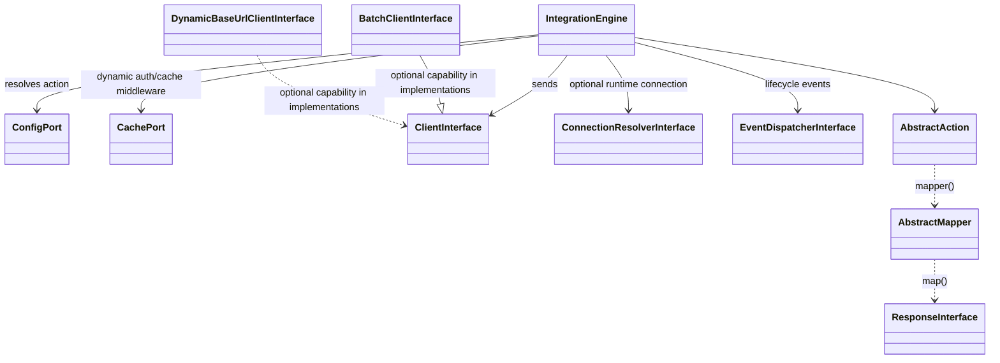
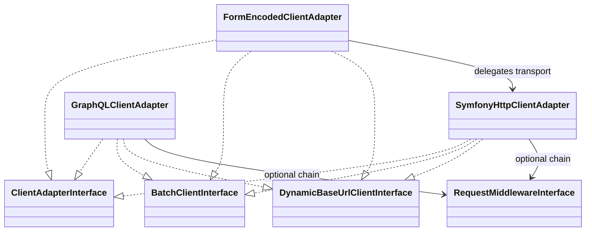

# Class relationship graph

This is a navigation aid, not a second architecture specification. The invariants, dependency rules and request flow live in [architecture.md](../../architecture.md); this page shows the main class relationships.

## Engine and ports

`BatchClientInterface` and `DynamicBaseUrlClientInterface` are capabilities detected at runtime; they do not replace `ClientInterface`.

## Built-in clients

The form adapter delegates to `SymfonyHttpClientAdapter`, so its request middleware and batch behavior follow the same transport path.

## Symfony bundle wiring

`IntegrationCompilerPass` creates one engine service per configured integration. The bundle wires the config adapter, selected client, cache adapter, optional connection resolver, middleware chains and lifecycle dispatcher dependencies. Protocol adapters are discovered through the `integration_engine.client_adapter` tag; request middleware uses its own bundle tag.

For exact configuration keys, use [configuration.md](../../configuration.md), not this graph.
