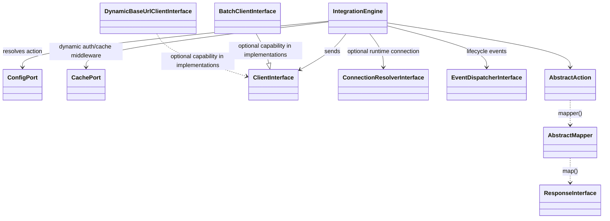
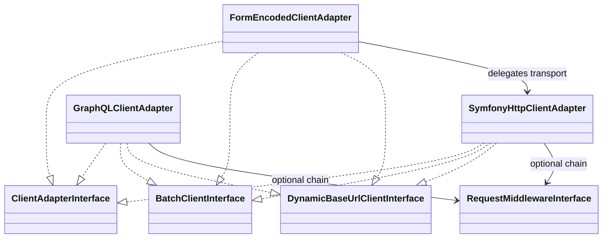
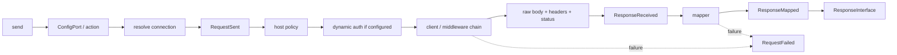
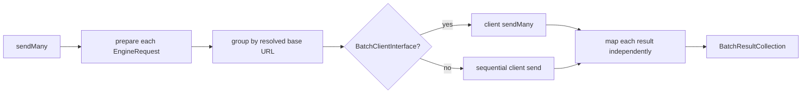
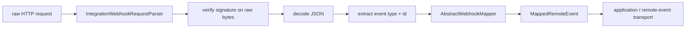

# IntegrationEngine — Documentation (extended edition)

> **Scope:** All current documentation. Architecture decision records and historical upgrade guides are left out; links to them point to the repository files.
>
> Single-file compilation of the repository documentation, generated on 2026-10-22 from commit `283709d` (latest tag `v9.4.0`). Every document is copied verbatim; only heading levels and links change: links between documents point to anchors inside this file, and links to code or to material not included here point to the repository files.
>
> **Never included, in any edition:** `CHANGELOG.md` (release history), `docs/archived/` (historical plans, explicitly not current documentation), navigation-only READMEs (replaced by the contents below), the ADR template, `CLAUDE.md`, `landing/` and `.symfony-recipes/`.
>
> Do not edit this file: edit the source document named under each title and regenerate it.

<a id="contents"></a>

## Contents

- [Part I — Overview](#part-overview)
  - [IntegrationEngine](#readme)
  - [IntegrationEngine — Documentation](#documentation)
- [Part II — Getting started](#part-getting-started)
  - [Actions](#getting-started-actions)
  - [Context and Path Resolution](#getting-started-context-and-path)
  - [Authorization](#getting-started-authorization)
  - [Mappers and Responses](#getting-started-mappers-and-responses)
  - [Batch requests](#getting-started-batch-requests)
- [Part III — Complete developer guide](#part-developer-guide)
  - [IntegrationEngine Complete Developer Guide](#developer-guide)
- [Part IV — Architecture and clients](#part-architecture)
  - [IntegrationEngine — Architecture](#architecture)
  - [HTTP clients and transport wiring](#advanced-architecture-clients)
  - [Class relationship graph](#advanced-architecture-class-graph)
  - [Form bodies](#form-bodies)
- [Part V — Resilience, security and observability](#part-operations)
  - [Declarative HTTP resilience](#resilience)
  - [Resilience](#advanced-resilience)
  - [Outgoing host and network policy](#security)
  - [IntegrationEngine · Lifecycle Events](#lifecycle)
  - [IntegrationEngine · Observability](#observability)
  - [Debugging — Console and Symfony Profiler](#advanced-debugging)
- [Part VI — Inbound webhooks](#part-webhooks)
  - [Webhook Integration Guide](#webhook)
  - [Webhook contract and compatibility notes](#webhook-compatibility-notes)
- [Part VII — Quality, testing and tooling](#part-quality)
  - [PHPStan rules](#phpstan)
  - [IntegrationEngine — Testing Guide](#testing)
  - [Quality gates](#advanced-quality)
  - [Quality audit — 2026-09-22](#quality-audit)
  - [Generating integrations with an AI agent](#advanced-ai-agent-usage)
  - [Contributing & Development](#contributing)
- [Part VIII — Roadmap](#part-roadmap)
  - [IntegrationEngine · Roadmap](#roadmap)
  - [Proposed next features](#advanced-next-features)

---

<a id="part-overview"></a>

# Part I — Overview

<a id="readme"></a>
<a id="readme--integrationengine"></a>

## IntegrationEngine

*Source: `README.md`*

[](https://github.com/CarlosGude/integrationEngine/actions/workflows/ci.yml)

**Latest tagged release:** [see releases](https://github.com/CarlosGude/integrationEngine/releases/latest)
**Requirements:** PHP 8.2+ · Symfony 6.4 / 7.x / 8.x
**Website:** [integrationengine.dev](https://integrationengine.dev)
**Documentation:** [docs/documentation.md](#documentation)
**Roadmap:** [docs/roadmap.md](#roadmap)

IntegrationEngine is a Symfony bundle for keeping outbound API integrations predictable: actions describe requests, mappers turn external responses into typed DTOs, and the engine owns the repetitive transport/authentication pipeline.

This README documents the current code in the repository. `CHANGELOG.md` is the source of truth for release history and unreleased changes.

<a id="readme--what-the-bundle-standardizes"></a>

### What the bundle standardizes

An integration is built from a small set of contracts:

- an `AbstractAction` per operation;
- optional `ActionBodyInterface` / `ActionContextInterface` values for runtime input;
- one `AbstractMapper` for each action that returns data;
- a typed `ResponseInterface` DTO;
- an integration facade in the consuming application, backed by `IntegrationRegistry`.

The bundle then handles configuration lookup, path resolution, static or dynamic auth, connection overrides, middleware, HTTP transport, batching, response mapping and lifecycle events.

It intentionally does **not** own your domain model. Keep the external DTOs behind a Gateway / Anti-Corruption Layer when they cross into application or domain code.

<a id="readme--when-not-to-use-it"></a>

### When not to use it

IntegrationEngine is a poor fit when an API needs a highly stateful SDK, protocol-specific streaming/session behavior, or a vendor library that already owns transport, retries and object mapping coherently. In those cases, wrapping the SDK behind your own application boundary is usually simpler than forcing it into this action/mapper model.

<a id="readme--why-this-exists"></a>

### Why this exists

Integrations tend to accumulate their own ad-hoc HTTP client, their own way of attaching auth, and their own untyped response handling, repeated slightly differently for every external API a project talks to. That inconsistency shows up as duplicated token logic, DTOs that drift from what the API actually returns, and observability that exists for some integrations and not others. This bundle grew out of exactly that pattern in a production integration, not from a speculative design exercise. The response is a small, uniform contract — Action, Mapper, Response — so every integration looks like every other one and can be tested in isolation.

<a id="readme--install"></a>

### Install

```bash
composer require carlosgude/integration-engine
```

With Symfony Flex, the bundle is registered automatically.

<a id="readme--first-integration"></a>

### First integration

Generate the integration shell and first action:

```bash
php bin/console make:integration MyApi GetEmployee
```

The command creates the integration facade, action, mapper/response when applicable, and the integration YAML. On the first integration it can also create `config/packages/integration_engine.yaml`.

Bundle configuration is per integration:

```yaml
# config/packages/integration_engine.yaml
integration_engine:
    integrations:
        my_api:
            base_url: 'https://api.example.com'
            config_path: '%kernel.project_dir%/src/Infrastructure/Integrations/MyApi/MyApi.yaml'
```

Action configuration lives in the integration YAML:

```yaml
GetEmployee:
    action: App\Infrastructure\Integrations\MyApi\GetEmployee\Request\GetEmployeeAction
    method: GET
    path: /employees/{id}
```

At the lowest level, calling an action is a single `send()` through the registry:

```php
use IntegrationEngine\Core\Contract\Action\DefaultActionContext;

$response = $registry->get('my_api')->send(
    actionName: GetEmployeeAction::getName(),
    context: DefaultActionContext::create(['id' => $id]),
);
```

In practice, wrap that behind a small facade instead of calling `IntegrationRegistry` directly from controllers and application services, so callers get a typed return instead of the base `ResponseInterface`.

The facade implements `IntegrationName` so the integration is referenced as `MyApiIntegration::NAME` rather than a bare string — the constant is autocompleted and can be grepped/refactored with the rest of the codebase, instead of relying on string literals that silently drift. This is the recommended facade pattern:

```php
use IntegrationEngine\Core\Contract\Action\DefaultActionContext;
use IntegrationEngine\Core\Registry\IntegrationName;
use IntegrationEngine\Core\Registry\IntegrationRegistry;

final class MyApiIntegration implements IntegrationName
{
    public const NAME = 'my_api';

    public function __construct(private IntegrationRegistry $registry) {}

    public function getEmployee(int $id): GetEmployeeResponse
    {
        $response = $this->registry->get(self::NAME)->send(
            actionName: GetEmployeeAction::getName(),
            context: DefaultActionContext::create(['id' => $id]),
        );

        if (!$response instanceof GetEmployeeResponse) {
            throw new \LogicException('Unexpected response type.');
        }

        return $response;
    }
}
```

A failed call (HTTP 4xx/5xx, or a network error) throws `RequestResponseException`, which carries the status code and context:

```php
use IntegrationEngine\Core\Exception\RequestResponseException;

try {
    $response = $this->registry->get(self::NAME)->send(/* ... */);
} catch (RequestResponseException $e) {
    // $e->statusCode, $e->context
}
```

See [Getting started](#part-getting-started) for the request, context, auth, mapping and batch contracts.

<a id="readme--current-capabilities"></a>

### Current capabilities

| Area | Current contract | Reference |
|---|---|---|
| REST | Built-in Symfony HttpClient adapter; JSON by default | [HTTP clients](#advanced-architecture-clients) |
| Form bodies | `FormEncodedBodyInterface`, or `client: form_encoded` for an all-form API | [Form bodies](#form-bodies) |
| GraphQL | `GraphQLBodyInterface`; body is sent as `query` + `variables` | [HTTP clients](#advanced-architecture-clients) |
| Batch | `sendMany()` isolates failures; built-in REST, GraphQL and form adapters support concurrent dispatch when request middleware does not force the sequential fallback | [Batch requests](#getting-started-batch-requests) |
| Auth | bearer/basic/API key; dynamic token action with cache + one fresh-token retry after a cached-token 401 | [Authorization](#getting-started-authorization) |
| Multi-connection | `ConnectionResolverInterface` can override base URL/auth and namespace token caches per call | [HTTP clients](#advanced-architecture-clients--runtime-connection-resolution) |
| Middleware | action-level client middleware plus full-request middleware for signing | [Architecture](#architecture--middleware-boundaries) |
| Resilience | transport timeout, max duration and Symfony retry configuration | [Resilience](#resilience) |
| Outgoing security | hostname allowlist and optional private-network blocking for built-in transports | [Security](#security) |
| Observability | scalar-only request, response, failure, token and webhook events | [Lifecycle events](#lifecycle) |
| Webhooks | YAML definition, HMAC verification, typed mapper, Symfony Webhook/RemoteEvent integration | [Webhooks](#webhook) |
| Static analysis | optional PHPStan rules for mapper reciprocity, response modifiers and facade return types | [PHPStan](#phpstan) |
| Debugging | `debug:integration [name]` and Symfony profiler integration in debug mode | [Debugging](#advanced-debugging) |

<a id="readme--configuration-split"></a>

### Configuration split

There are two YAML scopes and they solve different problems:

```text
config/packages/integration_engine.yaml
└── integration wiring: base_url, client, transport, headers, cache,
    middlewares, request_middlewares, connection_resolver

src/.../MyApi.yaml
├── action definitions: class, method, path, body, authorization,
│   cache_ttl, timeout
└── optional webhooks definition
```

Keeping those scopes separate matters: bundle configuration decides **how an integration is wired**; integration YAML describes **what operations that integration exposes**.

<a id="readme--architecture-in-one-sentence"></a>

### Architecture in one sentence

`Core` defines contracts and orchestration; `Infrastructure` implements adapters; `Bundle` wires Symfony; compatibility shims stay outside Core; optional PHPStan rules live in their own extension layer. The dependency direction is enforced by Deptrac.

The detailed dependency rules and runtime pipeline are in [architecture.md](#architecture).

<a id="readme--quality"></a>

### Quality

Repository gates cover style, PHPStan, PHPUnit, Deptrac and Infection. Measured results belong in [docs/advanced/quality.md](#advanced-quality), not in this README, so release copy does not become a museum of stale numbers.

<a id="readme--demo"></a>

### Demo

[integrationEngine-demo](https://github.com/CarlosGude/integrationEngine-demo) is the consuming Symfony application used to demonstrate and contract-test the bundle.

<a id="readme--further-reading"></a>

### Further reading

Start from [docs/documentation.md](#documentation). It is the only documentation index; archived plans, spikes and release-preparation notes live under [docs/archived/](archived/README.md) and are explicitly non-current.

A rough guide to where things live:

- [docs/getting-started/](#part-getting-started) — task-oriented guides for building a first integration: actions, context/path, auth, mapping, batching.
- [docs/advanced/](#contents) — client/architecture internals, debugging, quality gates, AI-agent-assisted generation.
- [docs/adr/](adr/README.md) — Architecture Decision Records; read these for *why* a design was chosen, not just *what* it does.
- [docs/archived/](archived/README.md) — historical plans, audits and spikes; explicitly not the current contract.
- `docs/architecture.md` is the single reference for dependency rules and the runtime pipeline.
- Breaking-change migration notes live under `docs/`, one `upgrade-N.0.md` file per major version.

<a id="documentation"></a>
<a id="documentation--integrationengine--documentation"></a>

## IntegrationEngine — Documentation

*Source: `docs/documentation.md`*

This is the **single index for current documentation**. It describes the code on `main`; the latest tagged release is [v9.4.0](https://github.com/CarlosGude/integrationEngine/releases/tag/v9.4.0) and release history remains in [`CHANGELOG.md`](../CHANGELOG.md).

The documentation is deliberately split by responsibility. If two pages appear to answer the same question, prefer the page listed here as the canonical source for that topic.

<a id="documentation--start-here"></a>

### Start here

| Need | Canonical document |
|---|---|
| Read the bundle end to end | [developer-guide.md](#developer-guide) |
| Understand the architecture and dependency rules | [architecture.md](#architecture) |
| Build the first action | [getting-started/actions.md](#getting-started-actions) |
| Resolve path/query inputs | [getting-started/context-and-path.md](#getting-started-context-and-path) |
| Configure auth/token caching | [getting-started/authorization.md](#getting-started-authorization) |
| Map responses and headers | [getting-started/mappers-and-responses.md](#getting-started-mappers-and-responses) |
| Send batches | [getting-started/batch-requests.md](#getting-started-batch-requests) |
| Choose/customize clients, base URLs or connections | [advanced/architecture/clients.md](#advanced-architecture-clients) |
| Add request/client middleware | [architecture.md](#architecture--middleware-boundaries) |
| Configure retries/timeouts | [resilience.md](#resilience) |
| Configure host/private-network protection | [security.md](#security) |
| Receive webhooks | [webhook.md](#webhook) |
| Observe lifecycle events | [lifecycle.md](#lifecycle) |
| Configure helper observability | [observability.md](#observability) |
| Debug an integration | [advanced/debugging.md](#advanced-debugging) |
| Enable PHPStan integration rules | [phpstan.md](#phpstan) |
| Run/extend the test suite | [testing.md](#testing) |
| Check quality gates and measured evidence | [advanced/quality.md](#advanced-quality) |
| Contribute | [CONTRIBUTING.md](#contributing) |

<a id="documentation--browse-by-area"></a>

### Browse by area

- [Getting started](#part-getting-started)
- [Advanced topics](#contents)
- [Architecture decisions](adr/README.md)

<a id="documentation--mental-model"></a>

### Mental model

The engine has two configuration scopes:

1. **Bundle configuration** (`config/packages/integration_engine.yaml`) wires each integration: base URL, client type/service, headers, cache, transport options, middleware and optional connection resolver.
2. **Integration YAML** defines actions and optional webhook metadata: action class, method, path, body class, authorization, cache TTL, action timeout and webhook mapping/signature rules.

At runtime, application code normally calls a small integration facade. The facade obtains an `IntegrationEngine` from `IntegrationRegistry`, calls `send()` or `sendMany()`, and returns integration DTOs. A Gateway/ACL then translates those DTOs into domain concepts when required.

<a id="documentation--current-public-flow"></a>

### Current public flow

```text
application facade
    ↓
IntegrationRegistry
    ↓
IntegrationEngine
    ├─ ConfigPort / YamlConfigAdapter
    ├─ optional ConnectionResolverInterface
    ├─ authentication + token cache
    ├─ client middleware
    ├─ request middleware
    ├─ built-in/custom ClientInterface
    └─ ResponseBuilder → AbstractMapper → ResponseInterface
```

Batch requests use the same contracts. Each item is prepared independently; failures are returned as `BatchResult` values instead of aborting the whole batch. Built-in REST, GraphQL and form transports can dispatch concurrently, but built-in request middleware forces a sequential fallback because middleware may inspect or replace a completed response.

<a id="documentation--specialized-references"></a>

### Specialized references

These pages are narrow references, not alternative manuals:

- [form-bodies.md](#form-bodies) — how form encoding is selected.
- [resilience.md](#resilience) — transport retry/timeout semantics.
- [security.md](#security) — outgoing host/private-network policy.
- [webhook-compatibility-notes.md](#webhook-compatibility-notes) — webhook contract background and compatibility notes; the usage guide remains `webhook.md`.
- [phpstan.md](#phpstan) — optional development-time contracts.

<a id="documentation--architecture-decisions"></a>

### Architecture decisions

[`adr/`](adr/README.md) records *why* the project chose its boundaries. ADRs are not usage guides and some intentionally describe superseded decisions. Their status table is the source of truth for which decisions remain active.

<a id="documentation--upgrade-guides"></a>

### Upgrade guides

Upgrade guides are historical migration documents. They intentionally mention APIs that no longer exist:

- [upgrade-4.0.md](upgrade-4.0.md)
- [upgrade-5.0.md](upgrade-5.0.md)
- [upgrade-5.1.md](upgrade-5.1.md)
- [upgrade-6.0.md](upgrade-6.0.md)
- [upgrade-7.0.md](upgrade-7.0.md)
- [upgrade-8.0.md](upgrade-8.0.md)
- [upgrade-9.0.md](upgrade-9.0.md)

For current behavior, use the guides in the sections above, not an old upgrade document.

<a id="documentation--archived-material"></a>

### Archived material

[`archived/`](archived/README.md) contains implementation plans, old release preparation, maintenance notes and spikes. They are retained as decision history only and **must not be used as current API documentation**.

---

<a id="part-getting-started"></a>

# Part II — Getting started

<a id="getting-started-actions"></a>
<a id="getting-started-actions--actions"></a>

## Actions

*Source: `docs/getting-started/actions.md`*

An action is the static contract for one external operation: method, path, response mapper and optional body type. Runtime data is supplied separately, so action classes remain stateless.

<a id="getting-started-actions--define-an-action"></a>

### Define an action

Extend `AbstractAction` and implement the three static methods:

```php
use IntegrationEngine\Core\Contract\Action\AbstractAction;

final class GetEmployeeAction extends AbstractAction
{
    public static function getName(): string
    {
        return 'GetEmployee';
    }

    public static function hasResponse(): bool
    {
        return true;
    }

    public static function mapper(): ?string
    {
        return GetEmployeeMapper::class;
    }
}
```

Then register the action in that integration's YAML file:

```yaml
GetEmployee:
    action: App\Infrastructure\Integrations\MyApi\GetEmployee\Request\GetEmployeeAction
    method: GET
    path: /employees/{id}
```

`getName()` must match the YAML key. `hasResponse(): false` does not skip the HTTP call; it skips mapper resolution and returns `EmptyResponse` after the request succeeds.

<a id="getting-started-actions--action-yaml"></a>

### Action YAML

The action file accepts these fields:

```yaml
ActionName:
    action: App\...\ActionClass        # required
    method: POST                       # optional, default POST
    path: /resource/{id}               # optional, default /
    body: App\...\ActionBody          # optional ActionBodyInterface class
    authorization:                     # optional; see authorization.md
        type: bearer
        token: '%env(API_TOKEN)%'
    cache_ttl: 60                      # optional raw-response cache TTL in seconds
    timeout: 5.0                       # optional per-action request timeout
```

Transport selection (`client`, `client_service`, retries, host policy and middleware) belongs in `config/packages/integration_engine.yaml`, not in the action YAML. See [HTTP clients](#advanced-architecture-clients).

<a id="getting-started-actions--runtime-data"></a>

### Runtime data

The configuration adapter creates action instances through `AbstractAction::create()`. Application code normally does not instantiate actions directly. Data that varies per call uses separate contracts:

| Runtime value | Contract |
|---|---|
| Path parameters and request context | `ActionContextInterface` |
| Request payload | `ActionBodyInterface` |
| Per-request headers | `RequestHeadersInterface` |
| Runtime endpoint override | `baseUrl` argument on `send()` / `EngineRequest` |
| Runtime connection/credentials | `connection` argument when a resolver is configured |

All `{placeholder}` values are resolved exclusively from the action context. The body is preserved, including fields whose names match placeholders. See [Context and path resolution](#getting-started-context-and-path).

<a id="getting-started-actions--invariants"></a>

### Invariants

Actions carry no mutable request state. A configured action may therefore be reused safely across single and batch dispatch without leaking values between calls. When `hasResponse()` is `true`, `mapper()` must identify the mapper for that action; the engine validates that relationship before mapping.

When the YAML declares a `body` class for an action, a body passed to `send()` / `sendMany()` must be an instance of that declared class — `YamlConfigAdapter` throws `\InvalidArgumentException` otherwise, before any HTTP call is made. See [0018](adr/0018-body-type-invariant.md).

<a id="getting-started-context-and-path"></a>
<a id="getting-started-context-and-path--context-and-path-resolution"></a>

## Context and Path Resolution

*Source: `docs/getting-started/context-and-path.md`*

Context supplies all runtime values used to build the URL: IDs, filters and pagination.
The engine resolves `{placeholder}` tokens exclusively from `context`. The `body`
contains payload fields and is preserved even when a field matches a placeholder.

<a id="getting-started-context-and-path--url-parameters-and-payload"></a>

### URL parameters and payload

Pass URL parameters in `context` and payload fields in `body`:

```yaml
UpdateEmployee:
    action: App\Infrastructure\Integrations\MyApi\UpdateEmployee\UpdateEmployeeAction
    method: PUT
    path: /employees/{id}
    body: App\Infrastructure\Integrations\MyApi\UpdateEmployee\Request\UpdateEmployeeBody
```

```php
use IntegrationEngine\Core\Contract\Action\DefaultActionContext;

$engine->send(
    actionName: UpdateEmployeeAction::getName(),
    context: DefaultActionContext::create(['id' => 42]),
    body: UpdateEmployeeBody::create(['name' => 'New Name']),
);
// → PUT /employees/42, with { "name": "New Name" } as the JSON body
```

If the API also requires `id` in the payload, include it explicitly in `body`;
it will be sent unchanged. A body field never supplies a missing context value.
No custom context class or `ConfigPort` implementation is needed.

<a id="getting-started-context-and-path--requests-without-a-body"></a>

### Requests without a body

Declare a `{placeholder}` in YAML and pass `DefaultActionContext`:

```yaml
GetEmployee:
    path: /employees/{id}
```

```php
use IntegrationEngine\Core\Contract\Action\DefaultActionContext;

$engine->send(
    actionName: GetEmployeeAction::getName(),
    context: DefaultActionContext::create(['id' => 42]),
);
// → GET /employees/42
```

`DefaultActionContext` is a transparent key-value wrapper. Use it for the vast majority
of cases.

---

<a id="getting-started-context-and-path--required-query-parameters"></a>

### Required query parameters

Placeholders work in the query string too — use them when the parameter is always
present:

```yaml
FilterByStatus:
    path: /employees?status={status}
```

```php
DefaultActionContext::create(['status' => 'active'])
// → GET /employees?status=active
```

Missing a placeholder throws `PathResolutionException` immediately, before the HTTP
request is made.

---

<a id="getting-started-context-and-path--optional-query-parameters"></a>

### Optional query parameters

When any parameter is optional, implement `PathResolvableContextInterface`. The context
receives the raw YAML path and returns the final URL — or `null` to fall back to the
default `{placeholder}` resolver:

```php
use IntegrationEngine\Core\Contract\Action\PathResolvableContextInterface;

final readonly class FilterEmployeesContext implements PathResolvableContextInterface
{
    private function __construct(private array $filters) {}

    public static function create(array $data): self { return new self($data); }
    public function toArray(): array { return $this->filters; }

    public function resolvePath(string $path): ?string
    {
        $allowed = ['status', 'department', 'page'];
        $params  = array_filter(
            array_intersect_key($this->filters, array_flip($allowed)),
            static fn(mixed $v): bool => '' !== (string) $v,
        );
        return empty($params) ? null : $path . '?' . http_build_query($params);
    }
}
```

The action stays declarative — path logic lives in the context, not in the action.
Returning an empty string throws `PathResolutionException`; return `null` to delegate.

---

<a id="getting-started-context-and-path--custom-context-with-validation"></a>

### Custom context with validation

A custom context also makes sense when you want to enforce invariants at construction
time, or accept domain objects instead of raw arrays:

```php
use IntegrationEngine\Core\Contract\Action\ActionContextInterface;

final readonly class GetEmployeeContext implements ActionContextInterface
{
    private function __construct(private int $id) {}

    public static function create(array $data): self
    {
        $id = (int) ($data['id'] ?? 0);
        if ($id <= 0) {
            throw new \InvalidArgumentException('Employee id must be a positive integer.');
        }
        return new self($id);
    }

    public function toArray(): array { return ['id' => $this->id]; }
}
```

If you find yourself validating or casting values before calling
`DefaultActionContext::create()`, move that logic into a custom context class instead.

---

<a id="getting-started-context-and-path--decision-table"></a>

### Decision table

| Scenario | Approach |
|---|---|
| Path segment | YAML `{placeholder}` + `DefaultActionContext` |
| Query params — all required | YAML `{placeholder}` in query string |
| Query params — any optional | Custom context with `PathResolvableContextInterface` |
| Validation or domain objects at construction | Custom context with `ActionContextInterface` |
| No dynamic values | No context (or `DefaultActionContext::create([])`) |

When migrating an action that previously supplied URL parameters through `body`,
pass those parameters through `context`. Remove them from `body` only if the API
does not require them in the payload.

<a id="getting-started-authorization"></a>
<a id="getting-started-authorization--authorization"></a>

## Authorization

*Source: `docs/getting-started/authorization.md`*

Authorization is declared per action. IntegrationEngine supports static credentials and dynamic token acquisition; runtime connection resolution can override either for a specific call. A `defaults:` block lets every action in the file share one authorization config instead of repeating it.

<a id="getting-started-authorization--static-authorization"></a>

### Static authorization

```yaml
GetOrders:
    action: App\...\GetOrdersAction
    method: GET
    path: /orders
    authorization:
        type: bearer
        token: '%env(MY_API_TOKEN)%'
```

Supported static forms:

| Type | Fields | Result |
|---|---|---|
| `bearer` | `token`, optional `prefix` | `Authorization: <prefix> <token>`; prefix defaults to `Bearer` |
| `basic` | `username`, `password` | HTTP Basic `Authorization` header |
| `api_key` | `token`, optional `header`, optional `prefix` | Custom header; header defaults to `X-Api-Key` |

```yaml
# Basic
authorization:
    type: basic
    username: '%env(API_USER)%'
    password: '%env(API_PASS)%'

# API key in a provider-specific header
authorization:
    type: api_key
    token: '%env(API_KEY)%'
    header: X-Shopify-Access-Token
```

<a id="getting-started-authorization--dynamic-authorization"></a>

### Dynamic authorization

Use `type: dynamic` when a second action must obtain the credential:

```yaml
FetchToken:
    action: App\...\FetchTokenAction
    method: POST
    path: /oauth/token

GetOrders:
    action: App\...\GetOrdersAction
    method: GET
    path: /orders
    authorization:
        type: dynamic
        action: FetchToken
        token_field: access_token
        ttl: 3600
        header: Authorization       # optional
        prefix: Bearer              # optional
```

The token action is a normal action. Its mapped response must expose `token_field` through `toArray()`.

On a cache miss the engine executes the token action, extracts the scalar token, stores it for `ttl`, converts the dynamic configuration to static authorization and sends the protected request.

<a id="getting-started-authorization--rejected-cached-tokens"></a>

#### Rejected cached tokens

A 401 is retried once only when the rejected token came from cache:

1. remove the cached token;
2. fetch and cache a fresh token;
3. retry the protected request once.

A 401 returned after a freshly fetched token is not retried, and non-401 failures do not evict the token.

<a id="getting-started-authorization--sharing-authorization-across-actions"></a>

### Sharing authorization across actions

Most integrations have one token action protecting many endpoints. Declare it once under `defaults.authorization` instead of repeating the full block on every action:

```yaml
defaults:
    authorization:
        type: dynamic
        action: FetchToken
        token_field: access_token
        ttl: 3600

FetchToken:
    action: App\...\FetchTokenAction
    method: POST
    path: /oauth/token
    authorization: false   # opts out of the default: the token action itself is unauthenticated

GetOrders:
    action: App\...\GetOrdersAction
    method: GET
    path: /orders
    # inherits the default dynamic authorization as-is

GetOrderDetails:
    action: App\...\GetOrderDetailsAction
    method: GET
    path: /orders/{id}
    authorization:
        ttl: 7200   # overrides only ttl; action/token_field/header/prefix come from the default
```

Resolution rules, in order:

1. **No `authorization:` key on the action** → the default applies unchanged (or no authorization, if there is no default).
2. **`authorization: false`** → opts this action out of the default; it sends no authorization. This is how the token action itself (`FetchToken` above) stays unauthenticated under a default. `authorization: ~` (explicit null) is equivalent — `false` is the recommended spelling because it reads as an explicit decision ("no auth here") rather than something that looks accidentally empty.
3. **`authorization:` with fields but no `type`, or the same `type` as the default** → shallow-merged on top of the default; the action's fields win on conflict.
4. **`authorization:` with a different `type`** → replaces the default entirely for this action; nothing is merged.

`authorization:` must be a map, `false`, or `~`/`null` — any other scalar (e.g. `true`) is rejected eagerly when the YAML file loads, with an error naming the action and the offending type. `defaults.authorization` is validated the same way — an invalid default fails immediately rather than on first dispatch.

<a id="getting-started-authorization--token-cache-identity"></a>

### Token cache identity

Dynamic token keys have this logical shape:

```text
integration_engine.token.{integration}.{token_action}.{xxh128(discriminator)}
```

The PSR-6 adapter sanitizes characters that are not portable cache-key characters before accessing the configured pool.

For runtime connections, the discriminator is selected in this order:

1. resolved `ConnectionCredentials::connectionId`;
2. the caller's scalar `connection` value;
3. resolved `baseUrl`;
4. an empty string when no connection-specific discriminator exists.

Use a stable, non-secret `connectionId` when several tenants can share the same base URL. Never use an API key, token or client secret as a connection ID.

<a id="getting-started-authorization--cache-backend"></a>

### Cache backend

The bundle's default `CachePort` is a `Psr6CacheAdapter` over Symfony's `cache.app`. The actual storage and sharing semantics therefore depend on the application's Symfony Cache configuration; IntegrationEngine does not assume that `cache.app` is local, filesystem-backed or shared.

Override the pool per integration when token storage needs a dedicated backend:

```yaml
# config/packages/integration_engine.yaml
integration_engine:
    integrations:
        my_api:
            cache_service: cache.my_api_tokens
```

The configured service must satisfy the cache contract expected by the bundle wiring.

<a id="getting-started-authorization--runtime-connection-overrides"></a>

### Runtime connection overrides

A configured `connection_resolver` can return `ConnectionCredentials` with a different `baseUrl`, `authorization`, and optional `connectionId` for each call. The override is resolved before dynamic authorization, so per-connection credentials and token caches stay separated. See [HTTP clients — runtime connection resolution](#advanced-architecture-clients--runtime-connection-resolution).

<a id="getting-started-mappers-and-responses"></a>
<a id="getting-started-mappers-and-responses--mappers-and-responses"></a>

## Mappers and Responses

*Source: `docs/getting-started/mappers-and-responses.md`*

A mapper transforms the raw HTTP response array into a typed DTO. It is the only place
where external API field names appear in your codebase.

---

<a id="getting-started-mappers-and-responses--the-minimum"></a>

### The minimum

Extend `AbstractMapper`, declare which action it belongs to, and implement `transform()`:

```php
use IntegrationEngine\Core\Contract\Action\AbstractAction;
use IntegrationEngine\Core\Contract\Mapper\AbstractMapper;
use IntegrationEngine\Core\Contract\Response\ResponseInterface;

final class GetEmployeeMapper extends AbstractMapper
{
    public static function getAction(): string { return GetEmployeeAction::class; }

    protected static function transform(AbstractAction $action, array $response, array $headers): ResponseInterface
    {
        return GetEmployeeResponse::create($response);
    }
}
```

The response DTO must implement `ResponseInterface`:

```php
use IntegrationEngine\Core\Contract\Response\ResponseInterface;

final readonly class GetEmployeeResponse implements ResponseInterface
{
    private function __construct(
        public int    $id,
        public string $name,
    ) {}

    public static function create(array $data): self
    {
        return new self(
            id:   (int)    ($data['id']   ?? 0),
            name: (string) ($data['name'] ?? ''),
        );
    }

    public function toArray(): array { return ['id' => $this->id, 'name' => $this->name]; }
}
```

---

<a id="getting-started-mappers-and-responses--type-mapping"></a>

### Type mapping

Match PHP types to what the API returns:

| API type | PHP type | Cast in `create()` |
|---|---|---|
| integer | `int` | `(int) ($data['x'] ?? 0)` |
| number | `float` | `(float) ($data['x'] ?? 0.0)` |
| boolean | `bool` | `(bool) ($data['x'] ?? false)` |
| string | `string` | `(string) ($data['x'] ?? '')` |
| array | `array` | `$data['x'] ?? []` |
| nullable string | `?string` | `is_string($data['x'] ?? null) ? $data['x'] : null` |
| nested object (simple) | `array` | `$data['x'] ?? []` |
| nested object (reused) | `NestedDto` | `NestedDto::create($data['x'] ?? [])` |

Use a dedicated DTO class for nested objects that appear in more than one response, or
that have more than three or four fields. Nested DTOs do **not** implement
`ResponseInterface` — only the top-level class returned from `transform()` does.

---

<a id="getting-started-mappers-and-responses--response-headers"></a>

### Response headers

`transform()`'s third argument, `$headers`, is the response's HTTP headers as
`array<string, string[]>` — the same shape Symfony's HttpClient exposes, one
list per header name since a header can repeat. Header names are lowercase,
so look them up as `x-ratelimit-remaining`, not `X-RateLimit-Remaining`. Most
mappers ignore it; it exists for the data some APIs put outside the body:
pagination cursors, rate-limit counters, request/correlation IDs.

```php
protected static function transform(AbstractAction $action, array $response, array $headers): ResponseInterface
{
    $remaining = $headers['x-ratelimit-remaining'][0] ?? null;

    return GetEmployeesResponse::create($response, remaining: $remaining !== null ? (int) $remaining : null);
}
```

Calling `AbstractMapper::map()` directly (outside the engine flow — e.g. in a
unit test for the mapper itself) can omit `$headers`; it defaults to `[]`.

---

<a id="getting-started-mappers-and-responses--one-mapper-per-action"></a>

### One mapper per action

The engine enforces `$mapper::getAction() === $action::class` before calling
`transform()`. Two action classes cannot share the same mapper — this throws
`MapperActionMismatchException`.

When two actions return the same response shape, extract the transformation logic into a
dedicated class and delegate from each mapper:

```php
final class EmployeeCollectionTransformer
{
    public static function transform(array $response): EmployeeListResponse { ... }
}

final class GetEmployeesMapper extends AbstractMapper
{
    public static function getAction(): string { return GetEmployeesAction::class; }
    protected static function transform(AbstractAction $action, array $response, array $headers): ResponseInterface
    {
        return EmployeeCollectionTransformer::transform($response);
    }
}

final class FilterEmployeesMapper extends AbstractMapper
{
    public static function getAction(): string { return FilterEmployeesAction::class; }
    protected static function transform(AbstractAction $action, array $response, array $headers): ResponseInterface
    {
        return EmployeeCollectionTransformer::transform($response);
    }
}
```

---

<a id="getting-started-mappers-and-responses--toarray--engine-contract-not-your-api"></a>

### `toArray()` — engine contract, not your API

`ResponseInterface` requires `toArray()`. The engine uses it internally to extract
dynamic auth tokens from token responses. It is not your public API.

Consumers of your facade should access typed properties directly:

```php
// ✅ correct — typed access
$name = $response->name;

// ❌ wrong — leaks the engine contract
$name = $response->toArray()['name'];
```

The only time `toArray()` is meaningful to you is when writing a token response for
dynamic auth — the field named in `token_field` must appear in `toArray()`.
See [Authorization](#getting-started-authorization) for details.

<a id="getting-started-batch-requests"></a>
<a id="getting-started-batch-requests--batch-requests"></a>

## Batch requests

*Source: `docs/getting-started/batch-requests.md`*

`sendMany()` executes several `EngineRequest` values while preserving each input key and isolating failures. It uses a client's batch capability when available and otherwise falls back to individual sends.

<a id="getting-started-batch-requests--build-and-dispatch-a-batch"></a>

### Build and dispatch a batch

```php
use IntegrationEngine\Core\Batch\EngineRequest;
use IntegrationEngine\Core\Contract\Action\DefaultActionContext;

$requests = [
    'lon' => new EngineRequest(
        GetAccommodationAction::getName(),
        context: DefaultActionContext::create(['id' => 101]),
    ),
    'par' => new EngineRequest(
        GetAccommodationAction::getName(),
        context: DefaultActionContext::create(['id' => 202]),
    ),
];

$results = $engine->sendMany($requests);
```

An `EngineRequest` can carry the same per-call inputs as `send()`: action name, context, body, headers, base URL override and connection value.

<a id="getting-started-batch-requests--results-and-failure-semantics"></a>

### Results and failure semantics

`sendMany()` returns `BatchResultCollection`. Every input key gets one `BatchResult`; one failure does not cancel unrelated items.

```php
if ($results['lon']->isSuccess()) {
    $response = $results['lon']->response();
} else {
    $error = $results['lon']->error();
}

foreach ($results->errors() as $key => $error) {
    // application-owned failure policy
}
```

`responses()` returns successful mapped responses and `errors()` returns failures, both keyed like the input.

For strict handling:

```php
$responses = $engine->sendManyOrFail($requests);
```

The complete batch is dispatched first; `sendManyOrFail()` then unwraps results in input order and throws when it reaches the first failed item.

<a id="getting-started-batch-requests--concurrency"></a>

### Concurrency

Concurrency is a client capability, represented by `BatchClientInterface`. The three built-in transports implement it:

| Built-in client | Batch behavior |
|---|---|
| `rest` | concurrent HTTP dispatch |
| `graphql` | concurrent HTTP dispatch |
| `form_encoded` | concurrent HTTP dispatch through the REST transport |

For REST and GraphQL, requests are dispatched before responses are consumed. The form adapter delegates batch work to the same REST transport.

When `request_middlewares` are configured on a built-in client, batch execution deliberately falls back to per-item sequential `send()`. A request middleware can inspect, replace or short-circuit a completed request, so the transport cannot preserve the same middleware semantics while blindly pre-dispatching every item.

A custom `client_service` or adapter is concurrent only if it implements `BatchClientInterface`; otherwise the engine transparently uses sequential `ClientInterface::send()` calls.

<a id="getting-started-batch-requests--mixed-actions-and-connections"></a>

### Mixed actions and connections

A batch may contain different actions and different runtime connections:

```php
$results = $engine->sendMany([
    'orders-acme' => new EngineRequest(GetOrdersAction::getName(), connection: 'acme'),
    'profile' => new EngineRequest(GetProfileAction::getName(), connection: 'globex'),
]);
```

Each item resolves its own action, connection, authorization and mapper. Connection resolution is memoized within one `sendMany()` call for repeated equivalent connection values, avoiding redundant resolver calls.

Items are grouped by resolved base URL before batch dispatch. That keeps dynamic endpoint overrides compatible with clients that implement both `BatchClientInterface` and `DynamicBaseUrlClientInterface`.

<a id="getting-started-batch-requests--homogeneous-batch-mapping"></a>

### Homogeneous batch mapping

`AbstractBatchMapper` is optional. Use it when all successful results belong to the same action and the application wants to consolidate them into one response object:

```php
use IntegrationEngine\Core\Batch\AbstractBatchMapper;
use IntegrationEngine\Core\Batch\BatchResultCollection;
use IntegrationEngine\Core\Contract\Response\ResponseInterface;

final class AccommodationListBatchMapper extends AbstractBatchMapper
{
    public static function getAction(): string
    {
        return GetAccommodationAction::class;
    }

    protected static function consolidate(BatchResultCollection $results): ResponseInterface
    {
        if ($results->hasFailures()) {
            throw array_values($results->errors())[0];
        }

        return new AccommodationListResponse($results->responses());
    }
}

$list = $engine->sendMany($requests)->mapWith(AccommodationListBatchMapper::class);
```

For mixed-action batches, consume `BatchResultCollection` directly instead of forcing a common batch mapper.

---

<a id="part-developer-guide"></a>

# Part III — Complete developer guide

<a id="developer-guide"></a>
<a id="developer-guide--integrationengine-complete-developer-guide"></a>

## IntegrationEngine Complete Developer Guide

*Source: `docs/developer-guide.md`*

> **Canonical long-form guide.** This document explains IntegrationEngine as one coherent system and is intended to be read sequentially. For task-oriented lookup, use [`documentation.md`](#documentation). When this guide and the implementation disagree, the implementation and tested contracts are authoritative.

This guide describes the bundle as one coherent system. Upgrade material and project history are intentionally kept outside this document.

**Recommended reading path:** Chapters 1-6 establish the model and public contracts. Chapters 7-18 explain runtime behavior. Chapters 19-24 cover extension, operations and quality. Chapter 25 collects production caveats and sharp edges. Chapter 26 provides end-to-end recipes; the appendices are reference material.

---

<a id="developer-guide--1-purpose-and-mental-model"></a>

### 1. Purpose and mental model

IntegrationEngine is a Symfony bundle for external API integrations. Its goal is not to hide HTTP; its goal is to make every external integration follow the same predictable shape so application code does not accumulate a different client architecture for every provider.

The central idea is that an integration is a collection of named operations. Each operation is represented by an action. Runtime values are supplied separately through a body, context, headers and optional connection. Transport details, authentication, caching, batching, mapping and observability are handled by reusable infrastructure.

<a id="developer-guide--11-the-public-flow"></a>

#### 1.1 The public flow

```text
application service / facade
    -> IntegrationRegistry
        -> IntegrationEngine
            -> ConfigPort / YamlConfigAdapter
            -> optional connection resolution
            -> authentication and token cache
            -> client middleware
            -> request middleware
            -> built-in or custom client
            -> raw response
            -> mapper
            -> typed ResponseInterface
```

Application code should normally depend on a small integration facade of its own, not on HTTP clients and not directly on provider payload arrays. A gateway or anti-corruption layer can then translate integration DTOs into domain concepts when domain isolation matters.

<a id="developer-guide--12-what-the-bundle-owns"></a>

#### 1.2 What the bundle owns

- Integration registration and lookup.
- Declarative action configuration in YAML.
- Action construction and path resolution.
- Built-in REST, GraphQL and form-encoded transports.
- Static and dynamic authorization.
- Dynamic-token caching and one stale-token retry after HTTP 401.
- Runtime connection resolution for multi-tenant or multi-account integrations.
- Client middleware and full-request middleware.
- Optional raw-response caching.
- Batch execution with per-item isolation.
- Transport timeouts, retry decoration and host/network restrictions.
- Response mapping and mapper/action invariants.
- Scalar lifecycle events, Symfony profiler integration and debugging commands.
- Generic authenticated webhook parsing and typed webhook mapping.
- Generators for integrations, webhooks and observability scaffolding.
- Optional PHPStan rules for architectural contracts.

<a id="developer-guide--13-what-the-bundle-deliberately-does-not-own"></a>

#### 1.3 What the bundle deliberately does not own

- Business workflows or domain rules.
- Provider-specific SDK behavior or vendor-specific domain abstractions.
- Persistent credential storage or IAM.
- Exactly-once webhook processing or durable webhook idempotency.
- Application queue topology, retry transports or DLQ policy.
- Metrics storage/export backends.
- Business-level fallbacks, circuit breakers or application orchestration.
- Domain entities. Integration DTOs should remain at the integration boundary.
**Design principle: **The bundle standardizes integration mechanics, not business meaning. When a concern belongs to the consuming application, IntegrationEngine exposes a boundary rather than absorbing the concern into the bundle.

<a id="developer-guide--2-installation-and-symfony-integration"></a>

### 2. Installation and Symfony integration

<a id="developer-guide--21-requirements"></a>

#### 2.1 Requirements

| Requirement | Supported |
| --- | --- |
| PHP | 8.2 or newer |
| Symfony Console / DI / HttpClient / YAML / HttpFoundation | 6.4, 7.x or 8.x |
| PSR logging | psr/log 2 or 3 |
| PSR clock | psr/clock 1.x |
| PSR event dispatcher | psr/event-dispatcher 1.x |

<a id="developer-guide--22-composer-installation"></a>

#### 2.2 Composer installation

```bash
composer require carlosgude/integration-engine
```

After installation, verify that the bundle is registered in config/bundles.php. Depending on how Symfony Flex discovers the bundle in the consuming project, manual registration may be necessary:

```text
return [
    Symfony\Bundle\FrameworkBundle\FrameworkBundle::class => ['all' => true],
    IntegrationEngine\Bundle\IntegrationEngineBundle::class => ['all' => true],
];
```

**Why verify registration: **The bundle class lives under IntegrationEngine\Bundle. A consuming application should treat config/bundles.php as the authoritative check that the bundle is actually active.

<a id="developer-guide--23-minimal-bundle-configuration"></a>

#### 2.3 Minimal bundle configuration

```yaml
# config/packages/integration_engine.yaml
integration_engine:
    integrations:
        acme:
            base_url: 'https://api.example.com'
            config_path: '%kernel.project_dir%/src/Infrastructure/Integrations/Acme/Acme.yaml'
```

<a id="developer-guide--24-minimal-integration-yaml"></a>

#### 2.4 Minimal integration YAML

```text
GetEmployee:
    action: App\Infrastructure\Integrations\Acme\GetEmployee\Request\GetEmployeeAction
    method: GET
    path: /employees/{id}
```

Bundle configuration decides how an integration is wired. Integration YAML describes which actions and webhooks the integration exposes. Keeping these two configuration scopes separate is a core part of the design.

<a id="developer-guide--3-architecture-and-package-boundaries"></a>

### 3. Architecture and package boundaries

<a id="developer-guide--31-layers"></a>

#### 3.1 Layers

| Layer | Responsibility | Allowed dependencies |
| --- | --- | --- |
| Core | Contracts, orchestration, events, registry, security policy, batch model | Core + PSR |
| Infrastructure | HTTP adapters, cache adapter, middleware, profiler, Symfony lifecycle bridge, webhook parser | Core + PSR + Symfony |
| Bundle | Symfony DI, compiler pass, commands, generators, service wiring | Core + Infrastructure + PSR + Symfony |
| Compatibility | Public resilience compatibility facades | Core + Infrastructure |
| Utils | Standalone helpers such as CSV parsing | No architectural dependencies |
| PHPStan extension | Static-analysis rules | Core + PHPStan + PhpParser |

Deptrac enforces these boundaries. Core cannot depend on Symfony classes. That rule is important: the central integration model remains framework-light even though the bundle wiring and built-in infrastructure are Symfony-aware.

<a id="developer-guide--32-main-runtime-collaborators"></a>

#### 3.2 Main runtime collaborators

- IntegrationRegistry: name -> IntegrationEngine lookup.
- IntegrationEngine: orchestration entry point for send(), sendMany() and sendManyOrFail().
- ConfigPort: action and webhook configuration abstraction; YamlConfigAdapter is the built-in implementation.
- ClientInterface: raw request execution abstraction.
- CachePort: token/response cache abstraction.
- AuthenticationHandler / DynamicAuthHandler: dynamic-token orchestration.
- ConnectionResolver: runtime connection override resolution.
- ResponseBuilder: no-response handling and mapper invocation.
- BatchDispatcher: grouping, dispatch and retry orchestration for batches.

<a id="developer-guide--33-immutability-and-stateless-actions"></a>

#### 3.3 Immutability and stateless actions

Concrete actions do not store request-specific state. AbstractAction is constructed through a final static create() method and stores method, path, body, authorization, cache TTL and timeout as readonly data. Concrete action classes only declare stable metadata: getName(), hasResponse() and mapper().

This prevents per-call values from leaking into shared service state and makes an action value safe to pass through middleware, retry and batch processing.

<a id="developer-guide--4-configuration-model"></a>

### 4. Configuration model

<a id="developer-guide--41-bundle-configuration-keys"></a>

#### 4.1 Bundle configuration keys

| Key | Meaning |
| --- | --- |
| config_path | Path to the integration YAML. Required at compile time. |
| base_url | Base URL used by bundle-managed adapters. Required unless client_service is used. |
| client | Adapter type: rest, graphql, form_encoded, or a registered custom type. Default: rest. |
| client_service | Custom ClientInterface service. Overrides client/base transport creation. |
| timeout | Default transport timeout for the integration. |
| max_duration | Maximum overall transport duration supported by Symfony HttpClient. |
| retry | Symfony transport retry policy configuration. |
| allowed_hosts | Optional hostname allowlist, supports exact names and *.example.com patterns. |
| block_private_networks | Wrap transport with Symfony NoPrivateNetworkHttpClient. |
| cache_service | CachePort service. Default is PSR-6 over Symfony cache.app. |
| connection_resolver | ConnectionResolverInterface service for per-call connection data. |
| middlewares | Ordered AbstractClientMiddleware service IDs, outermost first. |
| request_middlewares | Ordered RequestMiddlewareInterface service IDs for the fully-built request. |
| headers | Default integration headers. Header keys keep their original spelling. |
| profiler_payloads | Show body/context/response contents (never headers/credentials) in the Symfony Profiler panel. Default false. Only has any effect when kernel.debug is true. See ADR 0019. |

<a id="developer-guide--transport-ownership-with-client_service"></a>

##### Transport ownership with client_service

When client_service is supplied, the engine does not construct the HTTP transport. Configuration rejects retry, timeout, max_duration and block_private_networks with client_service because the bundle cannot guarantee those transport behaviors. A custom client also owns request construction and must implement optional capabilities itself if it wants dynamic base URLs, batching or request middleware semantics.

<a id="developer-guide--42-action-yaml-keys"></a>

#### 4.2 Action YAML keys

| Key | Meaning |
| --- | --- |
| action | Concrete AbstractAction class. Required. |
| method | HTTP method. Defaults to POST. |
| path | Raw path/template. Defaults to /. |
| body | ActionBodyInterface class accepted by this action. |
| authorization | Static or dynamic authorization definition. |
| cache_ttl | Optional raw-response cache TTL in seconds. |
| timeout | Optional action-level timeout. |
| webhooks | Top-level section, not an action key; defines generic inbound webhook handling. |

<a id="developer-guide--43-validation-timing"></a>

#### 4.3 Validation timing

Bundle configuration is normalized by Symfony configuration and compiler-pass wiring. Integration YAML is parsed by YamlConfigAdapter when the service is created. Missing files, invalid action definitions, invalid timeouts and malformed webhook definitions fail explicitly.

<a id="developer-guide--5-integration-facades-and-registry"></a>

### 5. Integration facades and registry

Every configured integration is registered in IntegrationRegistry under its configured name. The recommended application-facing pattern is a dedicated facade implementing IntegrationName and declaring a non-empty NAME constant.

```php
final class AcmeIntegration implements IntegrationName
{
    public const NAME = 'acme';

    public function __construct(private IntegrationRegistry $registry) {}

    public function employee(int $id): GetEmployeeResponse
    {
        $response = $this->registry->get(self::NAME)->send(
            GetEmployeeAction::getName(),
            DefaultActionContext::create(['id' => $id]),
        );

        if (!$response instanceof GetEmployeeResponse) {
            throw new LogicException('Unexpected response type.');
        }

        return $response;
    }
}
```

The registry refuses blank names and the marker constant value __MUST_OVERRIDE__. This prevents accidental registration under the interface default.

**Boundary: **A facade is the ideal place to present business-meaningful method names and return types while hiding action-name strings and generic engine APIs from application services.

<a id="developer-guide--6-actions-bodies-contexts-and-path-resolution"></a>

### 6. Actions, bodies, contexts and path resolution

<a id="developer-guide--61-abstractaction-contract"></a>

#### 6.1 AbstractAction contract

| Member | Purpose |
| --- | --- |
| getName() | Stable action name used by YAML/config lookup and lifecycle metadata. |
| hasResponse() | Whether ResponseBuilder must map a response. |
| mapper() | Mapper class for response actions, otherwise null. |
| getMethod() | Resolved HTTP method. |
| getRawPath() | Configured path before context resolution. |
| getPath(context) | Final path after custom/default context resolution. |
| getBody() | Resolved body object. |
| getAuthorization() | Current authorization config; may be replaced by connection/dynamic auth. |
| getCacheTtl() | Response-cache TTL or null. |
| getTimeout() | Action timeout or null. |

<a id="developer-guide--62-action-bodies"></a>

#### 6.2 Action bodies

ActionBodyInterface is a small immutable-data contract: create(array) and toArray(). The YAML body class determines whether a body is accepted. Passing a body to an action that does not declare body is an error. If the action declares a body and the caller passes none, the body class is created with an empty array. If a body is passed and it is not an instance of the declared class, YamlConfigAdapter throws before the HTTP call is made (see [ADR 0018](adr/0018-body-type-invariant.md)).

<a id="developer-guide--formencodedbodyinterface"></a>

##### FormEncodedBodyInterface

A body implementing FormEncodedBodyInterface tells the REST adapter to serialize toArray() as application/x-www-form-urlencoded. Alternatively an entire integration can use client: form_encoded, which makes form encoding the default body encoding for REST-like requests.

<a id="developer-guide--graphqlbodyinterface"></a>

##### GraphQLBodyInterface

A GraphQL action body implements getQuery() and getVariables(). The GraphQL adapter sends a POST body shaped as {query, variables}. A non-GraphQL body used with the GraphQL client fails with RequestResponseException.

<a id="developer-guide--63-contexts"></a>

#### 6.3 Contexts

ActionContextInterface holds per-call values used to build the URL independently of request-body fields. DefaultActionContext is a generic array-backed implementation. PathResolvableContextInterface adds resolvePath(string): ?string for optional/computed query strings or custom path construction.

<a id="developer-guide--64-context-only-placeholder-resolution"></a>

#### 6.4 Context-only placeholder resolution

1. YamlConfigAdapter preserves the configured path and all body fields.
1. AbstractAction::getPath() resolves {name} placeholders exclusively from context.
1. A PathResolvableContextInterface may return a complete path. Returning null falls back to standard placeholders; returning an empty string is an error.
```text
# YAML
UpdateEmployee:
    action: App\...\UpdateEmployeeAction
    method: PUT
    path: /employees/{id}
    body: App\...\UpdateEmployeeBody

# Runtime context
['id' => 42]

# Runtime body
['name' => 'Ada']

# Result
PUT /employees/42
body: {'name': 'Ada'}
```

**Validation:** Placeholder values from context must be scalar. Body fields never resolve URL parameters and are never removed by path resolution. Missing context placeholders, non-scalar values, PCRE failures and empty custom paths produce PathResolutionException.

<a id="developer-guide--65-request-headers"></a>

#### 6.5 Request headers

RequestHeadersInterface supplies per-call headers. Header precedence for built-in adapters is: adapter defaults -> integration headers -> authorization headers -> caller request headers. Therefore explicit caller headers win.

<a id="developer-guide--7-mapping-and-response-contracts"></a>

### 7. Mapping and response contracts

<a id="developer-guide--71-responseinterface"></a>

#### 7.1 ResponseInterface

Every mapped response implements ResponseInterface::toArray(). The bundle does not prescribe DTO properties; consuming integrations define their own immutable response classes.

<a id="developer-guide--72-mapper-invariant"></a>

#### 7.2 Mapper invariant

AbstractMapper requires getAction() and transform(). map() is final and verifies that the concrete action class exactly equals getAction(). ResponseBuilder performs the same invariant before invoking the mapper. An action and mapper therefore form a one-to-one declared pair.

```php
final class GetEmployeeMapper extends AbstractMapper
{
    public static function getAction(): string
    {
        return GetEmployeeAction::class;
    }

    protected static function transform(AbstractAction $action, array $response, array $headers): ResponseInterface
    {
        return new GetEmployeeResponse(
            id: (int) $response['id'],
            name: (string) $response['name'],
            requestId: $headers['x-request-id'][0] ?? null,
        );
    }
}
```

Mapper transform() receives both the decoded body and response headers. This lets integrations map pagination headers, rate-limit data, tracing IDs or other metadata without exposing the raw HTTP response object.

<a id="developer-guide--73-no-response-actions"></a>

#### 7.3 No-response actions

If hasResponse() is false, ResponseBuilder returns EmptyResponse and does not require a mapper. If hasResponse() is true but mapper() returns null, NotMappedActionException is thrown.

<a id="developer-guide--74-sharing-mapping-logic"></a>

#### 7.4 Sharing mapping logic

Two different action classes cannot share one mapper class because the mapper/action invariant checks concrete classes. Shared transformation logic should be extracted into a helper, trait or domain-specific transformer that each mapper calls.

<a id="developer-guide--8-http-clients-and-request-construction"></a>

### 8. HTTP clients and request construction

<a id="developer-guide--81-client-capabilities"></a>

#### 8.1 Client capabilities

| Capability | Contract | Effect |
| --- | --- | --- |
| Basic send | ClientInterface | Execute one action and return body, response headers and optional status code. |
| Batch | BatchClientInterface | Execute keyed PreparedRequest values concurrently where transport permits. |
| Dynamic base URL | DynamicBaseUrlClientInterface | Return a cloned client pointed at a per-call base URL. |
| Named adapter | ClientAdapterInterface | Expose a client type for bundle configuration. |

<a id="developer-guide--82-rest-adapter"></a>

#### 8.2 REST adapter

SymfonyHttpClientAdapter is the default rest adapter. It resolves the action path, merges headers, serializes bodies and converts HTTP/network errors into RequestResponseException.

- Request bodies are sent only for POST, PUT and PATCH.
- JSON is the default body encoding.
- FormEncodedBodyInterface switches an individual request to form encoding.
- Action timeout is passed to Symfony HttpClient for REST/form requests.
- HTTP 204 or an empty body maps to an empty array.
- HTTP status >=400 throws RequestResponseException and includes the upstream body in the exception context.
- Network exceptions are wrapped as RequestResponseException with statusCode 0.

<a id="developer-guide--83-form-encoded-adapter"></a>

#### 8.3 Form-encoded adapter

FormEncodedClientAdapter delegates to the REST adapter with BodyEncoding::Form as the default. It supports dynamic base URLs, batching and request middlewares just like REST.

<a id="developer-guide--84-graphql-adapter"></a>

#### 8.4 GraphQL adapter

- Always sends HTTP POST to the configured endpoint URL.
- Requires GraphQLBodyInterface.
- Sends JSON with query and variables.
- Returns only the GraphQL data member to the mapper.
- If the response contains a non-empty errors array, it throws RequestResponseException even when HTTP status is 200.
- GraphQL supports batch concurrency and request middleware.
- Per-action timeout stored on AbstractAction is currently not propagated into GraphQLClientAdapter request options. Use integration-level transport timeout when GraphQL calls need a timeout.
**GraphQL error semantics: **A GraphQL application error can be represented as RequestResponseException with statusCode 200. Code that classifies failures only by HTTP status must account for this.

<a id="developer-guide--85-custom-client-types"></a>

#### 8.5 Custom client types

Implement ClientAdapterInterface and register the service with the integration_engine.client_adapter tag. Its static getClientType() becomes the client: value. Later registrations override earlier ones, so an application adapter can intentionally replace a built-in type.

A custom client may also implement BatchClientInterface and DynamicBaseUrlClientInterface. If it does not implement dynamic base URLs, per-call baseUrl/connection URL values are ignored by the client.

<a id="developer-guide--9-authentication-and-token-lifecycle"></a>

### 9. Authentication and token lifecycle

<a id="developer-guide--91-static-authorization"></a>

#### 9.1 Static authorization

| type | Required/typical params | Header produced |
| --- | --- | --- |
| bearer | token, optional prefix | Authorization: <prefix or Bearer> <token> |
| basic | username, password | Authorization: Basic <base64(username:password)> |
| api_key | token, optional header, optional prefix | <header or X-Api-Key>: [prefix ]token |

Unknown static auth types fail explicitly. Auth parameter values must be strings when present.

<a id="developer-guide--92-dynamic-authorization-configuration"></a>

#### 9.2 Dynamic authorization configuration

```text
authorization:
    type: dynamic
    action: FetchToken
    token_field: access_token
    ttl: 3600
    header: Authorization       # optional
    prefix: Bearer              # optional
```

DynamicAuthorizationConfig requires an auth action name, token field and non-negative TTL. The token field is read from the auth action response after mapping when the auth action declares a response. token_field is a direct array key, not a dot-path expression.

<a id="developer-guide--93-token-cache-key"></a>

#### 9.3 Token cache key

```text
integration_engine.token.<integration>.<token-action>.<xxh128(connection-discriminator)>
```

The connection discriminator is derived in this order: resolved connectionId, scalar $connection argument, resolved base URL, or empty string. This prevents token sharing across distinct connections when a stable discriminator is available.

<a id="developer-guide--94-token-fetch-and-retry"></a>

#### 9.4 Token fetch and retry

1. Look up the token cache entry.
1. If present, convert dynamic auth to static auth and send the business request.
1. If absent, execute the configured token action, map it if necessary, extract token_field, store it for ttl seconds and emit TokenRefreshed(reason=cache_miss).
1. If a request using a token that was already cached receives HTTP 401, delete that cache entry, fetch a fresh token, emit TokenRefreshed(reason=rejected_401), and retry the business request exactly once.
1. A 401 from a token fetched during the current attempt is final. Non-401 failures never invalidate the token.
**Reasoning: **The single retry addresses tokens revoked before their TTL. Re-fetching repeatedly would hide real authentication problems and create loops.

<a id="developer-guide--95-cache-backend"></a>

#### 9.5 Cache backend

The default CachePort is Psr6CacheAdapter backed by Symfony cache.app. Sharing and persistence therefore depend on the consuming application cache configuration. Do not assume process-local or shared behavior without inspecting that application configuration.

<a id="developer-guide--10-runtime-connections-and-multi-tenant-integrations"></a>

### 10. Runtime connections and multi-tenant integrations

The optional $connection argument to send()/sendMany() is opaque to the engine. The application-provided ConnectionResolverInterface interprets it and returns ConnectionCredentials containing any combination of baseUrl, authorization override and stable connectionId.

```php
final class TenantConnectionResolver implements ConnectionResolverInterface
{
    public function resolve(mixed $connection): ConnectionCredentials
    {
        $tenant = $this->repository->get((string) $connection);

        return new ConnectionCredentials(
            baseUrl: $tenant->apiBaseUrl,
            authorization: new StaticAuthorizationConfig('api_key', [
                'header' => 'X-Api-Key',
                'token' => $tenant->apiKey,
            ]),
            connectionId: $tenant->id,
        );
    }
}
```

<a id="developer-guide--101-precedence"></a>

#### 10.1 Precedence

- An explicit baseUrl argument passed to send()/EngineRequest wins over the resolver baseUrl.
- A resolver authorization overrides the action/YAML authorization.
- connectionId is preferred for token-cache separation; if absent, scalar connection is used; then resolved base URL.

<a id="developer-guide--102-batch-memoization"></a>

#### 10.2 Batch memoization

During sendMany(), scalar connection values are memoized so repeated items for the same connection call the resolver only once. Non-scalar connection objects are not memoized by this mechanism.

<a id="developer-guide--103-stable-connection-identifiers"></a>

#### 10.3 Stable connection identifiers

connectionId must be stable and non-secret. It is an isolation identifier, not a credential. Use a tenant/account/connection UUID, never a token, consumer secret or password.

<a id="developer-guide--11-middleware-pipeline"></a>

### 11. Middleware pipeline

<a id="developer-guide--111-two-middleware-layers"></a>

#### 11.1 Two middleware layers

| Layer | Input | Best for |
| --- | --- | --- |
| AbstractClientMiddleware | Action + context + headers before final request construction | Caching, logging, policy, action-level concerns |
| RequestMiddlewareInterface | Fully built Request with method, final URL, headers, body, encoding, timeout | Request signing, final-header manipulation, transport-adjacent concerns |

<a id="developer-guide--112-action-level-ordering"></a>

#### 11.2 Action-level ordering

```text
CachingMiddleware (outermost)
    -> configured user middlewares, in declaration order
        -> TracingMiddleware (debug mode only)
            -> HTTP adapter
```

Middleware[0] is outermost: it sees the request first and the response last. CachingMiddleware can short-circuit the entire inner chain. Tracing is inside caching, so cache hits are not timed as HTTP calls.

<a id="developer-guide--113-request-middleware"></a>

#### 11.3 Request middleware

Request middleware receives the fully built immutable Request. withHeader() returns a new Request. Middleware may mutate the logical request by creating a replacement, short-circuit with a synthetic raw response, or throw. Built-in REST, GraphQL and form adapters support it.

When request middleware is configured, built-in sendMany() falls back to sequential per-item send(). This is intentional because a request middleware may need to observe or replace each completed response.

<a id="developer-guide--114-baseurlawaremiddlewareinterface"></a>

#### 11.4 BaseUrlAwareMiddlewareInterface

Middleware that includes the active base URL in behavior or cache keys can implement BaseUrlAwareMiddlewareInterface. MiddlewareClient::withBaseUrl() clones those middleware instances for the new URL while reusing other middlewares.

<a id="developer-guide--115-built-in-loggingmiddleware"></a>

#### 11.5 Built-in LoggingMiddleware

LoggingMiddleware is optional application middleware. It logs the resolved path, method, response status/duration, and on failure the exception message and class.

**Sensitive-data warning: **Do not assume LoggingMiddleware performs comprehensive PII/secret redaction. The current implementation logs resolved paths and exception messages. Upstream error messages can contain response bodies. Use it only with an appropriate logging policy or replace/decorate it with application-specific redaction.

<a id="developer-guide--12-response-caching"></a>

### 12. Response caching

When an action has cache_ttl, the automatically wired CachingMiddleware caches the raw client response before mapping. A cache hit therefore returns the same raw body/headers/status shape and the mapper still runs normally after the middleware chain returns.

<a id="developer-guide--121-cache-behavior-in-single-requests"></a>

#### 12.1 Cache behavior in single requests

1. Read cache using the derived response key.
1. On hit, return the raw cached response and record a zero-duration cached profiler call when the collector is available.
1. On miss, call the inner middleware/client, cache successful raw response for cache_ttl, and return it.

<a id="developer-guide--122-cache-behavior-in-batches"></a>

#### 12.2 Cache behavior in batches

sendMany() partitions the batch into hits and misses before dispatch. Only misses reach the inner batch client, so concurrent transport is preserved for uncached items. Throwable results are never written to the response cache.

<a id="developer-guide--123-current-response-cache-key"></a>

#### 12.3 Current response-cache key

```text
ie_response_<integration>_<xxh128(JSON([action class, baseUrl, context array, request headers]))>
```

**Sharp edge - body is not in the key: **The response-cache key currently does not include the action body. Two calls using the same action/context/headers/base URL but different bodies can collide if cache_ttl is enabled. Avoid response caching for body-dependent actions unless another keyed value distinguishes the calls, or provide a custom caching strategy.

**Sharp edge - connectionId/auth are not in the key: **The response cache is namespaced by base URL, not by ConnectionCredentials::connectionId or authorization. Two tenants sharing the same base URL with different credentials can share a cached response when action/context/headers match. For tenant-specific data on a shared endpoint, disable cache_ttl or replace the cache middleware/key strategy.

<a id="developer-guide--13-batch-execution-and-concurrency"></a>

### 13. Batch execution and concurrency

<a id="developer-guide--131-enginerequest"></a>

#### 13.1 EngineRequest

EngineRequest packages the same per-call inputs accepted by send(): actionName, context, body, headers, baseUrl and connection. A batch may mix actions, contexts, bodies and connections.

<a id="developer-guide--132-sendmany-guarantees"></a>

#### 13.2 sendMany() guarantees

- Input keys and order are preserved.
- One item failing does not abort unrelated items.
- Every result is represented as BatchResult success or failure.
- Configuration/connection/auth preparation failures are isolated before transport dispatch.
- Clients implementing BatchClientInterface can dispatch concurrently.
- Clients without BatchClientInterface fall back to sequential sends.
- Items targeting different resolved base URLs are grouped and dispatched through appropriately cloned clients.
- All requests are executed before sendManyOrFail() rethrows the first failure in request order.

<a id="developer-guide--133-batchresultcollection"></a>

#### 13.3 BatchResultCollection

The collection is read-only, iterable, countable and array-accessible. It exposes keys(), hasFailures(), responses(), errors(), actionClassFor() and mapWith(). BatchResult::response() returns the response or rethrows the stored failure; error() returns the stored Throwable or null.

<a id="developer-guide--134-batch-mapper"></a>

#### 13.4 Batch mapper

AbstractBatchMapper consolidates a homogeneous batch after individual item mapping. getAction() defines the required concrete action class. mapWith() validates every resolved item against that action before calling consolidate(). Preparation failures with no resolved action class are passed through for the batch mapper to decide how to handle.

<a id="developer-guide--135-concurrent-transport-semantics"></a>

#### 13.5 Concurrent transport semantics

REST and GraphQL dispatch all Symfony HttpClient request handles before consuming any responses. Symfony responses are lazy, so network activity overlaps. The public API is not lazy: sendMany() returns only after the batch consumption and mapping pass completes.

<a id="developer-guide--136-dynamic-auth-in-batches"></a>

#### 13.6 Dynamic auth in batches

Items share dynamic tokens by the same token cache key. A token fetched by an earlier batch item is reused by later items. Only items that entered the batch with a token already cached before the batch are eligible for the one 401 refresh. When several retryable items share one token cache key, the stale cache entry is deleted once and retry preparation reuses the newly fetched token.

<a id="developer-guide--14-timeouts-retries-and-resilience"></a>

### 14. Timeouts, retries and resilience

<a id="developer-guide--141-integration-level-transport-controls"></a>

#### 14.1 Integration-level transport controls

| Option | Behavior |
| --- | --- |
| timeout | Passed as a default Symfony HttpClient transport option. |
| max_duration | Passed as an overall transport duration option. |
| retry.max_retries | Maximum RetryableHttpClient retries. Default 3. |
| retry.delay_ms | Initial delay. Default 200 ms. |
| retry.multiplier | Exponential multiplier. Default 2.0. |
| retry.max_delay_ms | Maximum delay. Default 2000 ms. |
| retry.jitter | Delay jitter from 0 to 1. Default 0.1. |
| retry.status_codes | Retryable response codes. Defaults include 423,425,429,500,502,503,504,507,510 plus network code 0. |
| retry.retry_non_idempotent | If false, retries are limited to idempotent HTTP methods. |

<a id="developer-guide--142-action-level-timeout"></a>

#### 14.2 Action-level timeout

Action YAML can define timeout. The REST/form path passes that value into the final Request and Symfony HttpClient options, overriding/augmenting transport defaults as Symfony resolves them.

**GraphQL difference: **GraphQLClientAdapter currently constructs its final Request without copying AbstractAction::getTimeout(). Therefore use integration-level timeout for GraphQL if timeout enforcement is required.

<a id="developer-guide--143-transport-retry-versus-core-resilience-policy"></a>

#### 14.3 Transport retry versus Core resilience policy

Declarative retry in integration_engine.yaml wraps the Symfony HTTP transport with RetryableHttpClient. This is the automatic network/HTTP retry mechanism controlled by the bundle.

Core also exposes ErrorClassifierInterface, ErrorClassification, ResiliencePolicyInterface and ExponentialBackoff. These are decision helpers for application-owned retry/fallback workflows; IntegrationEngine::send() does not automatically execute ResiliencePolicyInterface.

<a id="developer-guide--error-classification"></a>

##### Error classification

ErrorClassification considers networkError=true, HTTP 408, 429 and 5xx transient. Other 4xx (except 408/429) are permanent. EngineErrorClassifier maps RequestResponseException only by status code.

**Network-classification caveat: **Built-in HTTP adapters wrap transport failures as RequestResponseException(statusCode=0). EngineErrorClassifier does not mark status 0 as networkError, so application-level ExponentialBackoff using EngineErrorClassifier will not classify those wrapped network failures as transient. Declarative Symfony transport retry operates earlier, before wrapping, and is the preferred automatic transport retry path.

<a id="developer-guide--15-outgoing-security"></a>

### 15. Outgoing security

<a id="developer-guide--151-host-allowlist"></a>

#### 15.1 Host allowlist

allowed_hosts creates a HostPolicy. Exact hostnames and wildcard subdomains such as *.example.com are supported. The engine checks the composed destination before dispatch, and bundle-managed transports can additionally be wrapped by HostPolicyHttpClient so final URLs, including token requests and request-middleware changes, are checked.

When HostPolicyHttpClient is active, max_redirects is forced to 0 so an approved host cannot redirect to an unapproved destination. Follow an approved redirect explicitly as a new guarded request if needed.

<a id="developer-guide--152-private-network-blocking"></a>

#### 15.2 Private-network blocking

block_private_networks wraps the transport with Symfony NoPrivateNetworkHttpClient. This is useful for integrations where target URLs or runtime base URLs may be influenced by configuration or tenant data and SSRF protection matters.

<a id="developer-guide--153-secret-boundaries"></a>

#### 15.3 Secret boundaries

- ConnectionCredentials::connectionId must be non-secret.
- Lifecycle events carry scalar metadata, not token/request/response objects.
- The profiler stores exception class names, never exception messages, failed-call response bodies or credentials. Successful payloads are recorded only when profiler_payloads is enabled, and only while kernel.debug is true.
- debug:integration deliberately suppresses YAML parser details because source lines might contain credentials.
- Webhook SignatureConfig marks the secret as a sensitive parameter and rejection events expose fixed reason codes.

<a id="developer-guide--154-logging-is-a-separate-risk-surface"></a>

#### 15.4 Logging is a separate risk surface

Application loggers and optional LoggingMiddleware are outside the profiler hardening boundary. If logging resolved paths or exception messages is unacceptable, use a redacting logger/middleware and avoid writing raw provider payloads or credentials.

<a id="developer-guide--16-lifecycle-events-and-observability"></a>

### 16. Lifecycle events and observability

<a id="developer-guide--161-event-model"></a>

#### 16.1 Event model

| Event | Important fields | When emitted |
| --- | --- | --- |
| RequestSent | integrationName, action, method, raw path, timestamp, connectionId, requestKey | After action/connection resolution and before host policy/dispatch; also emitted with blank method/path if preparation fails early. |
| ResponseReceived | integrationName, action, durationMs, statusCode, timestamp, requestKey | After the client returns a response, before mapping. Not emitted for transport failures or for the 401 that triggers a token refresh. |
| ResponseMapped | integrationName, action, durationMs, statusCode, responseClass, timestamp, requestKey | After successful response mapping. |
| RequestFailed | integrationName, action, durationMs, statusCode, exceptionClass, safe message, timestamp, requestKey | When preparation, transport or mapping fails. |
| TokenRefreshed | integrationName, token action, reason, timestamp, requestKey | After a token is fetched and cached. |
| WebhookReceived | integrationName, eventType, eventId, timestamp | After signature verification, JSON validation and typed mapping. |
| WebhookRejected | integrationName, fixed reason, timestamp | Before rejecting an invalid webhook. |

<a id="developer-guide--162-duration-semantics"></a>

#### 16.2 Duration semantics

ResponseMapped.durationMs and RequestFailed.durationMs are logical engine durations from the beginning of send/item preparation until mapping/failure. They may include connection resolution, authentication/token fetching, middleware, transport, retry and mapping. On their own they are not a split between HTTP time and mapping time.

ResponseReceived provides that split: its durationMs covers everything before mapping, and ResponseMapped.timestamp minus ResponseReceived.timestamp is the mapping time. In a batch, every item's result reaches the engine at once, so ResponseReceived.durationMs measures until the batch returned rather than that request's own network time; the per-item mapping time stays exact.

<a id="developer-guide--163-batch-requestkey"></a>

#### 16.3 Batch requestKey

Batch lifecycle events carry the original input key as requestKey, allowing metrics and traces to correlate an event to one EngineRequest.

<a id="developer-guide--164-symfony-event-dispatcher"></a>

#### 16.4 Symfony event dispatcher

Bundle-managed engines receive Symfony event_dispatcher when available, so normal #[AsEventListener] listeners are the simplest integration path in a Symfony application.

<a id="developer-guide--165-lifecycleeventdispatcher-and-observabilitysetup"></a>

#### 16.5 LifecycleEventDispatcher and ObservabilitySetup

LifecycleEventDispatcher is a small PSR-14 dispatcher with direct subscriptions. SymfonyEventDispatcherAdapter can bridge those local subscriptions to Symfony. ObservabilitySetup registers logging, slow-request warnings, metrics callbacks and error callbacks on a LifecycleEventDispatcher.

**Wiring caveat: **A generated ObservabilitySetup only observes events if it shares the same LifecycleEventDispatcher instance used by the engine. Bundle-managed engines normally dispatch directly through Symfony event_dispatcher, so ordinary Symfony listeners are the recommended default.

<a id="developer-guide--17-profiler-and-debugging"></a>

### 17. Profiler and debugging

<a id="developer-guide--171-symfony-profiler-collector"></a>

#### 17.1 Symfony profiler collector

When kernel.debug is true, the profiler service is available and HttpKernel DataCollectorInterface exists, the compiler pass wires TracingMiddleware and a shared IntegrationEngineDataCollector. All integrations report into that collector for the current application request.

Recorded fields are integration name, action name, HTTP method, raw path template, duration, HTTP status of a failed call, exception class, the action body's class name and cache-hit flag. Exception messages, final resolved URLs and credentials are never stored.

Body, context and response contents are not stored by default. Setting profiler_payloads: true on an integration additionally records the action body's toArray(), the context's toArray() and the response body of successful calls; a failed call's response body is still never recorded. See [advanced/debugging.md](#advanced-debugging) and [ADR 0019](adr/0019-profiler-payload-visibility.md).

<a id="developer-guide--172-cache-hits"></a>

#### 17.2 Cache hits

Cache hits never reach TracingMiddleware. CachingMiddleware records them directly with duration 0 and cached=true.

<a id="developer-guide--173-batch-timings-in-profiler"></a>

#### 17.3 Batch timings in profiler

TracingMiddleware measures one batch wall-clock duration and divides it across the number of requests for profiler aggregation. This avoids counting the full same wall-clock interval once per item. The per-item profiler duration is therefore an accounting approximation, not an independent network latency measurement.

<a id="developer-guide--174-debugintegration"></a>

#### 17.4 debug:integration

```bash
php bin/console debug:integration
php bin/console debug:integration acme
php bin/console debug:integration acme --format=json
```

Without an argument, the command lists configured integrations, client/service and config path. With an integration name, it parses the YAML and lists action name, method, path and class without sending requests. YAML parse errors are intentionally reported generically to avoid echoing source lines that might contain credentials.

<a id="developer-guide--18-inbound-webhooks"></a>

### 18. Inbound webhooks

<a id="developer-guide--181-responsibility-boundary"></a>

#### 18.1 Responsibility boundary

Webhook support authenticates, validates and maps provider HTTP events. It does not own provider business handlers, durable deduplication, replay tooling, exactly-once guarantees or application queue policy.

<a id="developer-guide--182-integration-yaml-shape"></a>

#### 18.2 Integration YAML shape

```yaml
webhooks:
    type_field: type
    id_field: id
    unknown_events: reject
    signature:
        type: timestamped_hmac
        header: Stripe-Signature
        secret: '%env(STRIPE_WEBHOOK_SECRET)%'
        tolerance: 300
    events:
        payment_intent.succeeded:
            mapper: App\Webhooks\Stripe\PaymentIntentSucceededMapper
```

type_field and id_field are non-empty dot-separated key paths. Every event key must equal the mapper class eventType(). Unknown-event policy is ignore or reject.

<a id="developer-guide--183-request-acceptance"></a>

#### 18.3 Request acceptance

- Only POST requests are accepted.
- Content-Type must be application/json or an application/*+json media type.
- Signature verification happens on the raw request body before JSON decoding.
- The JSON root must be an object; a JSON array is rejected.
- type_field must resolve to a non-empty string.
- id_field must resolve to a non-empty string or integer.

<a id="developer-guide--184-signature-schemes"></a>

#### 18.4 Signature schemes

| type | Algorithm / format |
| --- | --- |
| hmac_sha256 | Hex HMAC-SHA256 over the raw body, optional configured prefix. |
| hmac_base64 | Base64 of the raw binary HMAC-SHA256 digest. |
| timestamped_hmac | Header parts t=<timestamp>, v1=<hex HMAC>; signature is HMAC-SHA256(timestamp + "." + raw body) and timestamp must be within tolerance. |

Signature headers are read according to SignatureConfig. Missing, malformed, invalid and out-of-tolerance cases produce fixed WebhookRejectionReason values.

<a id="developer-guide--185-mapping"></a>

#### 18.5 Mapping

AbstractWebhookMapper mirrors the action mapper invariant. eventType() declares one type, map() is final and validates that declared type before transform(). MappedRemoteEvent stores both the raw decoded payload and the already typed WebhookEventInterface.

<a id="developer-guide--186-unknown-events"></a>

#### 18.6 Unknown events

With unknown_events=reject, unknown event types are rejected. With ignore, IntegrationWebhookRequestParser returns null. Symfony controller behavior for a null parsed event is not a portable guaranteed 2xx acknowledgement; applications that require explicit acknowledgement of authenticated unknown events should own that controller/transport behavior.

<a id="developer-guide--187-symfony-controller-and-messenger"></a>

#### 18.7 Symfony controller and Messenger

The standard Symfony Webhook controller path uses Symfony Webhook/RemoteEvent and Messenger. The parser itself does not require the application to adopt a bundle-owned Messenger abstraction. An application can call the parser through its own controller/transport when it wants different acknowledgement or queue semantics.

<a id="developer-guide--188-optional-dispatch-helper"></a>

#### 18.8 Optional dispatch helper

WebhookEventDispatcher can map a plain RemoteEvent through an AbstractWebhookMapper and dispatch the typed event through Symfony EventDispatcher. ConsumesWebhookEvents packages that pattern for AsRemoteEventConsumer consumers. The generic parser path can also provide MappedRemoteEvent directly with event().

<a id="developer-guide--189-idempotency"></a>

#### 18.9 Idempotency

**Application-owned: **The bundle exposes event IDs but does not provide durable idempotency storage. Implement a unique durable receipt around the same transaction as the side effect when duplicate delivery matters. A cache TTL is not an exactly-once guarantee.

<a id="developer-guide--19-generators-and-console-commands"></a>

### 19. Generators and console commands

<a id="developer-guide--191-makeintegration"></a>

#### 19.1 make:integration

```bash
php bin/console make:integration Acme GetEmployee
```

The command creates the integration facade/config skeleton when needed, creates action files, mapper/response files when appropriate, and appends the action to the integration YAML. On first setup it can create config/packages/integration_engine.yaml after asking for base URL and client type.

Adapters declare whether path and method are required, so generator prompts adapt to the selected client type. REST/form adapters require both; GraphQL does not require an action path/method declaration in the same way.

<a id="developer-guide--192-makewebhook"></a>

#### 19.2 make:webhook

```bash
php bin/console make:webhook stripe payment_intent.succeeded --signature-type=timestamped_hmac --signature-header=Stripe-Signature
```

The command generates webhook application classes and merges the integration webhook YAML. Supported signature generator choices are hmac_sha256, hmac_base64 and timestamped_hmac.

<a id="developer-guide--193-makeobservability"></a>

#### 19.3 make:observability

```bash
php bin/console make:observability acme
```

The command creates an application observability setup and service entry around LifecycleEventDispatcher. Treat the generated service as scaffolding: customize callbacks and ensure the same dispatcher is actually used by the integration engine if you choose this wiring style.

<a id="developer-guide--194-debugintegration"></a>

#### 19.4 debug:integration

Use the debug command to inspect configuration without making external calls. It supports text and JSON output.

<a id="developer-guide--20-extension-points-and-custom-implementations"></a>

### 20. Extension points and custom implementations

<a id="developer-guide--201-custom-http-adapter"></a>

#### 20.1 Custom HTTP adapter

Implement ClientAdapterInterface. Choose a unique getClientType(), declare whether path/method are required, and implement send(). Add BatchClientInterface for efficient batches and DynamicBaseUrlClientInterface for per-call URL overrides. Tag the service integration_engine.client_adapter.

<a id="developer-guide--202-custom-client-service"></a>

#### 20.2 Custom client service

Set client_service to any ClientInterface service when the application wants complete transport ownership. Bundle transport options are not applied. If the custom client needs batch or dynamic-base-url behavior, implement the optional interfaces explicitly.

<a id="developer-guide--203-custom-cache"></a>

#### 20.3 Custom cache

Implement CachePort get/set/delete and configure cache_service. This affects dynamic-token caching and the built-in response cache middleware for that integration.

<a id="developer-guide--204-custom-connection-resolver"></a>

#### 20.4 Custom connection resolver

Implement ConnectionResolverInterface when runtime connection input must be translated into base URL, auth or an isolation identifier.

<a id="developer-guide--205-custom-action-middleware"></a>

#### 20.5 Custom action middleware

Subclass AbstractClientMiddleware and register/tag it. Override processMany() when the concern must be batch-aware; otherwise the default implementation transparently passes the batch to the next layer.

<a id="developer-guide--206-custom-request-middleware"></a>

#### 20.6 Custom request middleware

Implement RequestMiddlewareInterface for concerns that require the final URL/body/headers such as OAuth 1.0a or AWS-style signing. Be aware of the sequential batch fallback in the built-in adapters.

<a id="developer-guide--207-custom-webhook-signature"></a>

#### 20.7 Custom webhook signature

Implement SignatureVerifierInterface when none of the three built-in HMAC schemes match the provider. Keep verification on raw bytes and compare secrets with constant-time primitives such as hash_equals.

<a id="developer-guide--208-custom-phpstan-usage"></a>

#### 20.8 Custom PHPStan usage

The bundle ships optional static-analysis rules. Projects can include the package PHPStan extension to enforce mapper/action reciprocity, final readonly response/event DTOs and declared object return types for public integration-facade methods.

<a id="developer-guide--21-error-model-and-exception-taxonomy"></a>

### 21. Error model and exception taxonomy

IntegrationEngine prefers typed exceptions at boundaries rather than returning error arrays from send(). Batch APIs are the exception: each item stores its Throwable in BatchResult so one failure does not abort the batch.

| Exception | Meaning |
| --- | --- |
| ActionNotFoundException | Requested action name is absent from the integration config. |
| IntegrationNotFoundException | Registry has no configured integration under the requested name. |
| PathResolutionException | Missing/non-scalar placeholder, empty custom resolved path or regex failure. |
| MapperActionMismatchException | Mapper getAction() does not match the concrete action. |
| BatchMapperActionMismatchException | A homogeneous batch mapper received a different action class. |
| NotMappedActionException | Action declares a response but no mapper. |
| DynamicAuthException | Token field missing or non-scalar. |
| ConnectionResolutionException | A non-null connection was passed without a configured resolver. |
| DisallowedHostException | Destination violates host policy. |
| RequestResponseException | HTTP, GraphQL or network request failure; statusCode 0 represents non-HTTP/network wrapping. |
| WebhookMapperMismatchException | Webhook mapper does not declare the event type being mapped. |
| WebhookSignatureException | Signature validation failed with a structured rejection reason. |

<a id="developer-guide--211-requestresponseexception-and-sensitive-data"></a>

#### 21.1 RequestResponseException and sensitive data

The exception stores a human-readable context. REST and GraphQL HTTP errors can include the upstream response body in that context; network failures include the transport exception message. Do not persist arbitrary exception messages into security-sensitive telemetry without redaction. Lifecycle RequestFailed and the profiler intentionally use safer bounded metadata instead.

<a id="developer-guide--22-static-analysis-architecture-enforcement-and-quality"></a>

### 22. Static analysis, architecture enforcement and quality

<a id="developer-guide--221-phpstan-rules"></a>

#### 22.1 PHPStan rules

| Rule | Enforced contract |
| --- | --- |
| MapperActionRule | Mapper getAction() returns an AbstractAction class and the action mapper() returns that mapper class. |
| ResponseClassModifiersRule | Concrete ResponseInterface and WebhookEventInterface DTO classes are final and readonly. |
| IntegrationFacadeReturnTypeRule | Public methods on IntegrationName facades declare return types; iterable results contain objects rather than untyped scalar collections. |

<a id="developer-guide--222-deptrac"></a>

#### 22.2 Deptrac

Deptrac checks both src and tests and enforces the layer rules described in Chapter 3. The intended gate is zero violations, zero skipped violations and zero uncovered dependencies.

<a id="developer-guide--223-mutation-testing"></a>

#### 22.3 Mutation testing

Infection runs default mutators, includes uncovered code and uses minimum MSI 85% and covered MSI 90%. The Bundle layer and small pure contracts are excluded from mutation source according to infection.json5; those exclusions should be understood as explicit scope, not hidden success.

<a id="developer-guide--224-ci-coverage"></a>

#### 22.4 CI coverage

The CI workflow runs style, PHPStan, Deptrac, landing content tests, generator smoke tests, PHPUnit over supported stable PHP/Symfony combinations, and Infection. A separate contract workflow validates the consuming demo application against the bundle checkout.

<a id="developer-guide--23-testing-strategy"></a>

### 23. Testing strategy

<a id="developer-guide--231-what-to-test-in-a-consuming-integration"></a>

#### 23.1 What to test in a consuming integration

- Action class metadata: name, hasResponse(), mapper().
- Body/context/path behavior including missing and non-scalar values.
- Mapper transformation with representative response bodies and headers.
- Facade return types and gateway/ACL translation.
- Authentication failure and token refresh behavior if dynamic auth is used.
- Batch partial failures and key preservation.
- Connection isolation when several tenants/accounts share an endpoint.
- Request-signing middleware against the final URL/body/headers.
- Webhook signature verification, event type/id extraction and typed mapping.
- Security boundaries: no secrets in profiler/lifecycle data.

<a id="developer-guide--232-bundle-testing-style"></a>

#### 23.2 Bundle testing style

The bundle uses small fake implementations of ports and clients for core behavior, adapter tests around Symfony HttpClient behavior, dependency-injection/compiler-pass tests, documentation link/import tests, PHPStan rule fixtures, quality-config tests, and a separate consuming demo contract suite.

<a id="developer-guide--233-commands"></a>

#### 23.3 Commands

```bash
make test       # PHPUnit
make stan       # PHPStan
make cs         # PHP-CS-Fixer dry run
make deptrac    # architecture
make mutation   # Infection
make qa         # cs + stan + test
make ci         # qa + deptrac + mutation
```

<a id="developer-guide--24-utilities-and-supporting-components"></a>

### 24. Utilities and supporting components

<a id="developer-guide--241-csv-parser"></a>

#### 24.1 CSV parser

CsvParser is a standalone utility that converts CSV text to associative rows using a header line. CsvParseOptions controls delimiter, enclosure, source encoding, whether empty lines are skipped and which row contains headers.

| Option | Default / behavior |
| --- | --- |
| delimiter | , |
| enclosure | " |
| encoding | UTF-8; other configured encodings are converted to UTF-8 |
| skipEmptyLines | truthy by default |
| headerRow | 0-based header row index |

Row column counts must exactly match the header count. Utility factories provide semicolon-delimited, tab-delimited, UTF-16 and ISO-8859-1 presets. Note the method name semiocolnDelimited() contains the spelling used by the public implementation.

<a id="developer-guide--242-compatibility-resilience-facades"></a>

#### 24.2 Compatibility resilience facades

The Compatibility namespace exposes resilience compatibility facades outside Core. Prefer the Core resilience contracts/classes when writing new integration code; the separate namespace keeps Core dependency direction clean.

<a id="developer-guide--25-operational-guidance-and-sharp-edges"></a>

### 25. Operational guidance and sharp edges

The following points are intentionally explicit. They are not reasons to avoid the bundle; they are current implementation boundaries a developer should know before relying on a feature in production.

| Sharp edge | Practical consequence |
| --- | --- |
| Response-cache body omission | cache_ttl keys do not include ActionBodyInterface data. Body-varying cacheable requests can collide. |
| Response-cache tenant isolation | response-cache keys include base URL but not connectionId or authorization. Tenants sharing one endpoint can collide. |
| GraphQL action timeout | per-action timeout is not copied into GraphQL request options; use integration transport timeout. |
| Request middleware and batch concurrency | any configured request middleware makes built-in REST/GraphQL/form batches sequential. |
| Dynamic base URL capability | a custom client that does not implement DynamicBaseUrlClientInterface silently keeps its configured target. |
| LoggingMiddleware sensitivity | it logs resolved paths and exception messages; upstream data may appear in logs. |
| RequestResponseException sensitivity | its context can include upstream response bodies. Prefer lifecycle/profiler bounded metadata for generic telemetry. |
| Application-level network classification | EngineErrorClassifier sees wrapped network errors as statusCode 0 and does not flag them transient; use declarative transport retry for automatic network retries. |
| Webhook unknown-event ignore | parser returns null, but the stock Symfony controller does not provide a portable guaranteed 2xx acknowledgement for that result. |
| Observability helper wiring | ObservabilitySetup is effective only when registered on the dispatcher instance that receives the engine events. |
| Flex registration | after Composer install, verify config/bundles.php rather than assuming bundle registration. |
| Raw response caching occurs before mapping | cache stores the client response shape, then mapper executes on each hit. Mapper code changes affect future reads of an existing cached raw response. |

<a id="developer-guide--251-production-checklist"></a>

#### 25.1 Production checklist

- Use a shared cache if dynamic token sharing must span workers/instances.
- Provide connectionId for accounts that can share a base URL.
- Disable or replace response caching for tenant-specific/body-dependent operations until the key captures the needed dimensions.
- Use allowed_hosts and block_private_networks when target URLs are dynamic or tenant-controlled.
- Keep retry_non_idempotent false unless the external operation is safe to repeat.
- Listen to scalar lifecycle events for metrics rather than serializing request/response objects.
- Redact application logs separately from profiler protections.
- Persist webhook idempotency in the same durable transaction boundary as the business side effect when duplicate delivery matters.
- Run debug:integration in deployment diagnostics to verify config without contacting providers.

<a id="developer-guide--26-end-to-end-implementation-recipes"></a>

### 26. End-to-end implementation recipes

<a id="developer-guide--261-rest-integration-with-static-api-key"></a>

#### 26.1 REST integration with static API key

```yaml
# config/packages/integration_engine.yaml
integration_engine:
  integrations:
    acme:
      base_url: 'https://api.acme.test'
      config_path: '%kernel.project_dir%/src/Infrastructure/Integrations/Acme/Acme.yaml'
      client: rest
      headers:
        Accept-Language: en
```

```text
# Acme.yaml
GetEmployee:
  action: App\Infrastructure\Integrations\Acme\GetEmployee\Request\GetEmployeeAction
  method: GET
  path: /employees/{id}
  authorization:
    type: api_key
    header: X-Api-Key
    token: '%env(ACME_API_KEY)%'
```

Use DefaultActionContext for id. The response mapper returns a typed DTO. The application facade returns that DTO or translates it through a gateway.

<a id="developer-guide--262-dynamic-bearer-token"></a>

#### 26.2 Dynamic bearer token

```text
FetchToken:
  action: App\...\FetchTokenAction
  method: POST
  path: /oauth/token
  body: App\...\FetchTokenBody

GetOrders:
  action: App\...\GetOrdersAction
  method: GET
  path: /orders
  authorization:
    type: dynamic
    action: FetchToken
    token_field: access_token
    ttl: 3500
```

The token action can itself have a mapper. The mapped ResponseInterface is converted to an array and access_token is read as a direct key. The business action receives static bearer auth after token resolution.

<a id="developer-guide--263-multi-tenant-shared-endpoint"></a>

#### 26.3 Multi-tenant shared endpoint

Use connection_resolver and always return a stable connectionId when several tenants share one base URL. This isolates dynamic-token cache entries. Do not enable response cache_ttl for tenant-specific responses unless you replace the response cache key strategy, because connectionId is not part of the built-in response-cache key.

<a id="developer-guide--264-signed-request"></a>

#### 26.4 Signed request

Use RequestMiddlewareInterface when the signature requires the final method, URL, headers and encoded body. Return a Request with added signature headers and call $next. Expect sendMany() to execute sequentially for built-in adapters while that middleware is configured.

<a id="developer-guide--265-batch-fan-out"></a>

#### 26.5 Batch fan-out

```php
$requests = [];
foreach ($ids as $id) {
    $requests[$id] = new EngineRequest(
        actionName: GetEmployeeAction::getName(),
        context: DefaultActionContext::create(['id' => $id]),
    );
}

$results = $engine->sendMany($requests);
foreach ($results as $id => $result) {
    if ($result->isSuccess()) {
        $employee = $result->response();
    } else {
        $error = $result->error();
    }
}
```

<a id="developer-guide--266-webhook-mapping"></a>

#### 26.6 Webhook mapping

Configure type_field, id_field, signature and event mapper in the integration YAML. The parser validates raw signature, JSON and event routing, then returns MappedRemoteEvent. Consume event() in an application handler or use the Symfony RemoteEvent path appropriate to the application.

<a id="developer-guide--appendix-a-configuration-reference"></a>

### Appendix A. Configuration reference

<a id="developer-guide--a1-bundle-configuration-example"></a>

#### A.1 Bundle configuration example

```yaml
integration_engine:
  integrations:
    acme:
      config_path: '%kernel.project_dir%/src/Infrastructure/Integrations/Acme/Acme.yaml'
      base_url: 'https://api.acme.test'
      client: rest
      timeout: 10
      max_duration: 30
      allowed_hosts: ['api.acme.test', '*.cdn.acme.test']
      block_private_networks: true
      retry:
        max_retries: 3
        delay_ms: 200
        multiplier: 2.0
        max_delay_ms: 2000
        jitter: 0.1
        status_codes: [423, 425, 429, 500, 502, 503, 504, 507, 510]
        retry_non_idempotent: false
      cache_service: integration_engine.cache.default
      connection_resolver: App\Infrastructure\Integrations\Acme\ConnectionResolver
      middlewares:
        - App\Infrastructure\Http\AuditMiddleware
      request_middlewares:
        - App\Infrastructure\Http\SigningMiddleware
      headers:
        Accept-Language: en
```

<a id="developer-guide--a2-action-yaml-example"></a>

#### A.2 Action YAML example

```text
FetchToken:
  action: App\...\FetchTokenAction
  method: POST
  path: /oauth/token
  body: App\...\FetchTokenBody

GetThing:
  action: App\...\GetThingAction
  method: GET
  path: /things/{id}
  authorization:
    type: dynamic
    action: FetchToken
    token_field: access_token
    ttl: 3600
  cache_ttl: 60
  timeout: 5
```

<a id="developer-guide--a3-webhook-yaml-example"></a>

#### A.3 Webhook YAML example

```yaml
webhooks:
  type_field: type
  id_field: data.id
  unknown_events: reject
  signature:
    type: hmac_sha256
    header: X-Signature
    secret: '%env(WEBHOOK_SECRET)%'
    prefix: 'sha256='
  events:
    order.created:
      mapper: App\Webhooks\OrderCreatedMapper
```

<a id="developer-guide--appendix-b-public-contracts-reference"></a>

### Appendix B. Public contracts reference

| Contract | Essential API |
| --- | --- |
| ActionBodyInterface | create(array): self; toArray(): array |
| ActionContextInterface | create(array): self; toArray(): array |
| PathResolvableContextInterface | resolvePath(string): ?string |
| FormEncodedBodyInterface | Marker extending ActionBodyInterface |
| GraphQLBodyInterface | getQuery(): string; getVariables(): array |
| RequestHeadersInterface | toArray(): array<string,string> |
| ResponseInterface | toArray(): array<string,mixed> |
| ClientInterface | send(action, context?, headers?): raw response array |
| BatchClientInterface | sendMany(array<key,PreparedRequest>): per-key raw response or Throwable |
| DynamicBaseUrlClientInterface | withBaseUrl(string): static |
| ClientAdapterInterface | ClientInterface + getClientType(), requiresPath(), requiresMethod() |
| RequestMiddlewareInterface | handle(Request, callable): raw response array |
| BaseUrlAwareMiddlewareInterface | withBaseUrl(string): static |
| ConnectionResolverInterface | resolve(mixed): ConnectionCredentials |
| CachePort | get(key), set(key,value,ttl), delete(key) |
| ConfigPort | Action/webhook configuration abstraction |
| SignatureVerifierInterface | verify(rawBody, headers, SignatureConfig): void |
| WebhookEventInterface | Marker for typed inbound event DTOs |
| ErrorClassifierInterface | classify(Throwable): ErrorClassification |
| ResiliencePolicyInterface | shouldRetry, getBackoffMs, getMaxAttempts, getFallback, getName |

<a id="developer-guide--b1-main-concrete-public-values"></a>

#### B.1 Main concrete public values

| Value | Purpose |
| --- | --- |
| DefaultActionContext | Generic array-backed action context. |
| Request | Fully built outgoing request for request middleware. |
| ConnectionCredentials | Runtime base URL/auth/connectionId override. |
| EngineRequest | One send() equivalent packaged for batch. |
| BatchResult | Success or stored Throwable. |
| BatchResultCollection | Read-only keyed batch results + consolidation. |
| EmptyResponse | ResponseInterface used for no-response actions. |
| WebhookDefinition | Parsed generic webhook definition. |
| SignatureConfig | Signature scheme/header/secret/tolerance/prefix. |
| MappedRemoteEvent | Symfony RemoteEvent plus typed WebhookEventInterface. |

<a id="developer-guide--appendix-c-events-and-exceptions-reference"></a>

### Appendix C. Events and exceptions reference

<a id="developer-guide--c1-lifecycle-events"></a>

#### C.1 Lifecycle events

| Event | Fields |
| --- | --- |
| RequestSent | integrationName, action, method, path, timestamp, connectionId?, requestKey? |
| ResponseReceived | integrationName, action, durationMs, statusCode, timestamp, requestKey? |
| ResponseMapped | integrationName, action, durationMs, statusCode, responseClass, timestamp, requestKey? |
| RequestFailed | integrationName, action, durationMs, statusCode, exceptionClass, safe message, timestamp, requestKey? |
| TokenRefreshed | integrationName, action, reason, timestamp, requestKey? |
| WebhookReceived | integrationName, eventType, eventId, timestamp |
| WebhookRejected | integrationName, reason, timestamp |

<a id="developer-guide--c2-webhook-rejection-reasons"></a>

#### C.2 Webhook rejection reasons

- header_missing
- header_malformed
- signature_invalid
- timestamp_out_of_tolerance
- payload_invalid
- unknown_event

<a id="developer-guide--c3-exception-handling-rule-of-thumb"></a>

#### C.3 Exception handling rule of thumb

Use normal try/catch around send(). For sendMany(), inspect BatchResult values rather than expecting per-item failures to be thrown. sendManyOrFail() is the convenience path when the caller wants every request dispatched but the first failed result rethrown afterward.

<a id="developer-guide--appendix-d-security-checklist"></a>

### Appendix D. Security checklist

- Configure allowed_hosts for integrations with runtime/dynamic targets.
- Enable block_private_networks when SSRF exposure is relevant.
- Do not use secret material as connectionId.
- Use shared token cache where multi-process token fetch duplication matters.
- Do not log RequestResponseException messages without redaction.
- Do not treat the profiler as a place to inspect provider bodies by default; it omits them unless profiler_payloads is enabled, and enable that only for development.
- Keep retry_non_idempotent disabled unless request replay is demonstrably safe.
- Verify webhook signatures before JSON parsing/business logic.
- Use a durable application transaction for webhook deduplication/side effects.
- For custom clients, reproduce required host/network protections because bundle transport wrappers do not own that transport.
- Review response caching carefully for bodies and tenants sharing a base URL.

<a id="developer-guide--appendix-e-glossary"></a>

### Appendix E. Glossary

| Term | Meaning |
| --- | --- |
| Action | Immutable configured operation value created from a concrete AbstractAction class plus YAML. |
| Body | ActionBodyInterface payload object; URL parameters come exclusively from context. |
| Context | Per-call values primarily used for path/query resolution. |
| Facade | Application-owned typed wrapper around IntegrationRegistry/IntegrationEngine. |
| Integration YAML | Per-integration file defining actions and optional webhooks. |
| Bundle configuration | Symfony configuration wiring clients, transport, cache, middleware and resolver. |
| Client middleware | Action-level middleware before request construction. |
| Request middleware | Middleware over the final Request immediately before transport. |
| PreparedRequest | Batch item after config, connection and authorization resolution. |
| Connection discriminator | Stable value used to namespace dynamic-token cache entries. |
| Mapper | Action-specific body/header -> typed response transformation. |
| Batch mapper | Second-stage consolidation of already mapped homogeneous batch results. |
| MappedRemoteEvent | Authenticated remote webhook carrying both raw payload and typed event DTO. |
| Lifecycle event | Scalar observability event emitted by the engine/webhook parser. |
| Transport retry | Symfony RetryableHttpClient policy configured per integration. |
| Resilience policy | Application-facing decision abstraction; not automatically executed by IntegrationEngine. |

<a id="developer-guide--final-mental-model"></a>

### Final mental model

A developer who understands the following sequence understands the bundle: configuration creates a named engine; the engine resolves an immutable action; runtime connection data may replace URL/auth; dynamic auth may fetch/cache a token; client middleware runs; the adapter constructs a final request and optionally runs request middleware; transport returns a decoded array plus headers/status; a mapper produces a typed response; lifecycle metadata is emitted; batches apply the same rules per key with isolation and optional concurrency; webhooks mirror the same philosophy inbound by verifying raw bytes before mapping into typed events.

Everything else in IntegrationEngine exists to keep that sequence predictable, observable, testable and replaceable at explicit boundaries.

---

<a id="part-architecture"></a>

# Part IV — Architecture and clients

<a id="architecture"></a>
<a id="architecture--integrationengine--architecture"></a>

## IntegrationEngine — Architecture

*Source: `docs/architecture.md`*

This document describes the boundaries enforced by the current code. Usage examples live in the focused guides linked from [`documentation.md`](#documentation); this page explains the invariants behind them.

<a id="architecture--repository-layers"></a>

### Repository layers

Deptrac classifies six source layers plus tests/external tool layers:

| Source layer | Responsibility | May depend on |
|---|---|---|
| `Core` | contracts, value objects, orchestration and framework-independent policy | PSR contracts only |
| `Infrastructure` | HTTP/cache/webhook/lifecycle adapters | Core, PSR, Symfony |
| `Bundle` | Symfony DI, compiler passes, commands and generators | Core, Infrastructure, PSR, Symfony |
| `Utils` | standalone utilities | nothing from the other source layers |
| `Compatibility` | deprecated public facades retained for BC | Core, Infrastructure |
| `Extension` (`src/PHPStan`) | optional PHPStan rules | Core, PHPStan, PhpParser |

`Tests` may depend on all of the above. External collectors (`Symfony`, `Psr`, `PHPStan`, `PhpParser`, `PHPUnit`) exist so Deptrac can reject unclassified or forbidden dependencies.

The important invariant is simple: **Core does not know Symfony**. Transport/framework behavior is pushed outward.

<a id="architecture--configuration-boundaries"></a>

### Configuration boundaries

IntegrationEngine intentionally has two different YAML scopes:

```text
bundle configuration
config/packages/integration_engine.yaml
    └─ how this integration is wired

integration configuration
src/.../MyApi.yaml
    └─ which actions/webhooks this integration exposes
```

Bundle configuration accepts, per integration:

- `config_path` (required by the compiler pass);
- `base_url` or `client_service`;
- `client` (`rest`, `graphql`, `form_encoded`, or a tagged custom adapter type);
- `headers`, `cache_service`;
- `connection_resolver`;
- `middlewares`, `request_middlewares`;
- transport `timeout`, `max_duration`, `retry`, `allowed_hosts`, `block_private_networks`;
- `profiler_payloads` (debug-only opt-in, see [ADR 0019](adr/0019-profiler-payload-visibility.md)).

Integration YAML accepts action entries with `action`, optional `method`, `path`, `body`, `authorization`, `cache_ttl`, and per-action `timeout`, plus an optional top-level `webhooks` block.

Putting a client selector in an action entry or an action class in bundle configuration mixes the two boundaries and is not part of the current contract.

<a id="architecture--outbound-request-pipeline"></a>

### Outbound request pipeline

For `IntegrationEngine::send()` the current order is:

```text
1. ConfigPort::getAction(actionName, body)
   └─ instantiate body declared by YAML, preserving its fields
2. ConnectionResolver (optional)
   ├─ base URL override
   ├─ authorization override
   └─ connectionId/cache discriminator
3. RequestSent event
4. HostPolicy check on the resolved URL
5. Dynamic auth resolution when configured
   ├─ token cache lookup
   ├─ token action on cache miss
   └─ one fresh-token retry when a cached token gets 401
6. Client middleware pipeline
7. Built-in/custom client
   ├─ final path resolution from context
   ├─ request headers/auth
   ├─ request middleware on the fully built request
   └─ HTTP transport
8. ResponseReceived event
9. ResponseBuilder
   └─ mapper → typed ResponseInterface, or EmptyResponse
10. ResponseMapped event
```

Any exception inside preparation/dispatch/mapping produces `RequestFailed` with scalar metadata and is rethrown. Listener exceptions follow the semantics of the configured dispatcher and are not converted into transport errors.

<a id="architecture--actions-are-stateless-descriptions"></a>

### Actions are stateless descriptions

An `AbstractAction` contains only the resolved method, path, body, authorization, cache TTL and timeout for one call. Concrete actions declare three static contracts:

```php
public static function getName(): string;
public static function hasResponse(): bool;
public static function mapper(): ?string;
```

Instances are created through `AbstractAction::create()` by the configuration adapter. Application code normally passes runtime values through:

- `ActionBodyInterface` — request payload;
- `ActionContextInterface` — path/query context;
- `RequestHeadersInterface` — caller-supplied headers;
- the `connection` argument — opaque application-specific connection identity.

No mutable request state is stored on the concrete action class.

<a id="architecture--path-resolution"></a>

### Path resolution

`YamlConfigAdapter` preserves the configured path and body. `AbstractAction::getPath()` resolves placeholders exclusively from context. A custom `PathResolvableContextInterface` may resolve the whole path first; returning null delegates to the default context lookup.

Missing or non-scalar context parameters fail explicitly. A body field never supplies a URL parameter, and matching body fields remain in the payload.

Detailed examples: [context-and-path.md](#getting-started-context-and-path).

<a id="architecture--mapper-invariant"></a>

### Mapper invariant

Each response-producing action has one mapper relationship in both directions:

- action `mapper()` returns the mapper class;
- mapper `getAction()` returns the action class.

`ResponseBuilder` and `AbstractMapper::map()` validate this at runtime. Optional PHPStan rules can also validate statically declared pairs. Mappers receive **both** decoded body and response headers:

```php
protected static function transform(
    AbstractAction $action,
    array $response,
    array $headers,
): ResponseInterface;
```

An action with `hasResponse() === false` returns `EmptyResponse`; it still performs the request.

<a id="architecture--client-and-transport-boundaries"></a>

### Client and transport boundaries

`ClientInterface` is the engine-facing transport contract. Built-in protocol adapters are:

- `SymfonyHttpClientAdapter` (`client: rest`);
- `GraphQLClientAdapter` (`client: graphql`);
- `FormEncodedClientAdapter` (`client: form_encoded`).

All three built-ins implement `BatchClientInterface` and `DynamicBaseUrlClientInterface`.

A tagged `ClientAdapterInterface` adds another `client:` type while retaining bundle-managed wiring. `client_service` is different: it injects an application-owned `ClientInterface` directly and therefore owns its own transport behavior. Bundle transport options such as retry/timeout/private-network blocking are rejected with `client_service` because the engine does not control that transport.

<a id="architecture--middleware-boundaries"></a>

### Middleware boundaries

There are two middleware levels because they see different data.

<a id="architecture--client-middleware"></a>

#### Client middleware

`AbstractClientMiddleware` receives the action, context and caller headers **before** the adapter builds the final HTTP request. It is suitable for concerns such as caching, tracing around the client call, or policies based on action metadata. It also has `processMany()` for batch-aware behavior.

The bundle always places `CachingMiddleware` outermost. Configured user middleware follows. In debug mode `TracingMiddleware` is added nearest the HTTP adapter.

<a id="architecture--request-middleware"></a>

#### Request middleware

`RequestMiddlewareInterface` receives a fully built immutable `Request` containing method, final URL, merged headers, body, encoding and timeout. It is the extension point for OAuth 1.0a/AWS-style signatures and any concern that must see the exact outgoing request.

Built-in REST, GraphQL and form adapters accept request middleware. A custom `client_service` is responsible for its own equivalent behavior.

Because request middleware can synchronously inspect or replace a response, built-in batch adapters fall back to sequential per-item `send()` when request middleware is configured.

<a id="architecture--batch-execution"></a>

### Batch execution

`sendMany()` prepares every `EngineRequest` independently and preserves input keys/order in `BatchResultCollection`.

Preparation failures do not abort other items. Prepared requests are grouped by resolved base URL. Within each group:

- a `BatchClientInterface` gets the whole group;
- otherwise the dispatcher sends items sequentially and captures each exception.

REST, GraphQL and form built-ins dispatch all HTTP handles before consuming responses when no request middleware forces the sequential path. `sendManyOrFail()` still dispatches the complete batch first and throws only when results are unwrapped, in input order.

Dynamic auth is batch-aware: token acquisition can be shared, and items rejected with 401 after using cached credentials are re-prepared with one fresh token retry.

<a id="architecture--runtime-connections-and-dynamic-auth"></a>

### Runtime connections and dynamic auth

`ConnectionResolverInterface` is an application boundary. The engine does not inspect the opaque `connection` value; it asks the configured resolver for `ConnectionCredentials` containing optional base URL, authorization and stable non-secret `connectionId`.

Dynamic-token cache keys are namespaced by integration + token action + an `xxh128` hash of a discriminator. The discriminator prefers:

1. resolved `connectionId`;
2. the scalar `connection` argument;
3. resolved base URL;
4. empty string when none exists.

The hash keeps the cache key compact; it is **not** a mechanism for making secrets safe. Do not use access tokens or client secrets as connection IDs.

<a id="architecture--transport-resilience-and-egress-policy"></a>

### Transport resilience and egress policy

For bundle-managed clients, the compiler builds the Symfony transport in this order:

```text
http_client
  → optional withOptions(timeout/max_duration)
  → optional NoPrivateNetworkHttpClient
  → optional HostPolicyHttpClient
  → optional RetryableHttpClient
  → protocol adapter
```

`HostPolicy` is also checked by the engine before dispatch. `HostPolicyHttpClient` checks the final URL again, including token requests and URLs modified by request middleware, and disables automatic redirects when an allowlist is active.

See [security.md](#security) and [resilience.md](#resilience) for behavior and supported-version notes.

<a id="architecture--lifecycle-and-observability-boundary"></a>

### Lifecycle and observability boundary

Events contain scalar metadata only; request/response objects, payloads, tokens and exceptions are not attached. The current event set is:

- `RequestSent`
- `ResponseReceived`
- `ResponseMapped`
- `RequestFailed`
- `TokenRefreshed`
- `WebhookReceived`
- `WebhookRejected`

The Symfony bundle wires engines to Symfony's `event_dispatcher` when available. `LifecycleEventDispatcher` is a small PSR-14 dispatcher for direct/manual use; `SymfonyEventDispatcherAdapter` can bridge local subscriptions to Symfony.

See [lifecycle.md](#lifecycle) for the exact event fields.

<a id="architecture--inbound-webhook-boundary"></a>

### Inbound webhook boundary

Webhooks are provider-agnostic. The bundle owns mechanisms, not Stripe/Shopify/etc. integrations:

```text
integration YAML
  → WebhookDefinition
  → IntegrationWebhookRequestParser
  → signature verifier
  → AbstractWebhookMapper
  → MappedRemoteEvent
  → Symfony Webhook / RemoteEvent transport
  → application consumer/listener
```

The parser verifies the raw body before JSON decoding, requires POST + JSON media type, resolves event type/id through configured dot paths and maps only declared event types. Deduplication and business side effects belong to the consuming application.

See [webhook.md](#webhook).

<a id="architecture--compatibility-layer"></a>

### Compatibility layer

Deprecated resilience names remain under `src/Compatibility/` so their public namespaces can survive without pulling Symfony dependencies into Core. They are explicitly classmapped rather than discovered as normal bundle services.

This is an outer compatibility shell, not a place for new behavior.

<a id="architecture--domain-boundary"></a>

### Domain boundary

Integration DTOs model the external API. They are not domain entities. A consuming application that has a domain model should translate them at its own boundary:

```text
Controller/Application Service
        ↓
Domain-facing Gateway / ACL
        ↓
Integration facade
        ↓
IntegrationEngine
        ↓
External API DTOs
```

That boundary is an application architecture choice, not something the bundle can enforce, but it prevents an upstream API schema from leaking across the codebase.

<a id="advanced-architecture-clients"></a>
<a id="advanced-architecture-clients--http-clients-and-transport-wiring"></a>

## HTTP clients and transport wiring

*Source: `docs/advanced/architecture/clients.md`*

IntegrationEngine separates the engine contract from the HTTP implementation. `ClientInterface` is the minimum capability; optional interfaces add batching and runtime URL overrides.

For the architectural boundary around clients and middleware, see [architecture.md](#architecture). This page is the configuration and extension reference.

<a id="advanced-architecture-clients--built-in-clients"></a>

### Built-in clients

Select the transport at integration level:

```yaml
integration_engine:
    integrations:
        my_api:
            base_url: 'https://api.example.com'
            config_path: '%kernel.project_dir%/config/integrations/my_api.yaml'
            client: rest
```

`client` defaults to `rest`.

| `client` | Adapter | Body/request model | Batch | Runtime `baseUrl` |
|---|---|---|---|---|
| `rest` | `SymfonyHttpClientAdapter` | ordinary HTTP, JSON by default | yes | yes |
| `graphql` | `GraphQLClientAdapter` | POST to the configured endpoint using `GraphQLBodyInterface` | yes | yes |
| `form_encoded` | `FormEncodedClientAdapter` | `application/x-www-form-urlencoded` | yes | yes |

All three built-ins implement `BatchClientInterface` and `DynamicBaseUrlClientInterface`. With `request_middlewares` configured, their batch path falls back to sequential per-item dispatch so middleware semantics remain identical to `send()`.

<a id="advanced-architecture-clients--rest"></a>

#### REST

REST is the default. Action method and path are used to build the request. Bodies are JSON unless the action's body implements the form-encoding contract described below.

<a id="advanced-architecture-clients--graphql"></a>

#### GraphQL

Configure the endpoint as the integration `base_url` and implement `GraphQLBodyInterface`:

```php
use IntegrationEngine\Core\Contract\Action\GraphQLBodyInterface;

final readonly class GetUserBody implements GraphQLBodyInterface
{
    private function __construct(private int $id) {}

    public static function create(array $data): self
    {
        return new self((int) ($data['id'] ?? 0));
    }

    public function getQuery(): string
    {
        return 'query GetUser($id: ID!) { user(id: $id) { id name } }';
    }

    public function getVariables(): array
    {
        return ['id' => $this->id];
    }

    public function toArray(): array
    {
        return ['query' => $this->getQuery(), 'variables' => $this->getVariables()];
    }
}
```

The GraphQL adapter posts to the integration endpoint, returns the `data` payload to the mapper and converts GraphQL `errors` into `RequestResponseException`.

<a id="advanced-architecture-clients--form-encoded-requests"></a>

#### Form-encoded requests

Use `client: form_encoded` when an integration is form-based by default. `FormEncodedClientAdapter` delegates transport behavior to the REST adapter with form body encoding.

For a REST integration where only particular actions are form-encoded, implement `FormEncodedBodyInterface` on those action bodies instead of changing the whole integration client.

<a id="advanced-architecture-clients--client-vs-client_service"></a>

### `client` vs `client_service`

`client_service` bypasses the built-in adapter construction and injects an application service implementing `ClientInterface`:

```yaml
integration_engine:
    integrations:
        my_api:
            config_path: '%kernel.project_dir%/config/integrations/my_api.yaml'
            client_service: App\Infrastructure\Http\MyApiClient
```

`client` and `client_service` are alternative extension points. With `client_service`, the bundle does not control the transport, so transport options such as `retry`, `timeout`, `max_duration` and `block_private_networks` are rejected by configuration. Request middleware is likewise the responsibility of the custom client.

A custom service can opt into additional engine capabilities by implementing `BatchClientInterface` and/or `DynamicBaseUrlClientInterface`.

<a id="advanced-architecture-clients--custom-adapter-type"></a>

### Custom adapter type

Use `ClientAdapterInterface` when you want a reusable protocol type selectable through `client:`. Tag the service with `integration_engine.client_adapter`; the adapter's `getClientType()` becomes the configuration value.

```php
use IntegrationEngine\Core\Contract\Client\ClientAdapterInterface;

final class SoapClientAdapter implements ClientAdapterInterface
{
    public static function getClientType(): string
    {
        return 'soap';
    }

    public static function requiresPath(): bool
    {
        return false;
    }

    public static function requiresMethod(): bool
    {
        return false;
    }

    // ClientInterface::send() implementation omitted.
}
```

```yaml
App\Infrastructure\Http\SoapClientAdapter:
    tags: [integration_engine.client_adapter]
```

An application adapter registered for an existing type can replace the bundle adapter for that type.

<a id="advanced-architecture-clients--runtime-base-url"></a>

### Runtime base URL

The `baseUrl` argument on `send()` and `EngineRequest` is honored only when the resolved client implements `DynamicBaseUrlClientInterface`:

```php
$response = $engine->send(
    GetOrdersAction::getName(),
    context: $context,
    baseUrl: $tenant->apiBaseUrl(),
);
```

The three built-ins support this. A custom client that does not implement the interface keeps its configured endpoint; the override is ignored.

In a batch, the engine groups prepared requests by resolved base URL before delegating each group to the client.

<a id="advanced-architecture-clients--runtime-connection-resolution"></a>

### Runtime connection resolution

Use `connection_resolver` when a per-call connection changes credentials as well as, or instead of, the URL:

```yaml
integration_engine:
    integrations:
        my_api:
            base_url: 'https://api.example.com'
            config_path: '%kernel.project_dir%/config/integrations/my_api.yaml'
            connection_resolver: App\Infrastructure\Integrations\MyApi\MyApiConnectionResolver
```

```php
use IntegrationEngine\Core\Contract\Connection\ConnectionCredentials;
use IntegrationEngine\Core\Contract\Connection\ConnectionResolverInterface;

final class MyApiConnectionResolver implements ConnectionResolverInterface
{
    public function resolve(mixed $connection): ConnectionCredentials
    {
        $tenant = $this->tenants->getById($connection);

        return new ConnectionCredentials(
            baseUrl: $tenant->baseUrl,
            authorization: $tenant->authorization,
            connectionId: (string) $connection,
        );
    }
}
```

```php
$response = $engine->send(GetOrdersAction::getName(), connection: $tenantId);
```

`ConnectionCredentials` can provide `baseUrl`, `authorization` and `connectionId`; every field is optional. Passing a connection without a configured resolver is an error. Omitting `connection` leaves the integration's static configuration unchanged.

`connectionId` is also the strongest discriminator for dynamic-auth token caching. Use a stable, non-secret identifier when different connections may share one endpoint.

<a id="advanced-architecture-clients--engine-middleware-vs-request-middleware"></a>

### Engine middleware vs request middleware

These extension points run at different levels.

`middlewares:` registers `AbstractClientMiddleware` services. They see the action, context and caller headers before a final transport request is built. This is appropriate for engine-level cross-cutting behavior.

`request_middlewares:` registers `RequestMiddlewareInterface` services. They receive an immutable `Request` containing the resolved method, URL, headers, body, encoding and optional timeout immediately before transport execution. This is the extension point for signatures such as OAuth 1.0a or AWS SigV4.

```php
use IntegrationEngine\Core\Contract\Client\Request;
use IntegrationEngine\Core\Contract\Client\RequestMiddlewareInterface;

final class SigningMiddleware implements RequestMiddlewareInterface
{
    public function handle(Request $request, callable $next): array
    {
        return $next($request->withHeader('Authorization', $this->sign($request)));
    }
}
```

```yaml
integration_engine:
    integrations:
        my_api:
            request_middlewares:
                - App\Infrastructure\Integrations\MyApi\SigningMiddleware
```

The built-in REST, GraphQL and form-encoded clients support request middleware. A `client_service` owns its request construction and must implement equivalent behavior itself if needed.

<a id="advanced-architecture-clients--transport-controls-for-built-in-clients"></a>

### Transport controls for built-in clients

The bundle can wrap its managed Symfony HTTP transport with:

- `timeout` and `max_duration`;
- private-network blocking;
- an `allowed_hosts` policy;
- retry configuration for selected status codes and methods.

These settings are integration-level controls. An action may additionally define its own `timeout`, which travels on the prepared request. See [Resilience and transport policy](#advanced-resilience) and [Security](#security) for the specialized rules rather than duplicating them here.

<a id="advanced-architecture-class-graph"></a>
<a id="advanced-architecture-class-graph--class-relationship-graph"></a>

## Class relationship graph

*Source: `docs/advanced/architecture/class-graph.md`*

This is a navigation aid, not a second architecture specification. The invariants and dependency rules live in [architecture.md](#architecture); this page shows the current major runtime relationships.

<a id="advanced-architecture-class-graph--engine-and-ports"></a>

### Engine and ports



`BatchClientInterface` and `DynamicBaseUrlClientInterface` are capabilities detected at runtime; they do not replace `ClientInterface`.

<a id="advanced-architecture-class-graph--built-in-clients"></a>

### Built-in clients



The form adapter delegates to `SymfonyHttpClientAdapter`, so its request middleware and batch behavior follow the same transport path.

<a id="advanced-architecture-class-graph--single-request-flow"></a>

### Single request flow



`RequestSent` marks the prepared engine dispatch, not proof that bytes already reached the network. `RequestFailed` is emitted for failed execution/mapping paths handled by the engine.

<a id="advanced-architecture-class-graph--batch-flow"></a>

### Batch flow



The three built-in clients take the batch path. Configured request middleware causes their adapters to use their own sequential fallback before returning results.

<a id="advanced-architecture-class-graph--webhook-path"></a>

### Webhook path



IntegrationEngine v8 exposes the verified event ID and typed event but deliberately does not provide durable idempotency. That boundary belongs to the consuming application.

<a id="advanced-architecture-class-graph--symfony-bundle-wiring"></a>

### Symfony bundle wiring

`IntegrationCompilerPass` creates one engine service per configured integration. The bundle wires the config adapter, selected client, cache adapter, optional connection resolver, middleware chains and lifecycle dispatcher dependencies. Protocol adapters are discovered through the `integration_engine.client_adapter` tag; request middleware uses its own bundle tag.

For exact configuration keys, use [HTTP clients](#advanced-architecture-clients) and [documentation.md](#documentation), not this graph.

<a id="form-bodies"></a>
<a id="form-bodies--form-bodies"></a>

## Form bodies

*Source: `docs/form-bodies.md`*

REST actions can declare a body implementing `IntegrationEngine\Core\Contract\Action\FormEncodedBodyInterface`. Its `toArray()` payload is submitted as `application/x-www-form-urlencoded`, including bracket notation for nested arrays. Ordinary `ActionBodyInterface` bodies remain JSON. POST, PUT and PATCH send bodies; other methods omit them.

```php
use IntegrationEngine\Core\Contract\Action\FormEncodedBodyInterface;

final readonly class TokenBody implements FormEncodedBodyInterface
{
    /** @param array<string, mixed> $data */
    private function __construct(private array $data) {}

    public static function create(array $data): self
    {
        return new self($data);
    }

    public function toArray(): array
    {
        return $this->data;
    }
}
```

Configure the body on a REST action exactly like a JSON body. Encoding follows its contract, so one integration and one batch can contain both formats. Request middlewares receive the structured array and `BodyEncoding::Form`; adding a header with `Request::withHeader()` preserves encoding and timeout.

The `form_encoded` client selector remains useful for providers whose entire API uses forms. It delegates the same REST implementation with form encoding as its default, including batch dispatch and request middleware support. There is one HTTP serialization and response handling implementation.

GraphQL requires `GraphQLBodyInterface` and rejects form bodies explicitly. Multipart uploads are outside this contract.

Executable examples: [form transport tests](../tests/Infrastructure/SymfonyHttpClientAdapterFormBodyTest.php), [request contract](../tests/Core/RequestEncodingTest.php), [GraphQL rejection](../tests/Infrastructure/GraphQLFormBodyTest.php).

---

<a id="part-operations"></a>

# Part V — Resilience, security and observability

<a id="resilience"></a>
<a id="resilience--declarative-http-resilience"></a>

## Declarative HTTP resilience

*Source: `docs/resilience.md`*

Built-in HTTP integrations accept `timeout` (inactivity), `max_duration` (total request duration) and optional `retry`. Omitting retry leaves the plain transport. Custom `client_service` owns its transport and cannot combine these options.

```yaml
integration_engine:
  integrations:
    supplier:
      base_url: 'https://supplier.example'
      config_path: '%kernel.project_dir%/config/integrations/supplier.yaml'
      timeout: 2.0
      max_duration: 10.0
      retry:
        max_retries: 3
        delay_ms: 200
        multiplier: 2.0
        max_delay_ms: 2000
        jitter: 0.1
        status_codes: [423, 425, 429, 500, 502, 503, 504, 507, 510]
        retry_non_idempotent: false
```

Each configured HTTP status and transport error (code zero) retries only GET, HEAD, PUT, DELETE, OPTIONS and TRACE by default. Setting `retry_non_idempotent: true` allows any method, including POST. Use it only when the provider supports an idempotency key and reuse the same key across all attempts; supply it through `RequestHeadersInterface`.

Symfony has one explicit exception: a DNS failure with an empty `primary_ip` is retried before consulting the strategy, including POST, because no remote HTTP request has been delivered. This behavior is shared by the supported versions.

`Retry-After` overrides exponential delay, supporting seconds or an HTTP date. The bundle delegates this to Symfony; no duplicate retry scheduler is introduced. The test records the pause handler requested by Symfony, without sleeping. A max retry count of three permits four attempts in total.

Action YAML may set `timeout` to override the integration inactivity timeout. `AbstractAction::getTimeout()` and the fully built `Request` preserve the override through header middleware and authorization rebuilding. Batch transport starts every initial request before consuming responses. Request middlewares retain the documented sequential fallback because they can synchronously inspect or replace responses.

Source verification against exact Symfony tags:

| Version | Status/method map and transport errors | Retry-After and DNS exception |
|---|---|---|
| 6.4.0 | [GenericRetryStrategy, lines 77–98](https://github.com/symfony/symfony/blob/v6.4.0/src/Symfony/Component/HttpClient/Retry/GenericRetryStrategy.php#L77) | [RetryableHttpClient, lines 99–181](https://github.com/symfony/symfony/blob/v6.4.0/src/Symfony/Component/HttpClient/RetryableHttpClient.php#L99) |
| 7.4.0 | [GenericRetryStrategy, lines 70–91](https://github.com/symfony/symfony/blob/v7.4.0/src/Symfony/Component/HttpClient/Retry/GenericRetryStrategy.php#L70) | [RetryableHttpClient, lines 99–181](https://github.com/symfony/symfony/blob/v7.4.0/src/Symfony/Component/HttpClient/RetryableHttpClient.php#L99) |
| 8.0.0 | [GenericRetryStrategy, lines 70–91](https://github.com/symfony/symfony/blob/v8.0.0/src/Symfony/Component/HttpClient/Retry/GenericRetryStrategy.php#L70) | [RetryableHttpClient, lines 99–181](https://github.com/symfony/symfony/blob/v8.0.0/src/Symfony/Component/HttpClient/RetryableHttpClient.php#L99) |

See [behavior tests](../tests/Infrastructure/ResilienceBehaviourTest.php), [concurrent retry test](../tests/Infrastructure/ResilienceBatchTest.php) and [factory tests](../tests/Infrastructure/RetryStrategyFactoryTest.php).

<a id="advanced-resilience"></a>
<a id="advanced-resilience--resilience"></a>

## Resilience

*Source: `docs/advanced/resilience.md`*

IntegrationEngine has two distinct resilience layers. Keeping them separate avoids implying that application retry utilities automatically wrap engine calls.

<a id="advanced-resilience--managed-http-transport-retries"></a>

### Managed HTTP transport retries

For built-in clients, `integration_engine.yaml` can configure Symfony's managed transport retry policy:

```yaml
integration_engine:
    integrations:
        my_api:
            retry:
                max_retries: 3
                delay_ms: 200
                multiplier: 2
                max_delay_ms: 2000
                jitter: 0.1
                status_codes: [423, 425, 429, 500, 502, 503, 504, 507, 510]
                retry_non_idempotent: false
```

This policy belongs to the HTTP transport constructed by the bundle. It is not available with `client_service`, because a custom client owns its own transport behavior. Non-idempotent methods are not retried unless explicitly enabled.

See [the transport resilience reference](#resilience) for the detailed transport classification and configuration introduced for v8.

<a id="advanced-resilience--application-owned-resilience-utilities"></a>

### Application-owned resilience utilities

The core also exposes framework-independent classification/backoff contracts for code that owns a retry loop outside the engine transport:

- `EngineErrorClassifier` and `ErrorClassifierInterface`;
- `ErrorClassification`;
- `ExponentialBackoff` and `ResiliencePolicyInterface`;
- `SymfonyErrorClassifier` when Symfony HTTP exception knowledge is useful.

Example:

```php
use IntegrationEngine\Core\Resilience\ExponentialBackoff;
use IntegrationEngine\Infrastructure\Resilience\SymfonyErrorClassifier;

$policy = new ExponentialBackoff(
    maxAttempts: 3,
    classifier: new SymfonyErrorClassifier(),
);

if ($policy->shouldRetry($error, $retryNumber)) {
    $delayMs = $policy->getBackoffMs($retryNumber);
    // The application decides how and when to wait/retry.
}
```

These objects do not intercept `IntegrationEngine::send()` automatically. They are building blocks for application orchestration.

<a id="advanced-resilience--dynamic-auth-401-retry"></a>

### Dynamic-auth 401 retry

Dynamic authorization has one separate, narrowly scoped retry: when a cached token is rejected with 401, the engine evicts it, fetches a new token and retries the protected request once. This is credential refresh behavior, not the general transport retry policy. See [Authorization](#getting-started-authorization).

<a id="advanced-resilience--compatibility-names"></a>

### Compatibility names

Legacy `ErrorClassifier` and `ExponentialBackoffPolicy` names remain in the compatibility layer. New code should use the core contracts/classes above; compatibility exists to preserve migrations, not as a parallel API to document independently.

<a id="security"></a>
<a id="security--outgoing-host-and-network-policy"></a>

## Outgoing host and network policy

*Source: `docs/security.md`*

`allowed_hosts` restricts final outgoing HTTP URLs by exact hostname or leading wildcard (`*.partners.example` permits subdomains, not the apex). Ports do not change the hostname policy. An empty list allows all hosts. The engine checks resolved connection/base URLs before dispatch and the built-in HTTP transport checks again after request middleware changes.

```yaml
integration_engine:
  integrations:
    partner:
      base_url: 'https://api.partner.example'
      config_path: '%kernel.project_dir%/config/integrations/partner.yaml'
      allowed_hosts: ['api.partner.example', '*.partners.example']
      block_private_networks: true
```

When a host allowlist is active, automatic redirects are disabled. Follow a redirect explicitly through a new checked engine request if the application needs it. This keeps every destination subject to the same allowlist, including requests modified by middleware and authorization requests. `block_private_networks` defaults to false and wraps the built-in transport with Symfony `NoPrivateNetworkHttpClient`. A custom client owns its transport and cannot use this option.

Private network rejection is surfaced as `RequestResponseException` with status zero. Tests cover loopback IPv4/IPv6, RFC1918 and cloud metadata link-local addresses, plus a public-to-private redirect. There are no real network calls in these tests.

<a id="security--symfony-version-behavior"></a>

### Symfony version behavior

The exact historical [6.4.0 implementation](https://github.com/symfony/symfony/blob/v6.4.0/src/Symfony/Component/HttpClient/NoPrivateNetworkHttpClient.php#L49) checks `primary_ip` in transport progress callbacks, including changes across redirects. It does not guarantee rejection before a socket connection is established. An ordinary `MockResponse` alone cannot demonstrate that protection: the test transport must emit the actual connected IP to the supplied callback.

The [7.4.0 implementation](https://github.com/symfony/symfony/blob/v7.4.0/src/Symfony/Component/HttpClient/NoPrivateNetworkHttpClient.php#L71) and [8.0.0 implementation](https://github.com/symfony/symfony/blob/v8.0.0/src/Symfony/Component/HttpClient/NoPrivateNetworkHttpClient.php#L69) additionally resolve and check the initial host and each followed redirect before issuing the next request. They pin the resolved address and retain progress-time checks. Later supported patch releases may backport protections; install maintained security patches rather than relying on the initial tag of a release line.

The [test](../tests/Infrastructure/PrivateNetworkBlockingTest.php) exercises the old transport-progress contract and newer decorator-managed redirects without pretending that MockHttpClient follows redirects itself. For newer versions it supplies `redirect_url` metadata as a real Symfony transport does and verifies the private redirect never reaches a second request.

These controls supplement application input validation and network egress policy. An allowed public hostname is not a guarantee about the content it serves. Proxy configuration and the underlying supported Symfony transport remain part of the deployment trust boundary.

<a id="lifecycle"></a>
<a id="lifecycle--integrationengine--lifecycle-events"></a>

## IntegrationEngine · Lifecycle Events

*Source: `docs/lifecycle.md`*

IntegrationEngine emits immutable scalar metadata for outbound calls, auth refreshes and inbound webhooks. Events never carry request bodies, response objects, tokens or exception objects.

<a id="lifecycle--event-catalogue"></a>

### Event catalogue

| Event | Emitted when | Public fields |
|---|---|---|
| `RequestSent` | an outbound action has been resolved and is about to be dispatched | `integrationName`, `action`, `method`, `path`, `timestamp`, `connectionId`, `requestKey` |
| `ResponseReceived` | the client returned a response and the engine is about to map it | `integrationName`, `action`, `durationMs`, `statusCode`, `timestamp`, `requestKey` |
| `ResponseMapped` | the response has been successfully mapped (or `EmptyResponse` built) | `integrationName`, `action`, `durationMs`, `statusCode`, `responseClass`, `timestamp`, `requestKey` |
| `RequestFailed` | preparation, transport, auth or mapping fails inside the engine flow | `integrationName`, `action`, `durationMs`, `statusCode`, `exceptionClass`, sanitized `message`, `timestamp`, `requestKey` |
| `TokenRefreshed` | dynamic auth resolves a new token | `integrationName`, token `action`, `reason`, `timestamp`, `requestKey` |
| `WebhookReceived` | a signed webhook is accepted and mapped | `integrationName`, `eventType`, `eventId`, `timestamp` |
| `WebhookRejected` | webhook validation/signature/type validation rejects the request | `integrationName`, rejection `reason`, `timestamp` |

`requestKey` is populated for `sendMany()` items so one listener can correlate per-item batch events without receiving the request itself.

`RequestFailed::message` is intentionally coarse (`Upstream request failed.` or `Integration request failed.`); detailed exception messages are not copied into the lifecycle event.

<a id="lifecycle--symfony-applications"></a>

### Symfony applications

Bundle-managed engines receive Symfony's `event_dispatcher` when that service is available. The normal Symfony integration is therefore a listener/subscriber on the event class:

```php
use IntegrationEngine\Core\Event\ResponseMapped;
use Symfony\Component\EventDispatcher\Attribute\AsEventListener;

#[AsEventListener]
final class IntegrationMetricsListener
{
    public function __invoke(ResponseMapped $event): void
    {
        // $event->integrationName
        // $event->action
        // $event->durationMs
        // $event->statusCode
    }
}
```

The same applies to `RequestSent`, `ResponseReceived`, `RequestFailed`, `TokenRefreshed`, `WebhookReceived` and `WebhookRejected`.

<a id="lifecycle--direct-psr-14-dispatcher"></a>

### Direct PSR-14 dispatcher

For framework-independent/manual wiring, `LifecycleEventDispatcher` implements `Psr\EventDispatcher\EventDispatcherInterface` and adds a small `subscribe()` API:

```php
use IntegrationEngine\Core\Event\RequestFailed;
use IntegrationEngine\Core\Lifecycle\LifecycleEventDispatcher;

$dispatcher = new LifecycleEventDispatcher();
$dispatcher->subscribe(RequestFailed::class, static function (RequestFailed $event): void {
    // record an application-specific metric or log entry
});
```

Pass the **same dispatcher instance** to `IntegrationEngine` if you construct the engine manually.

`SymfonyEventDispatcherAdapter` extends this local dispatcher and forwards dispatched events to a Symfony dispatcher as well. Use it only when you specifically need both `subscribe()` and Symfony listeners on the same event stream.

<a id="lifecycle--timing-semantics"></a>

### Timing semantics

`durationMs` is measured around the logical engine operation. It can include configuration/connection resolution after the initial timestamp, authentication work, transport, retries, middleware and mapping. It is not a pure network-latency metric.

For batches, each item gets its own start timestamp and completion/failure duration. Concurrent requests can therefore have overlapping durations; summing them is not equivalent to wall-clock batch duration.

`ResponseReceived` splits that operation in two. Its `durationMs` covers everything before mapping (resolution, authentication, middleware, transport), and the gap between its `timestamp` and `ResponseMapped::timestamp` is the mapping time. It is emitted only for responses that reach the mapper: a transport failure goes straight to `RequestFailed`, and the 401 that triggers a token refresh shows up as `TokenRefreshed` (`rejected_401`), not as a received response. `ResponseReceived` followed by `RequestFailed` therefore means the API answered and mapping failed. Response-cache hits emit it too, since their mapping still runs.

In a batch the engine gets every item's result at once, so an item's `ResponseReceived::durationMs` measures until the batch returned, not that request's own network time. The per-item mapping time (the timestamp gap, correlated by `requestKey`) stays exact.

`RequestSent::path` is the action's raw path at that point. It preserves the configured placeholders; `ActionContextInterface` supplies their values during path resolution. Treat it as operation metadata, not as a complete URL or trace span.

<a id="lifecycle--token-refresh-reasons"></a>

### Token refresh reasons

Dynamic authentication currently emits:

- `cache_miss` — no usable cached token existed;
- `rejected_401` — a cached token was rejected and the engine fetched one fresh token for the single retry.

A freshly fetched token that is rejected with 401 is not retried again.

<a id="lifecycle--failure-semantics"></a>

### Failure semantics

Lifecycle listeners execute through the configured dispatcher. If a listener throws, normal dispatcher exception semantics apply; the engine does not promise observer isolation. Production metrics/log listeners should therefore avoid throwing into the integration flow.

For higher-level helper registration, see [observability.md](#observability). For profiler/request debugging, see [advanced/debugging.md](#advanced-debugging).

<a id="observability"></a>
<a id="observability--integrationengine--observability"></a>

## IntegrationEngine · Observability

*Source: `docs/observability.md`*

The primary observability contract is the scalar lifecycle event set documented in [lifecycle.md](#lifecycle). In a normal Symfony application, listen to those events through Symfony's `event_dispatcher`.

This page documents the optional `ObservabilitySetup` helper and the generator built around it.

<a id="observability--recommended-symfony-setup"></a>

### Recommended Symfony setup

For application-wide production observability, Symfony listeners are the least surprising path because bundle-managed engines already dispatch there:

```php
use IntegrationEngine\Core\Event\RequestFailed;
use IntegrationEngine\Core\Event\ResponseMapped;
use Symfony\Component\EventDispatcher\Attribute\AsEventListener;

final class IntegrationObservability
{
    #[AsEventListener]
    public function success(ResponseMapped $event): void
    {
        // histogram/counter/logging using bounded labels such as
        // integrationName + action + statusCode
    }

    #[AsEventListener]
    public function failure(RequestFailed $event): void
    {
        // error metric/log; do not add tenant IDs, URLs or payloads as labels
    }
}
```

Use `TokenRefreshed`, `WebhookReceived` and `WebhookRejected` when those are meaningful operational signals.

<a id="observability--observabilitysetup-helper"></a>

### `ObservabilitySetup` helper

`IntegrationEngine\Infrastructure\Lifecycle\ObservabilitySetup::register()` works with `LifecycleEventDispatcher` and can register:

- normal success/start/failure logging;
- a slow-request warning threshold;
- a metrics callback for `ResponseMapped|RequestFailed`;
- an error callback for `RequestFailed`;
- an optional integration-name filter.

```php
use IntegrationEngine\Core\Lifecycle\LifecycleEventDispatcher;
use IntegrationEngine\Infrastructure\Lifecycle\ObservabilitySetup;

ObservabilitySetup::register($dispatcher, $logger, [
    'logging' => true,
    'log_level' => 'info',
    'slow_request_threshold_ms' => 3000,
    'metrics_callback' => static function ($event): void {
        // application-owned metrics backend
    },
    'integration_filter' => 'shopify',
]);
```

The helper only receives events dispatched through that `LifecycleEventDispatcher` instance.

<a id="observability--important-v8-wiring-caveat"></a>

### Important v8 wiring caveat

The Symfony compiler pass currently injects Symfony's `event_dispatcher` directly into each bundle-managed `IntegrationEngine`. It does **not** replace that dispatcher with the `LifecycleEventDispatcher` service.

Therefore a service that merely calls `ObservabilitySetup::register()` on `LifecycleEventDispatcher` will not automatically observe the default bundle event stream. Either:

- prefer ordinary Symfony event listeners (recommended); or
- explicitly construct/wire the engine with the same `LifecycleEventDispatcher`/`SymfonyEventDispatcherAdapter` instance used by the helper.

This also means `make:observability` should be treated as **boilerplate generation**, not as proof that observers are active in a default bundle setup. Verify the dispatcher wiring in the consuming application.

<a id="observability--generator"></a>

### Generator

```bash
php bin/console make:observability my_api
# alias: make:obs
```

The command generates an application class under `src/Integration/<Name>/` and adds a service entry that calls its `register()` method. Customize the generated callbacks for the actual metrics/logging backend and apply the wiring caveat above.

<a id="observability--metric-design"></a>

### Metric design

Lifecycle durations are logical-operation durations, not pure network timings. For batches, every item carries its own `requestKey`; concurrent durations overlap.

To tell a slow mapper from a slow upstream, subtract `ResponseReceived::timestamp` from `ResponseMapped::timestamp` for the mapping time; `ResponseReceived::durationMs` is the time before mapping. See [lifecycle.md](#lifecycle) for what that includes and how it behaves in batches.

Good metric labels are bounded values such as integration name, action, outcome and status class. Avoid connection IDs, resolved URLs, payload fields, exception messages and any credential-derived value.

The bundle does not ship a Prometheus registry/exporter. Storage, aggregation and scrape endpoints belong to the consuming application.

For per-request inspection in development, use the Symfony profiler integration documented in [advanced/debugging.md](#advanced-debugging).

<a id="advanced-debugging"></a>
<a id="advanced-debugging--debugging--console-and-symfony-profiler"></a>

## Debugging — Console and Symfony Profiler

*Source: `docs/advanced/debugging.md`*

<a id="advanced-debugging--inspect-configured-integrations"></a>

### Inspect configured integrations

```bash
php bin/console debug:integration
php bin/console debug:integration my_api
php bin/console debug:integration my_api --format=json
```

The list shows integration names, client types (or custom service IDs) and YAML
config paths. Selecting an integration shows each action's name, configured HTTP
method, path and class. Missing methods and paths use the same `POST` and `/`
defaults as the YAML adapter. The `webhooks:` and `defaults:` sections are
excluded from the action list.

Inspection reads configuration without instantiating action or body classes,
resolving path placeholders or sending HTTP requests. It omits base URLs,
authorization and headers. It is a configuration overview, not a connectivity
check or validation that the referenced classes exist.

`--format=json` formats successful results for scripts. Unknown integrations and
unreadable or invalid action files return exit code 1 with a text error;
unsupported output formats return exit code 2.

<a id="advanced-debugging--symfony-profiler"></a>

### Symfony Profiler

In `dev`/`test`, every outgoing call made through any configured integration is recorded
and shown in the Symfony Toolbar/Profiler — automatically, with zero configuration.

---

<a id="advanced-debugging--what-you-see"></a>

### What you see

A panel listing every call made during the current app request: integration name,
action, HTTP method, raw path template, duration, HTTP status when available, and the
exception class when a call fails. Exception messages, upstream response bodies,
resolved URLs and runtime context values are deliberately not stored by default.

The toolbar shows a compact summary — total calls, total time, cache hits and an error
badge when any call failed.

<a id="advanced-debugging--opt-in-showing-body-context-and-response-contents"></a>

#### Opt-in: showing body, context and response contents

By default the panel only shows metadata — never the actual body, context or response
content, per [ADR 0006](adr/0006-profiler-never-records-secrets.md). Set
`profiler_payloads: true` on an integration to also show, per call:

- the action body's contents (`toArray()`);
- the resolved context's contents (`toArray()`);
- the response body — **only for successful calls**; a failed call's response/error body
  is still never recorded, same as the exception-message rule above.

Authorization headers and other credentials are never recorded, with or without this flag.

```yaml
# config/packages/integration_engine.yaml
when@dev:
    integration_engine:
        integrations:
            my_api:
                profiler_payloads: true
```

This flag only has any effect while `kernel.debug` is `true` — the same condition that
gates the whole panel (see "Why only dev/test" below). Declaring it under `when@dev:` is
recommended as config hygiene, making the intent explicit in the YAML, but it is not what
makes this safe: the `kernel.debug` gate already makes the flag inert in production
regardless of where it's declared. See [ADR 0019](adr/0019-profiler-payload-visibility.md)
for the full rationale, including why this doesn't weaken ADR 0006's existing rules for
credentials and failed-call bodies.

<a id="advanced-debugging--why-this-matters-beyond-the-browser-toolbar"></a>

##### Why this matters beyond the browser toolbar

The toolbar itself only renders when a browser loads the HTML response. Two common
workflows don't get that for free, and this is where `profiler_payloads` earns its keep
over a throwaway `dump()`:

- **Calling your own endpoint through Postman/Bruno/curl instead of a browser.** Symfony
  still profiles the request and returns an `X-Debug-Token` response header even though
  there's no toolbar to show it. Copy that token and open
  `/_profiler/{token}` in a browser afterwards to get the full IntegrationEngine panel for
  that exact request — including, with the flag on, what was actually sent to the upstream
  API and what came back. A black-box look at your own endpoint's response never shows
  that intermediate call; the profiler does.
- **Step debugging isn't always available.** Classic Xdebug remote debugging assumes a
  request that starts and ends one process. Worker-mode runtimes (FrankenPHP in worker
  mode, Swoole, RoadRunner) keep processes alive across requests, which makes attaching a
  step debugger noticeably more fiddly than on traditional PHP-FPM. The profiler panel
  needs no IDE↔process connection at all, so it keeps working exactly the same regardless
  of which runtime is serving the app.

This is per **app request**, not per outgoing call. If a controller triggers three calls
across two integrations (including a `sendMany()` batch), all three show up in the same
panel. Batch entries are recorded in the input request order after the batch completes;
they are not ordered by network completion time.

---

<a id="advanced-debugging--why-only-devtest"></a>

### Why only `dev`/`test`

The panel works primarily through `TracingMiddleware`, the innermost built-in layer in
`MiddlewareClient`, which times requests that reach the transport and reports them to a
collector. Cache hits never reach `TracingMiddleware`; `CachingMiddleware` records those
directly with zero transport duration and marks them as cached. `IntegrationCompilerPass` only wires `TracingMiddleware` when **all three** hold:

1. `kernel.debug` is `true`.
2. `symfony/http-kernel`'s `DataCollectorInterface` is available — it is not a required
   dependency of this bundle, though in a real Symfony app it always is (pulled in by
   `symfony/framework-bundle`).
3. A `profiler` service is registered in the container — the signal that
   `symfony/web-profiler-bundle` is actually installed and active.

The third check matters on its own: a project can have `symfony/http-kernel` (almost
every Symfony app does) without ever installing `web-profiler-bundle` — e.g. a `prod`-like
`dev` setup, or an app that deliberately leaves the profiler out. Without it, nothing
would ever read the collected data, so the compiler pass skips the decoration rather than
paying for timing and accumulation that nobody will see.

In `prod`, or whenever any of the three checks fails, the engine uses the configured
client directly — exactly as if this feature did not exist. No timing, no accumulation,
no memory cost.

---

<a id="advanced-debugging--why-middleware-not-engine-instrumentation"></a>

### Why middleware, not engine instrumentation

The panel records action-level transport metadata — HTTP method, raw path template,
duration and status when available — because `TracingMiddleware` sits at the HTTP adapter
boundary. It never retains the fully resolved URL (e.g. a concrete employee identifier
substituted into the path), with or without `profiler_payloads`. Runtime context values
are likewise not retained by default — only when `profiler_payloads` is explicitly enabled
for that integration, see "Opt-in" above. It also does **not** instrument inside
`IntegrationEngine::send()`; the core engine flow is untouched. The Action's logical name
comes from `$action::getName()`, so the panel can identify `GetEmployee` without the flag
needing to be on just to know which action ran.

This trade-off was deliberate: instrumenting inside `IntegrationEngine` would mean
touching the one class every request flows through, for a feature that is purely
observability. A middleware layer keeps the core untouched and the feature fully opt-in.

---

<a id="advanced-debugging--relationship-with-loggerinterface"></a>

### Relationship with `LoggerInterface`

The bundle already logs specific events through the optional `LoggerInterface` passed to
`IntegrationEngine`/`DynamicAuthHandler` — auth token cache hits, 401 retries. That logger
is for **events worth a log line in any environment**, including production.

The profiler panel is the complementary view: outgoing calls for one application request,
normally in `dev`/`test`. It is a per-request debugging view, **not** an application
audit log or production observability store. Symfony may persist profiler data, which is
why the collector keeps only bounded metadata by default and never stores exception
messages, resolved URLs or credentials — payloads are the one opt-in exception, see
"Opt-in" above. Use application logging/metrics for persistent operational evidence and
the profiler for request-scoped diagnosis.

---

<a id="part-webhooks"></a>

# Part VI — Inbound webhooks

<a id="webhook"></a>
<a id="webhook--webhook-integration-guide"></a>

## Webhook Integration Guide

*Source: `docs/webhook.md`*

Inbound webhooks in v8 are configured in the same integration YAML as outbound actions, but they use Symfony's Webhook/RemoteEvent transport. The bundle supplies provider-neutral signature schemes, parsing and typed mapping; the application owns business handling and idempotency.

<a id="webhook--request-flow"></a>

### Request flow

A webhook request crosses three layers, only the first of which belongs to this bundle. Knowing where one layer ends and the next begins is the key to reading everything below:

```
External provider (e.g. Stripe)
  → POST https://your-app/webhook/<name>                              [HTTP request — synchronous]

  → Symfony\Webhook\Controller\WebhookController::handle()             (symfony/webhook — NOT this bundle)
      resolves the parser configured under framework.webhook.routing.<name>
      → IntegrationWebhookRequestParser::parse($request, $secret)      (THIS BUNDLE)
          → validate()      method + content-type check; reject() on mismatch
          → doParse()
              → SignatureVerifierInterface::verify()   on raw bytes, BEFORE decoding
              → json_decode()                           reject() on invalid/non-object JSON
              → read type/id via type_field/id_field dot paths
              → WebhookDefinition::mapperFor(type)
                    no mapper, unknown_events: reject  → reject() → RejectWebhookException, emits WebhookRejected
                    no mapper, unknown_events: ignore  → return null (see "Unknown events" below — NOT a success)
              → Mapper::map() → transform() → WebhookEventInterface DTO
              → wrap in MappedRemoteEvent (a RemoteEvent carrying the typed DTO)
              → emit WebhookReceived
  ← reject() was called       → 406 Rejected (fixed reason code, WebhookRejected emitted); Messenger never involved
  ← parser returned null      → 406 Rejected (generic message, no reason code, no WebhookRejected — same status
                                 as a rejection even though the parser itself never called reject())
  ← parser returned a MappedRemoteEvent
      → WebhookController dispatches it through Messenger: $bus->dispatch(new ConsumeRemoteEventMessage(...))
          default synchronous bus → Messenger runs your consumer (below) right here, inside the HTTP request
          async transport         → Messenger only enqueues the message; a worker runs your consumer later
      → WebhookController responds 202 Accepted
                                                                               [HTTP REQUEST ENDS HERE, any branch]

  → your #[AsRemoteEventConsumer('<name>')] class::consume(RemoteEvent $event)   (YOUR APPLICATION)
      → $event instanceof MappedRemoteEvent
      → $typedEvent = $event->event()
      → hand $typedEvent to application/domain code
```

A rejection (406) goes back to the provider without Messenger or your consumer ever being involved. An accepted event is dispatched to Messenger *before* the 202 is sent. With the default synchronous bus your `#[AsRemoteEventConsumer]` consumer therefore runs inside the webhook request, before the provider gets its response; only when the app routes `ConsumeRemoteEventMessage` to an async transport does the 202 go out first and the consumer run later, on a worker. Steps 1 and 2 below (YAML contract, mapper) are what you write for the first layer. Steps 3 and 4 are, respectively, telling *Symfony* which parser owns a routing name, and writing the consumer that runs *after* Messenger hands the event back to your code — the bundle has no part in that handoff; it only produces the `MappedRemoteEvent` that Messenger carries.

<a id="webhook--why-dispatch-an-event-at-all-instead-of-just-calling-your-business-logic"></a>

#### Why dispatch an event at all, instead of just calling your business logic?

Because the webhook connection needs to close fast, and your business logic is allowed to be slow or fail. Most providers (Stripe, GitHub, ...) expect an acknowledgement within a few seconds and will treat a slow or failed response as "not delivered" — retrying, and redelivering the same event. If verifying the signature and building the typed DTO were the *last* thing that happened before responding — i.e. if your domain code (database writes, calls to other services, emails, ...) ran inline, in the same request — then a slow dependency or a thrown exception in *your* code would make the provider think the webhook itself failed, and it would resend an event you may have already partially processed.

Dispatching through Messenger is what *lets* the controller respond 202 the moment the event is authenticated and mapped, without waiting on business logic — but only if the app actually routes `ConsumeRemoteEventMessage` to an async transport. Without that routing, Messenger's default bus runs the consumer synchronously, inline, as part of `$bus->dispatch()` — which happens *before* `createSuccessfulResponse()` returns. See [What happens if the event fails](#webhook--what-happens-if-the-event-fails): that distinction is not cosmetic, it changes what the provider sees on failure.

<a id="webhook--requirements"></a>

### Requirements

Webhook support is optional. A consuming application that enables a `webhooks:` definition needs Symfony's webhook/remote-event stack available; the bundle detects `AbstractRequestParser` during container compilation and rejects webhook wiring when the component is missing.

For Symfony's standard webhook controller/consumer path install Messenger as well:

```bash
composer require symfony/webhook symfony/remote-event symfony/messenger
```

Messenger is a requirement of Symfony's supplied webhook controller flow, not of the parser itself. An application that invokes the parser through its own controller/transport can choose a different delivery mechanism.

The generated parser service ID is:

```text
integration_engine.webhook_parser.<integration-name>
```

<a id="webhook--1-define-the-webhook-contract-in-integration-yaml"></a>

### 1. Define the webhook contract in integration YAML

```yaml
# src/Infrastructure/Integrations/Stripe/Stripe.yaml
webhooks:
    type_field: type
    id_field: id
    unknown_events: reject
    signature:
        type: hmac_sha256
        header: X-Webhook-Signature
        secret: '%env(STRIPE_WEBHOOK_SECRET)%'
    events:
        payment.completed:
            mapper: App\Webhooks\Stripe\PaymentCompletedMapper
```

The top-level action entries and `webhooks:` block coexist in the same file.

<a id="webhook--fields"></a>

#### Fields

| Field | Meaning |
|---|---|
| `type_field` | dot path used to read the provider event type |
| `id_field` | dot path used to read the provider event ID |
| `unknown_events` | `reject` or `ignore` |
| `signature.type` | `hmac_sha256`, `hmac_base64`, or `timestamped_hmac` |
| `signature.header` | header containing the provider signature |
| `signature.secret` | signing secret; may be an env placeholder resolved by DI |
| `signature.tolerance` | required only for `timestamped_hmac` |
| `signature.prefix` | optional only for `hmac_sha256` |
| `events.<type>.mapper` | mapper class; its `eventType()` must equal the YAML event key |

`type_field` and `id_field` are non-empty dot-separated key paths. Event IDs may be strings or integers and are normalized to strings.

<a id="webhook--2-create-a-typed-event-and-mapper"></a>

### 2. Create a typed event and mapper

This step is two separate classes with two separate jobs. Neither of them is Symfony's `RemoteEvent` — you never write that class yourself; the bundle builds it for you as `MappedRemoteEvent` once your mapper has run (see step 4). What you write here only produces the *typed payload* that ends up riding inside it.

**The event: the typed shape your domain code will actually receive.**

```php
use IntegrationEngine\Core\Contract\Webhook\WebhookEventInterface;

final readonly class PaymentCompleted implements WebhookEventInterface
{
    public function __construct(
        public string $id,
        public int $amount,
    ) {}
}
```

`WebhookEventInterface` is just a marker — this class has no behavior of its own. It exists so that, by the time your application code sees the webhook, it's working with `$event->amount` (an `int`, type-checked) instead of `$payload['data']['amount']` (an untyped array offset that could be a string, missing, or the wrong shape). One of these per event *type* you care about (`payment.completed`, `payment.refunded`, ...), each shaped for what that event actually carries.

**The mapper: the only place that knows how to build that shape from the raw payload.**

```php
use IntegrationEngine\Core\Contract\Webhook\AbstractWebhookMapper;
use IntegrationEngine\Core\Contract\Webhook\WebhookEventInterface;

final class PaymentCompletedMapper extends AbstractWebhookMapper
{
    public static function eventType(): string
    {
        return 'payment.completed';
    }

    protected static function transform(array $payload, array $headers): WebhookEventInterface
    {
        return new PaymentCompleted(
            id: (string) $payload['id'],
            amount: (int) $payload['data']['amount'],
        );
    }
}
```

This is the class the YAML `events.payment.completed.mapper` key (step 1) points at — it's the glue between "a declared event type" and "a typed DTO". `eventType()` is a self-check: `AbstractWebhookMapper::map()` compares it against the event type the parser just read from the payload, and throws if they don't match. That guards against the one way this can be misconfigured silently: copy-pasting a mapper for a new event type and forgetting to update `eventType()` — without the check, it would quietly build the wrong DTO for the wrong event instead of failing loudly.

You write one mapper per event type, same as one typed event class per event type. The parser (step 4's diagram) is what actually calls `Mapper::map()` for you — you never call it yourself.

<a id="webhook--3-route-symfony-webhook-to-the-generated-parser"></a>

### 3. Route Symfony Webhook to the generated parser

This is the `<name>` in the [Request flow](#webhook--request-flow) diagram above: it tells Symfony's own `WebhookController` which parser service handles requests to this webhook. Configure `framework.webhook.routing` with the parser service. The parser deliberately ignores Symfony's routing secret and uses the secret from the integration YAML as the single signing-secret source, so leave the routing secret empty.

```yaml
# config/packages/framework.yaml
framework:
    webhook:
        routing:
            stripe:
                service: 'integration_engine.webhook_parser.stripe'
                secret: ''
```

Import Symfony's webhook route resource according to the Symfony version used by the consuming application. Symfony 6.4/7.x and 8.x use different resource formats; follow that version's Webhook documentation rather than copying a route file across majors.

<a id="webhook--4-consume-the-remoteevent"></a>

### 4. Consume the `RemoteEvent`

This is the last hop in the [Request flow](#webhook--request-flow) diagram: the consumer below runs when Messenger delivers the event — inline, before the 202, on the default synchronous bus; after the HTTP response has already gone back to the provider when `ConsumeRemoteEventMessage` is routed to an async transport. The parser returns `MappedRemoteEvent`, a `RemoteEvent` that retains both the authenticated decoded payload and the already-mapped typed event:

```php
use IntegrationEngine\Infrastructure\Webhook\MappedRemoteEvent;
use Symfony\Component\RemoteEvent\Attribute\AsRemoteEventConsumer;
use Symfony\Component\RemoteEvent\Consumer\ConsumerInterface;
use Symfony\Component\RemoteEvent\RemoteEvent;

#[AsRemoteEventConsumer('stripe')]
final class StripeWebhookConsumer implements ConsumerInterface
{
    public function consume(RemoteEvent $event): void
    {
        if (!$event instanceof MappedRemoteEvent) {
            return;
        }

        $typedEvent = $event->event();
        // hand $typedEvent to application/domain code
    }
}
```

This is the shortest v8 path. `WebhookEventDispatcher` and `ConsumesWebhookEvents` remain available for applications that want to map/dispatch from a plain `RemoteEvent`, but the v8 parser already returns a `MappedRemoteEvent`; do not remap it just to reach the same DTO again.

<a id="webhook--parser-behavior"></a>

### Parser behavior

The current parser:

1. accepts only `POST`;
2. accepts `application/json` and structured `application/*+json` media types;
3. reads the raw request bytes;
4. verifies the configured signature **before** JSON decoding;
5. requires a JSON object at the root (lists/scalars are rejected);
6. reads event type/id using configured dot paths;
7. validates the event against the configured mapper table;
8. returns `MappedRemoteEvent` and emits `WebhookReceived`.

Rejected requests use HTTP 406 through Symfony's `RejectWebhookException` and emit `WebhookRejected`. Rejection messages carry fixed reason codes and do not include payloads, signatures or secrets.

<a id="webhook--unknown-events"></a>

### Unknown events

`unknown_events: reject` explicitly rejects an authenticated but undeclared event.

`unknown_events: ignore` makes the parser return `null`. Be aware that Symfony Webhook controller behavior around a `null` parser result is version-sensitive and, in the supported 6.4/7.4/8.0 controller flow verified by the project spike, a null event is not a portable way to guarantee a 2xx acknowledgement. Use `reject` when you need unambiguous behavior, or own the acknowledgement/controller policy in the application.

See [webhook-compatibility-notes.md](#webhook-compatibility-notes) for the compatibility finding behind this caveat.

<a id="webhook--signature-schemes"></a>

### Signature schemes

<a id="webhook--hmac_sha256"></a>

#### `hmac_sha256`

Compares a hexadecimal HMAC-SHA256 signature. Optional `prefix` is supported by this scheme only.

<a id="webhook--hmac_base64"></a>

#### `hmac_base64`

Compares the raw HMAC-SHA256 digest encoded as base64.

<a id="webhook--timestamped_hmac"></a>

#### `timestamped_hmac`

Validates timestamped HMAC input and requires a non-negative `tolerance`. It uses a PSR-20 clock through the bundle's `SystemClock` adapter.

<a id="webhook--generator"></a>

### Generator

```bash
php bin/console make:webhook stripe payment.completed \
    --signature-type=hmac_sha256 \
    --signature-header=X-Webhook-Signature
```

The command generates a typed event and mapper, and merges the webhook definition into the integration YAML. It then prints the parser service ID to use in Symfony routing.

<a id="webhook--what-happens-if-the-event-fails"></a>

### What happens if the event fails

There are two different points where "the event fails", and the provider sees a completely different outcome depending on which one it is.

<a id="webhook--rejected-before-acceptance--inside-the-http-request"></a>

#### Rejected before acceptance — inside the HTTP request

This is the parser (the `validate()`/`doParse()` branch in the [Request flow](#webhook--request-flow) diagram) refusing to hand the event onward at all: invalid signature, malformed/non-object JSON, missing type/id, or an undeclared type under `unknown_events: reject`. See [Parser behavior](#webhook--parser-behavior) and [Unknown events](#webhook--unknown-events) above for the exact checks. The HTTP response is 406, `WebhookRejected` is emitted with a fixed reason code, and no mapper, consumer, or Messenger dispatch ever runs — the event never got far enough to reach any of that. What the provider does next (retry, give up, alert a human) is entirely its own policy; the bundle has no say in it.

<a id="webhook--failing-after-acceptance--inside-or-after-consumption"></a>

#### Failing after acceptance — inside (or after) consumption

This is the case where authentication and mapping both succeeded, the event was handed to Messenger, and then your `#[AsRemoteEventConsumer]` code itself throws — bad data for your domain rules, a downstream dependency being down, a database constraint, anything. What the provider sees here depends entirely on whether `ConsumeRemoteEventMessage` is routed to an async transport in `messenger.yaml`:

- **No async routing (the default if you don't add one):** the consumer runs *inside* the HTTP request, before the response is sent. An exception there is wrapped in a `HandlerFailedException` and propagates straight out of `WebhookController::handle()` — Symfony turns that into an HTTP 500 to the provider. The provider sees a failed webhook and will retry/redeliver the same event, even though signature verification and mapping both succeeded cleanly the first time. This also means the "respond fast" design from [Why dispatch an event at all](#webhook--why-dispatch-an-event-at-all-instead-of-just-calling-your-business-logic) does not actually hold: a slow or failing consumer makes the *webhook request itself* slow or failing.
- **Routed to an async transport (the recommended setup):** `$bus->dispatch()` only enqueues the message and returns immediately; the 202 has already gone out regardless of what happens next. A worker later picks up the message and runs your consumer out-of-band. If it throws there, Messenger's own `retry_strategy` (`max_retries`, `delay`, `multiplier`) retries it automatically, on its own schedule — not the provider's. Once retries are exhausted, the message moves to the transport's `failure_transport` if one is configured (Symfony's built-in dead-letter queue — see [upgrade-6.0.md](upgrade-6.0.md) for why the bundle doesn't ship its own DLQ on top of it), or is dropped if none is configured. Either way, **the provider never finds out** — it already got its 2xx and has no reason to redeliver.

That second bullet is exactly why idempotency matters even when everything above looks healthy: Messenger retrying your consumer means the same event can run through your business logic more than once (e.g. it half-succeeded, then failed, then retried), with no redelivery from the provider to tip you off. See the next section.

<a id="webhook--idempotency-belongs-to-the-application"></a>

### Idempotency belongs to the application

v8 does **not** ship `WebhookIdempotencyService`, `WebhookFingerprinter` or an idempotency storage port. A provider can redeliver the same valid event, so side-effecting consumers must still be idempotent.

Prefer a durable unique receipt keyed by provider/event ID and, where possible, write that receipt in the same transaction as the business side effect. A cache TTL alone cannot guarantee exactly-once processing.

For example, a `webhook_receipts` table with a `UNIQUE(provider, event_id)` constraint, written in the same transaction as the side effect it's guarding:

```php
use Doctrine\DBAL\Connection;
use Doctrine\DBAL\Exception\UniqueConstraintViolationException;
use IntegrationEngine\Infrastructure\Webhook\MappedRemoteEvent;
use Symfony\Component\RemoteEvent\Attribute\AsRemoteEventConsumer;
use Symfony\Component\RemoteEvent\Consumer\ConsumerInterface;
use Symfony\Component\RemoteEvent\RemoteEvent;

#[AsRemoteEventConsumer('stripe')]
final class StripeWebhookConsumer implements ConsumerInterface
{
    public function __construct(
        private readonly Connection $connection,
        private readonly OrderService $orders, // app's own service, not part of the bundle
    ) {}

    public function consume(RemoteEvent $event): void
    {
        if (!$event instanceof MappedRemoteEvent) {
            return;
        }

        $typedEvent = $event->event();
        if (!$typedEvent instanceof PaymentCompleted) {
            return;
        }

        $this->connection->transactional(function () use ($typedEvent): void {
            try {
                $this->connection->insert('webhook_receipts', [
                    'provider' => 'stripe',
                    'event_id' => $typedEvent->id,
                ]);
            } catch (UniqueConstraintViolationException) {
                return; // already processed this event — skip the side effect, don't throw
            }

            $this->orders->markPaid($typedEvent->id, $typedEvent->amount);
        });
    }
}
```

The unique constraint is what makes this safe under retries, whether it's the provider redelivering or Messenger retrying a failed consumer: the insert and `markPaid()` commit together or not at all, so there's no window where the receipt exists but the side effect didn't run, or vice versa. A first delivery inserts the receipt and runs `markPaid()`. A redelivery or Messenger retry hits the unique constraint, catches it, and returns — `markPaid()` never runs a second time. An unrelated failure (e.g. `markPaid()` itself throwing) rolls back the whole transaction, receipt included, so that event is correctly still "unprocessed" and eligible to run again on the next retry.

<a id="webhook--business-boundary"></a>

### Business boundary

Signature verification proves authenticity according to the configured scheme. It does not make payload fields trustworthy domain state. Keep validation and business invariants in the consuming application after mapping.

<a id="webhook--related-documents"></a>

### Related documents

- [webhook-compatibility-notes.md](#webhook-compatibility-notes) — contract background and compatibility notes
- [lifecycle.md](#lifecycle) — `WebhookReceived` / `WebhookRejected`
- [ADR 0016](adr/0016-generic-webhooks-and-application-idempotency.md) — generic webhook + application idempotency decision
- [upgrade-8.0.md](upgrade-8.0.md) — migration from the v7 webhook model

<a id="webhook-compatibility-notes"></a>
<a id="webhook-compatibility-notes--webhook-contract-and-compatibility-notes"></a>

## Webhook contract and compatibility notes

*Source: `docs/webhook-compatibility-notes.md`*

This page records the current webhook contract's background and compatibility findings. For implementation steps, use [webhook.md](#webhook).

<a id="webhook-compatibility-notes--what-changed-in-v8"></a>

### What changed in v8

- Webhook definition is read from the integration YAML (`type_field`, `id_field`, signature, unknown-event policy and event mapper table).
- The parser verifies raw bytes before JSON decoding.
- A declared event is mapped immediately into `MappedRemoteEvent`, which retains both the raw decoded payload and the typed `WebhookEventInterface` DTO.
- Mapper event names are validated against the YAML key.
- Rejections expose fixed reason codes and never embed secret/signature/payload data.
- Legacy bundle-owned webhook idempotency was removed; durable deduplication belongs to the consuming application.

<a id="webhook-compatibility-notes--symfony-transport-finding"></a>

### Symfony transport finding

The compatibility spike checked Symfony 6.4.0, 7.4.0 and 8.0.0. A parser returning `?RemoteEvent` is compatible with the parser contract across those versions, but the supplied Symfony webhook controller treats a null/empty parse result as a rejection rather than a portable 2xx acknowledgement.

That matters for `unknown_events: ignore`: the parser itself returns `null`, but applications that require an authenticated unknown event to be acknowledged with 2xx should own that transport/controller decision instead of assuming Symfony's default controller will do it.

The archived source investigation is in [archived/spikes/webhooks.md](archived/spikes/webhooks.md).

<a id="webhook-compatibility-notes--current-application-boundary"></a>

### Current application boundary

The bundle stops after authentication/parsing/mapping and Symfony transport integration. It does not own:

- provider-specific business handlers;
- exactly-once/idempotency storage;
- replay tooling;
- a second DLQ abstraction on top of the application's Messenger setup.

That keeps the bundle generic and avoids a cache receipt being mistaken for a transactional guarantee.

---

<a id="part-quality"></a>

# Part VII — Quality, testing and tooling

<a id="phpstan"></a>
<a id="phpstan--phpstan-rules"></a>

## PHPStan rules

*Source: `docs/phpstan.md`*

Install PHPStan 2.2 or newer as a development dependency. The bundle's optional
extension runs during static analysis; production applications do not need PHPStan.
With `phpstan/extension-installer`, Composer discovers the configuration automatically.
Without the installer, add this to your application's PHPStan configuration:

```neon
includes:
    - vendor/carlosgude/integration-engine/extension.neon
```

The rules are opt-in through that configuration (or installation of the extension
installer). They are not enabled automatically by the Symfony bundle.

| Identifier | Contract |
| --- | --- |
| `integrationEngine.mapperAction` | A concrete mapper's `getAction()` consists of a return of `SomeAction::class`, where that class extends `AbstractAction`. |
| `integrationEngine.mapperReciprocity` | That action's `mapper()` consists of a return of this mapper's class constant. |
| `integrationEngine.facadeReturnType` | Public methods on `IntegrationName` implementations declare return types. `mixed` and collections without object value types are rejected. Constructors and destructors are exempt. |
| `integrationEngine.responseModifiers` | Concrete named classes implementing `ResponseInterface` or `WebhookEventInterface` are `final readonly`. |

A facade returning `MovieResponse` or an array annotated `@return list<MovieDto>`
is accepted. A bare `array`, `array<string, mixed>`, or an `array|string` union is
rejected. `iterable<MovieDto>` and nullable typed object collections are accepted.
Private and protected helper methods are outside this facade rule.

Mapper relationships are inspected from syntax and PHPStan's static reflection;
application methods are never invoked. Computed mapper/action class names and
conditional returns are deliberately rejected: use a direct class constant.
The rule also checks the declaring class when an action inherits `mapper()`.

These rules check response modifiers, not the transitive serializability of every
property or the absence of side effects inside a mapper.

<a id="phpstan--return-type-inference"></a>

### Return type inference

The extension deliberately does not narrow `IntegrationEngine::send()` based on
`SomeAction::getName()`. The engine resolves that string through its configured
`ConfigPort`; the expression does not guarantee which action class the runtime
configuration selects. Concrete facades should declare the response type and
validate the engine result. See the [inference decision](adr/0017-phpstan-contracts.md).

<a id="phpstan--verification"></a>

### Verification

```bash
vendor/bin/phpunit tests/PHPStan
vendor/bin/phpstan diagnose
```

Rule fixtures have the `.php.fixture` extension so intentionally invalid examples
are analysed by their rule tests instead of being treated as application source by
the repository's general PHPStan run. Fixtures are not loaded by the extension.

<a id="testing"></a>
<a id="testing--integrationengine--testing-guide"></a>

## IntegrationEngine — Testing Guide

*Source: `docs/testing.md`*

The test suite is organized around contracts rather than around one giant kernel test. Most behavior is exercised with direct objects/fakes; bundle wiring gets focused container/compiler-pass tests.

<a id="testing--commands"></a>

### Commands

```bash
make test       # PHPUnit
make stan       # PHPStan
make deptrac    # dependency rules
make cs         # php-cs-fixer dry run
make mutation   # Infection with uncovered code included
make qa         # cs + stan + test
make ci         # qa + deptrac + mutation
```

Thresholds and measured CI evidence belong in [advanced/quality.md](#advanced-quality).

<a id="testing--test-areas"></a>

### Test areas

<a id="testing--core-engine"></a>

#### Core engine

Tests under `tests/Core/` cover:

- single request orchestration and response mapping;
- mapper/action reciprocity and response-less actions;
- context-only path resolution and preservation of matching body fields;
- dynamic auth cache behavior and the single cached-token 401 refresh;
- runtime connection resolution and cache discrimination;
- batch success/failure isolation, strict unwrapping and batch mapper checks;
- lifecycle event metadata/durations;
- resilience classification and backoff contracts;
- webhook mapper/signature/domain contracts.

<a id="testing--infrastructure"></a>

#### Infrastructure

Tests under `tests/Infrastructure/` exercise the real adapter behavior around fake/mock transports:

- REST request bodies, headers, response headers and dynamic base URLs;
- form encoding and per-action timeout propagation;
- GraphQL request bodies, errors, headers, dynamic base URLs and concurrent batch behavior;
- request middleware semantics, including the sequential batch fallback;
- caching/tracing/logging middleware;
- retry behavior and concurrent retries;
- host allowlists/private-network blocking without real external network calls;
- YAML configuration, webhook parsing and lifecycle helper behavior.

<a id="testing--bundle"></a>

#### Bundle

Tests under `tests/Bundle/` focus on configuration and generated/wired services:

- configuration validation;
- compiler-pass client/transport/middleware/connection wiring;
- optional webhook component wiring;
- generator output for integrations/webhooks/observability;
- debug command behavior.

These tests are intentionally narrower than booting a full application kernel for every case.

<a id="testing--phpstan-extension"></a>

#### PHPStan extension

`tests/PHPStan/` contains rule tests and intentionally invalid fixtures. The fixtures use a dedicated extension so the repository's normal PHPStan run does not treat them as source code that should pass.

<a id="testing--batch-assertions"></a>

### Batch assertions

`sendMany()` returns `BatchResultCollection`. Tests should assert success/failure per original key rather than relying on exception order:

```php
$results = $engine->sendMany($requests);

self::assertFalse($results['first']->isSuccess());
self::assertTrue($results['second']->isSuccess());
self::assertArrayHasKey('second', $results->responses());
self::assertArrayHasKey('first', $results->errors());
```

Use `sendManyOrFail()` only when the behavior under test is the strict unwrapping contract. The engine still dispatches the complete batch before the first failed result is thrown during unwrapping.

<a id="testing--webhook-tests"></a>

### Webhook tests

Current webhook tests should pin the v8 order of operations:

1. raw signature validation;
2. JSON object validation;
3. type/id dot-path resolution;
4. mapper lookup/type consistency;
5. typed `MappedRemoteEvent` creation;
6. structured rejection without secrets.

Do not add tests for removed bundle idempotency classes; v8 deliberately moved deduplication to the consuming application.

<a id="testing--transport-tests"></a>

### Transport tests

Use Symfony `MockHttpClient`/`MockResponse` or small spy transports. No test should depend on a live external API. For private-network behavior, the fake must expose the transport metadata/progress callbacks that Symfony's decorator actually reads; a plain mock response is not sufficient evidence by itself.

<a id="testing--mutation-testing"></a>

### Mutation testing

Mutation results are a signal about exercised behavior, not a substitute for line/branch coverage or architectural tests. Keep surviving/equivalent/uncovered mutants visible rather than excluding broad source areas just to improve a percentage.

The repository's current Infection policy and measured run are documented in [advanced/quality.md](#advanced-quality).

<a id="advanced-quality"></a>
<a id="advanced-quality--quality-gates"></a>

## Quality gates

*Source: `docs/advanced/quality.md`*

Thresholds are defined only in infection.json5. Local and remote commands use
that configuration; no CLI threshold override, baseline or suppressed mutator
is used.

| Gate | Command | Requirement |
|---|---|---|
| Style | `make cs` | No changes |
| Static analysis | `make stan` | PHPStan max over src and tests, no baseline |
| Tests | `make test` | Green, no skipped/incomplete tests |
| Architecture | `make deptrac` | Zero violations, uncovered dependencies or skipped violations |
| Mutation | `make mutation` | MSI >=85%, covered MSI >=90%; includes uncovered code |
| Landing | `cd landing && node --test` | EN/ES parity and content checks; dedicated CI job |

```bash
make qa   # style + static analysis + tests
make ci   # qa + deptrac + mutation
```

`make pre-commit` is an alias of `make ci`. Mutation runs
`vendor/bin/infection --threads=max --show-mutations --with-uncovered` locally
and in CI. QualityConfigTest guards the thresholds, existing excluded paths,
the absence of suppressed default mutators and inclusion of uncovered code.

<a id="advanced-quality--measurements-and-scope"></a>

### Measurements and scope

Measured 2026-10-22 on PHP 8.5.12 with Xdebug:

- `make ci`: **918 tests, 2,651 assertions**, style, PHPStan and Deptrac passing.
- Deptrac: **0 violations, 0 skipped violations, 0 uncovered dependencies**.
- Infection: **1,548 mutants**, 1,421 killed, 2 errored, 110 escaped, 15 uncovered.
- **MSI 91.93%; covered MSI 92.82%**. All default mutators enabled, no ignores.
- Landing: **27 tests** passing in its independent Node job.

Counts reflect that execution; documentation data-provider counts can change
when documents are updated. The [quality audit](#quality-audit) includes
commit-specific remote results. PHPUnit line coverage and mutation coverage are different measurements;
passing MSI does not establish complete line coverage.

All default Infection mutators are enabled. Previous ignore entries, including
wall-clock conversions and presumed equivalent mutants, were removed, as were
the global UnwrapArrayMap/UnwrapArrayFilter exclusions. A fractional-connection
regression test now checks that two scalar IDs cannot share cached credentials.
Tests also cover the new Core backoff defaults independently of the legacy facade.

Survivors remain visible in var/infection/infection.log; they count against the
unchanged thresholds. They include hash-set values observed only through isset,
redundant guards, wall-clock conversion precision, trait visibility and error
paths. They are not all claimed equivalent. Uncovered mutations remain visible
and reduce overall MSI instead of being silently omitted.

<a id="advanced-quality--bundle-exclusion"></a>

### Bundle exclusion

The current all-default-mutators experiment with only Bundle/Resources excluded
produced **1,809 mutants: 1,651 killed, 2 errors, 1 syntax error, 121 escaped and
34 uncovered**. Covered MSI was **93.18%**; that historical run predated the current 90% covered-MSI gate.

Bundle therefore remains excluded under the fallback allowed by B1.1. No other
source exclusion was widened and no threshold was reduced. Improve behavioral
command/generator/container tests before narrowing this boundary. Compatibility
facades and the new classification code remain in the mutated source set.

The earlier 94.68% Bundle experiment used the old, narrower mutator set; it is
historical evidence, not the current measurement.

<a id="advanced-quality--architectural-boundary"></a>

### Architectural boundary

Deptrac checks src and tests with explicit Core, Infrastructure, Bundle,
Compatibility, Utils, PSR, Symfony and PHPUnit layers. Core allows PSR only.
The two old resilience APIs keep their public names in an explicit outer
Compatibility layer; Core never references those facades. See
[ADR 0015](adr/0015-resilience-classification-boundary.md) and
[the architecture rules](#architecture).

The initial two Core-to-Symfony violations were fixed in the separate
[architecture PR #5](https://github.com/CarlosGude/integrationEngine/pull/5)
before activating the gate. Negative verification confirms both forbidden
Symfony dependencies and unclassified external dependencies fail the command.

<a id="advanced-quality--compatibility-and-negative-verification"></a>

### Compatibility and negative verification

The CI matrix covers PHP 8.2/8.3/8.4 against supported Symfony 6.4/7.4/8.x
stable resolutions, excluding PHP 8.2/8.3 with Symfony 8. Symfony documents PHP >=8.2 for
[7.4](https://symfony.com/releases/7.4) and PHP >=8.4 for
[8.0](https://symfony.com/releases/8.0), matching these exclusions.

The generator smoke job runs in a real PHP 8.2 Symfony app. The demo contract
installs this bundle checkout through a path repository and runs the consuming
application's tests and PHPStan. The temporary
[negative-verification PR #6](https://github.com/CarlosGude/integrationEngine/pull/6)
proved both checks fail for the intended regressions and was closed without merge.
The [audit](#quality-audit) links the exact failing jobs and diagnostic messages.

<a id="quality-audit"></a>
<a id="quality-audit--quality-audit--2026-09-22"></a>

## Quality audit — 2026-09-22

*Source: `docs/quality-audit.md`*

This records the quality work following the [historical bundle plan](archived/plan-status.md).
The implementation baseline is `6f3107cd98daef8114d05dab9e56dd4979347c9d`;
measurements below also include the local quality changes. They are not remote
CI results for a new commit.

<a id="quality-audit--architecture-correction-and-activation"></a>

### Architecture correction and activation

The initial run found two Symfony dependencies in Core/Resilience/ErrorClassifier.
The separate [PR #5](https://github.com/CarlosGude/integrationEngine/pull/5) introduces
Core-owned classification and backoff contracts, a Symfony Infrastructure adapter
and explicitly classmapped legacy compatibility facades. Existing public methods,
constructor arguments and service IDs remain callable; existing behavior tests
pass unchanged. See [ADR 0015](adr/0015-resilience-classification-boundary.md).

The architecture PR passed [main CI](https://github.com/CarlosGude/integrationEngine/actions/runs/35743555351)
and [demo contract](https://github.com/CarlosGude/integrationEngine/actions/runs/35743555349).
Deptrac now reports zero violations and zero uncovered dependencies. The quality
follow-up adds it to make ci and a dedicated PHP 8.4 workflow job, without a
baseline or skipped violations. Core is still limited to PSR dependencies.

An isolated negative fixture placing a Symfony HttpClientInterface dependency in
Core exits 1 with a forbidden-layer violation. An unclassified dependency is also
required to fail through --fail-on-uncovered. This is a real gate, not a report-only job.

<a id="quality-audit--final-review"></a>

### Final review

Local `make ci` passed: **796 tests, 2,238 assertions**, PHPStan max, style,
Deptrac with zero violations/uncovered dependencies, and Infection with all default
mutators. **1,151 mutations: 1,104 killed, 1 errored, 31 escaped, 15 uncovered**;
MSI **96.00%**, covered MSI **97.27%**. Documentation counts reflect that execution.

All default mutators are enabled and every ignore entry has been removed.
The standard local/CI command now includes --with-uncovered, so uncovered code
reduces MSI. Current thresholds are 85/90. The earlier experiments below are retained
as history, not current totals.

The new scalar-connection regression test covers the formerly suppressed CastString
mutation. Core backoff defaults have their own behavioral test instead of relying
only on callers that explicitly pass constructor arguments.

The final Bundle/Resources-only experiment with all default mutators generated
1,809 mutations: 1,651 killed, 2 errors, 1 syntax error, 121 escaped and 34 uncovered.
Covered MSI was 93.18%; Bundle remains excluded as B1.1 explicitly permits.
The compatibility layer is included in mutation testing.

<a id="quality-audit--earlier-mutation-measurements-and-decisions"></a>

### Earlier mutation measurements and decisions

All runs use Infection 0.33.2, PHP 8.5.6 with Xdebug, and thresholds **85/95**.
The Bundle experiment used a temporary configuration, leaving the committed
exclusions unchanged.

| Experiment | Result | Decision |
|---|---|---|
| Narrow Bundle exclusion to Bundle/Resources | 1,728 mutants: 1,633 killed, 2 errors, 1 syntax error, 92 escaped; covered MSI **94.68%**, exit 1 | Keep Bundle excluded for now, as B1.1 allows. |
| Default command after removing three ignores | 1,098 mutants: 1,092 killed, 1 error, 5 escaped; covered MSI **99.54%**, exit 0 | Existing quality gate passes. |
| Include uncovered code with the existing Bundle exclusion | 1,113 mutants: 1,092 killed, 1 error, 5 escaped, 15 uncovered; MSI **98.20%**, covered MSI **99.54%**, exit 0 | Keep the coverage limitation explicit and retain a separate diagnostic command. |

Bundle survivors include command validation, generator behavior and container
wiring. They are not all presumed equivalent or dismissed as framework noise.
Improve their behavioral tests before attempting to narrow the exclusion again.
The full report is generated locally under var/quality-audit/bundle-resources.

Infection defaults `withUncovered` to false; `Configuration::mutateOnlyCoveredCode()`
returns its inverse. See the pinned source for
[the default](https://github.com/infection/infection/blob/0.33.2/src/Container/Container.php)
and [the configuration](https://github.com/infection/infection/blob/0.33.2/src/Configuration/Configuration.php).
Consequently, the normal run's zero uncovered mutants is not evidence of complete
line coverage. To measure uncovered mutations as well, run:

```bash
XDEBUG_MODE=coverage vendor/bin/infection --with-uncovered --threads=max --show-mutations
```

Three ignore entries were removed after adding behavioral regression tests:

- Missing timestamp with a clock near the Unix epoch must still be rejected.
  This kills the timestamp verifier's previously ignored LogicalOr changes.
- Numeric timestamps currently normalize to an integer before signing. A valid
  signature for timestamp `1e3` uses `1000` in the signed input. This kills the
  ignored CastInt mutation in verify without changing the existing input contract.
- An explicit null CSV encoding must preserve bytes even if the process uses a
  different internal encoding. This kills the previously ignored LogicalAnd change.

The default `make ci` run passed style, static analysis, 783 tests with 2,163
assertions, and mutation testing. Additional audit documentation is checked by
the documentation suite after writing; its data-provider case count may increase.

That first pass changed no production behavior or MSI threshold. The subsequent
architecture correction preserves the documented utility behavior; all mutator
suppressions have now been removed. See [QUALITY](#advanced-quality).

<a id="quality-audit--negative-checks-and-documentation"></a>

### Negative checks and documentation

In an isolated temporary copy, QualityConfigTest rejects all four injected faults:
wrong thresholds, a nonexistent Infection exclusion, a nonexistent PHPUnit
exclusion and CLI threshold overrides. Result: **4 tests, 4 failures**, exit 1.
The real configuration retains passing checks. This is new negative evidence,
not a claim about the original historical TDD sequence.

DocumentationImportsTest now reports **file, line and class**. An isolated
Markdown fixture with an invalid import on line 4 fails with that exact location.
The real documentation remains in the normal suite.

The existing link convention is retained and documented in CONTRIBUTING:
navigable Markdown links resolve from their document; backtick path mentions
resolve from the repository root. The canonical agent guide remains CLAUDE.md.
This is an explicit adaptation of B1.5, not a recreation of the obsolete agent folder.

<a id="quality-audit--remote-negative-evidence"></a>

### Remote negative evidence

Temporary commit `4e1fc03` changed the generator to emit a typed class constant
and renamed IntegrationEngine::send(). It was isolated in
[PR #6](https://github.com/CarlosGude/integrationEngine/pull/6), closed without merge.

- [PHP 8.2 generator job](https://github.com/CarlosGude/integrationEngine/actions/runs/35743779152/job/106799963171):
  installation and generation succeeded; the lint step failed in AcmeIntegration.php
  line 11, with `unexpected identifier "NAME", expecting "="`. Exit code 124.
- [Demo contract job](https://github.com/CarlosGude/integrationEngine/actions/runs/35743779469/job/106799970462):
  dependency installation succeeded; demo tests failed with
  `Call to undefined method IntegrationEngine\Core\IntegrationEngine::send()`
  at MovieCatalogGateway.php line 67. This was an API regression, not a runner failure.

The positive architecture commit `7a57e84` passed both workflows. These negative
results fulfill the requested B1.3/B2.2 evidence; the broken branch is never a
release candidate.

<a id="quality-audit--quality-closure-remote-verification"></a>

### Quality closure: remote verification

The implementation commit `d6c9fb4` in
[PR #7](https://github.com/CarlosGude/integrationEngine/pull/7) passes
[CI](https://github.com/CarlosGude/integrationEngine/actions/runs/35745075378)
and the [demo contract](https://github.com/CarlosGude/integrationEngine/actions/runs/35745075551).
All 14 compatibility matrix cells, the PHP 8.2 generator, style, static analysis,
Deptrac, landing tests and mutation testing passed. SonarCloud and the Cloudflare
Workers check also passed. Remote mutation counts match the local measurement:
1,151 generated, 1,104 killed, one error, 31 escaped and 15 uncovered; MSI 96.00%
and covered MSI 97.27%. These results close the quality review; merging the PR
is a separate repository action. The follow-up documentation commit only records
this evidence and is checked by the same workflows.

<a id="advanced-ai-agent-usage"></a>
<a id="advanced-ai-agent-usage--generating-integrations-with-an-ai-agent"></a>

## Generating integrations with an AI agent

*Source: `docs/advanced/ai-agent-usage.md`*

> ⚠️ **Experimental.** This workflow is under active development. Generated code requires
> manual review before use in production. The agent may make mistakes — treat its output
> as a first draft, not a final result.

---

<a id="advanced-ai-agent-usage--what-this-enables"></a>

### What this enables

You can point a compatible AI agent (Claude, GPT-4, etc.) at an API documentation URL
and have it generate a complete IntegrationEngine integration: Actions, Mappers, DTOs,
Response classes, YAML config, and a typed facade.

The agent uses the context in [`CLAUDE.md`](../CLAUDE.md)
to understand the engine's contracts and follow its conventions.

---

<a id="advanced-ai-agent-usage--requirements"></a>

### Requirements

- An AI assistant with web browsing capability (Claude with web search, ChatGPT with
  browsing, etc.)
- The `CLAUDE.md` file loaded into the agent's context
- The API documentation URL (REST or GraphQL)

---

<a id="advanced-ai-agent-usage--step-by-step"></a>

### Step-by-step

<a id="advanced-ai-agent-usage--1-load-the-agent-guide"></a>

#### 1. Load the agent guide

Paste the contents of `CLAUDE.md` into the conversation,
or attach the file directly. Tell the agent:

```
You are generating a Symfony IntegrationEngine integration.
Follow the conventions and rules in this guide exactly.
```

<a id="advanced-ai-agent-usage--2-provide-the-api-documentation"></a>

#### 2. Provide the API documentation

Give the agent a URL or paste the relevant sections of the API documentation:

```
Generate a complete IntegrationEngine integration for this API:
https://api.example.com/documentation
```

The agent will read the documentation and identify the available endpoints, schemas,
and authentication requirements.

<a id="advanced-ai-agent-usage--3-review-the-query-param-decision"></a>

#### 3. Review the query param decision

`CLAUDE.md` describes both path-resolution approaches but does not make the agent stop
and ask. Tell it to — the [example prompt](#advanced-ai-agent-usage--example-prompt) below does — so that for any
endpoint with filter parameters it confirms the approach before generating code:

```
The API declares these filter params for /employees: name, department, status.
→ Are all of them required, or can any be omitted?

  [A] All required  → YAML placeholders: path: /employees?name={name}&...
                       No custom context needed.
  [B] Some optional → custom context implementing PathResolvableContextInterface
                       with http_build_query.

Which fits this API?
```

Answer `A` or `B` before letting it generate the filter action.

<a id="advanced-ai-agent-usage--4-collect-the-output"></a>

#### 4. Collect the output

The agent will generate:

```
src/Infrastructure/Integrations/{Name}/
├── {Name}Integration.php
├── {Name}.yaml
├── Dto/
│   └── {Entity}.php
└── {ActionName}/
    ├── Request/
    │   └── {ActionName}Action.php
    └── Response/
        ├── {ActionName}Response.php
        └── {ActionName}Mapper.php

config/packages/integration_engine.yaml
```

<a id="advanced-ai-agent-usage--5-review-the-generated-code"></a>

#### 5. Review the generated code

Before using the integration, verify the following manually:

- [ ] Every `Filter*Action` points to its own `Filter*Mapper`, not to `GetAll*Mapper`
- [ ] Every `Filter*Mapper::getAction()` returns the `Filter*Action::class`, not `GetAll*Action::class`
- [ ] DTOs with two actions of the same shape use a `*CollectionTransformer` class
- [ ] Dynamic auth token field name matches the field in the auth response DTO's `toArray()`
- [ ] Base URL in `integration_engine.yaml` matches the API's production endpoint
- [ ] Environment variables are used for secrets (`'%env(MY_API_TOKEN)%'`), not hardcoded values

<a id="advanced-ai-agent-usage--6-install-and-clear-cache"></a>

#### 6. Install and clear cache

```bash
composer require carlosgude/integration-engine  # if not already installed
php bin/console cache:clear
```

---

<a id="advanced-ai-agent-usage--known-limitations"></a>

### Known limitations

**The agent cannot test the integration.** It generates code based on the documentation,
but does not make real HTTP calls. Verify that field names, response shapes, and auth
flows match the actual API behaviour.

**Documentation gaps become code gaps.** If the API documentation is incomplete or
ambiguous, the agent will make reasonable assumptions — but they may be wrong. Pay
particular attention to nullable fields, pagination wrappers, and error response shapes.

**Custom path resolution is error-prone.** The agent generates
`PathResolvableContextInterface` contexts correctly for standard filter patterns, but
complex path logic (versioned URLs, dynamic base paths, content negotiation) may require
manual adjustment.

**GraphQL introspection is not used.** The agent reads documentation prose, not the
GraphQL schema. If the schema differs from the documentation, the generated queries
may not match.

---

<a id="advanced-ai-agent-usage--example-prompt"></a>

### Example prompt

```
I need a complete IntegrationEngine integration for the Rick and Morty API.
Documentation: https://rickandmortyapi.com/documentation#rest

The integration should cover all three resources: Character, Location, Episode.
Include listing, single-item, and filter actions for each.

Follow the agent guide I've attached and ask me to confirm the query param
strategy before generating any filter actions.
```

---

<a id="advanced-ai-agent-usage--reporting-issues"></a>

### Reporting issues

If the agent generates incorrect code — wrong mapper wiring, missing transformer
classes, incorrect auth config — please open an issue and include:

1. The API documentation URL
2. The agent's output
3. The specific error or incorrect pattern

This helps improve the agent guide for everyone.

<a id="contributing"></a>
<a id="contributing--contributing--development"></a>

## Contributing & Development

*Source: `CONTRIBUTING.md`*

<a id="contributing--requirements"></a>

### Requirements

- PHP 8.2+
- Composer

<a id="contributing--setup"></a>

### Setup

```bash
git clone https://github.com/CarlosGude/integrationEngine.git
cd integrationEngine
composer install
```

<a id="contributing--running-tests"></a>

### Running tests

```bash
vendor/bin/phpunit --testdox
```

Or via the Makefile:

```bash
make test   # phpunit
make stan   # phpstan level max
make cs     # php-cs-fixer (dry-run)
make qa     # cs + stan + test — run before each commit
make ci     # qa + deptrac + mutation — run before opening a PR
```

<a id="contributing--code-quality"></a>

### Code quality

Quality gates (style, static analysis, tests, mutation), their commands, and
current MSI: see [`docs/advanced/quality.md`](#advanced-quality).

`make deptrac` enforces architectural layers locally and in CI, with no baseline
and no uncovered dependencies. Core may depend only on PSR and its own classes;
legacy resilience facades live in an explicit outer compatibility layer. See the
[quality audit](#quality-audit) and [ADR 0015](adr/0015-resilience-classification-boundary.md).

The documentation tests run in the normal PHPUnit suite. Use Markdown links
relative to the document containing them. Backtick path mentions are relative
to the repository root; use a Markdown link when you mean a navigable relative
path. CLAUDE.md is the canonical agent guide, so update it rather than creating
another guide under a separate agent directory.

A red *Demo contract* job means a potential breaking change: investigate the
failure, then justify any contract change with an ADR or redesign it. Dependency
resolution or runner failures must also be diagnosed before attributing a red
job to a public API change.

<a id="contributing--versioning-policy"></a>

### Versioning Policy

This project adheres to [Semantic Versioning](https://semver.org/):

<a id="contributing--major"></a>

#### MAJOR

Increment on **breaking changes** to public APIs:

- Renamed classes, interfaces, or methods used by applications integrating this bundle.
- Removed public methods or class properties without deprecation period.
- Changed method signatures that break existing callsites.
- Changed behavior that breaks integrations (e.g., cache key strategy, authentication flow).

**Examples from history:**
- **v2.0** → **v3.0**: `sendMany()` batch isolation; `DoubleDecorator` → pipeline.
- **v3.0** → **v4.0**: `ClientMiddlewareInterface` → `AbstractClientMiddleware`; middleware discovery via tagging.

<a id="contributing--minor"></a>

#### MINOR

Increment on **backward-compatible additions**:

- New public methods or optional parameters.
- New configuration options.
- New middleware or adapter integrations (existing middleware unchanged).
- Documentation improvements.

**Examples:**
- v2.3: Added `DynamicBaseUrlClientInterface`.
- v4.1: Added Symfony 6.4+ support; PHPStan Symfony extension.

<a id="contributing--patch"></a>

#### PATCH

Increment on **backward-compatible bug fixes**:

- Fixes to existing behavior without breaking API.
- Security patches.
- Test and documentation corrections.
- Performance improvements.

<a id="contributing--release-process"></a>

### Release Process

1. **CHANGELOG.md** — updated with each release, following [Keep a Changelog](https://keepachangelog.com/) format.
   - `## [Unreleased]` section with in-progress changes.
   - Promoted to version number upon release.
   - Sections: `Added`, `Changed`, `Deprecated`, `Removed`, `Fixed`, `Security`.

2. **docs/upgrade-N.0.md** — created for each MAJOR version with migration guide for breaking changes, and listed in [`docs/documentation.md`](#documentation).

3. **Commit messages** — follow conventional commits (optional but encouraged):
   - `feat: description` (MINOR if new)
   - `fix: description` (PATCH if fix)
   - `feat!: description` or `BREAKING CHANGE:` footer (MAJOR)

4. **Git tags** — `vX.Y.Z` format.

5. **GitHub releases** — populated from CHANGELOG section for that version.

6. **Packagist** — automatically synced from GitHub releases.

<a id="contributing--when-to-open-a-pr"></a>

### When to Open a PR

- Any change to `src/` or `tests/`.
- Changes to `docs/advanced/quality.md`, `docs/architecture.md`, or version-related files.
- Anything affecting public API or behavior.

Skip PRs only for trivial documentation (typos in README examples, comment fixes) when committing directly to `main` is acceptable to your team.

<a id="contributing--further-reading"></a>

### Further reading

- [`docs/architecture.md`](#architecture) — design decisions: why actions are stateless,
  how path resolution works, the mapper invariant, cache behaviour, and the
  DTO/domain boundary.
- [`CLAUDE.md`](../CLAUDE.md) — the engine's contracts and conventions in agent-readable
  form; also the context for AI-assisted integration generation.

---

<a id="part-roadmap"></a>

# Part VIII — Roadmap

<a id="roadmap"></a>
<a id="roadmap--integrationengine--roadmap"></a>

## IntegrationEngine · Roadmap

*Source: `docs/roadmap.md`*

This roadmap separates shipped behavior from proposals. It intentionally avoids dates for future work.

<a id="roadmap--recently-shipped"></a>

### Recently shipped

<a id="roadmap--v80x"></a>

#### v8.0.x

- scalar-only lifecycle/webhook observability events;
- YAML-driven generic webhooks with typed mapping;
- built-in form-body support;
- outgoing hostname allowlist and optional private-network blocking;
- declarative timeout/retry transport options;
- optional PHPStan integration rules;
- batch-aware dynamic-token refresh and runtime connection resolution improvements;
- `debug:integration` command and strengthened architecture/quality gates.

The exact breaking changes are in [upgrade-8.0.md](upgrade-8.0.md) and release history in [`CHANGELOG.md`](../CHANGELOG.md).

<a id="roadmap--current-branch"></a>

### Current branch

[v9.4.0](https://github.com/CarlosGude/integrationEngine/releases/tag/v9.4.0) is the latest tag. Since v9.0.0 (URL parameters resolved exclusively from context, see [upgrade-9.0.md](upgrade-9.0.md)) it has added body-type validation against the declared YAML class (v9.1.0), an opt-in profiler payload panel (v9.2.0), shared `defaults.authorization` with per-action override (v9.3.0), and the `ResponseReceived` lifecycle event that separates pre-mapping time from mapping time (v9.4.0). See [the changelog](../CHANGELOG.md) for details.

<a id="roadmap--next-proposals"></a>

### Next proposals

The concrete unshipped ideas that remain are documented in [advanced/next-features.md](#advanced-next-features):

- optional selection of an application-provided Symfony `HttpClientInterface` transport while retaining built-in protocol adapters;
- a first-party metrics exporter only after its storage/worker model is defined.

These are proposals, not commitments.

<a id="roadmap--out-of-scope"></a>

### Out of scope

- vendor-specific integrations inside this bundle;
- a plugin registry;
- bundle-owned business workflows;
- a second Messenger/DLQ abstraction;
- webhook exactly-once guarantees;
- application IAM/credential persistence;
- deployment-specific metric storage.

<a id="roadmap--delivery-policy"></a>

### Delivery policy

A feature becomes current documentation only when its implementation, behavioral tests and integration wiring exist in the repository. Plans and spikes remain under `docs/archived/` once they stop describing current behavior.

<a id="advanced-next-features"></a>
<a id="advanced-next-features--proposed-next-features"></a>

## Proposed next features

*Source: `docs/advanced/next-features.md`*

These items are **not implemented**. Features already shipped in v8 (host/private-network protection, retry/timeout configuration and PHPStan rules) were removed from this proposal document so it does not describe released code as future work.

<a id="advanced-next-features--application-selected-symfony-transport"></a>

### Application-selected Symfony transport

Today bundle-managed REST, GraphQL and form adapters are built on the application's `http_client` service plus per-integration decorators/options. Applications can replace the entire engine-facing client with `client_service`, but cannot select a different Symfony `HttpClientInterface` service while retaining the built-in adapter wiring.

A possible extension is an optional `http_client_service` integration setting that supplies the transport used underneath the built-in protocol adapter.

Acceptance criteria before shipping:

- cannot be combined ambiguously with `client_service`;
- works for REST, GraphQL and form adapters;
- runtime base-URL overrides, token requests, batches, host policy and request middleware still use the selected transport;
- invalid/missing transport services fail at container build time with a useful message;
- current default `http_client` behavior remains unchanged.

This is an extensibility feature, not another SSRF feature: v8 already provides `allowed_hosts` and `block_private_networks` for the bundle-managed transport.

<a id="advanced-next-features--metrics-exporter"></a>

### Metrics exporter

The current event model already emits per-operation/per-batch-item `ResponseMapped` and `RequestFailed` events with duration, status and `requestKey`, and `ObservabilitySetup` can call an application callback.

A first-party Prometheus-style exporter would still need a deliberate ownership model for registry/storage across PHP workers and for the scrape endpoint. The bundle should not silently create process-local metrics that look global.

A future exporter should keep labels bounded (`integration`, `action`, outcome/status class) and exclude connection IDs, URLs, payload data, exception messages and credentials.

Before implementation, decide:

- which optional metrics library, if any, is supported;
- how storage is shared between workers;
- how listener failures affect counting;
- whether webhook counters belong in the same exporter;
- how the consuming application exposes the scrape endpoint.

Until then, consume lifecycle events directly in the application.
