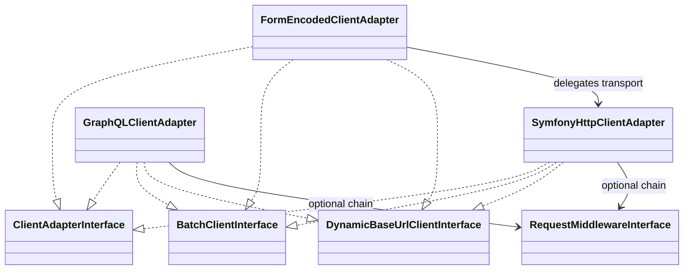

# IntegrationEngine — Documentation (extended edition)

> **Scope:** All current documentation. Architecture decision records and historical upgrade guides are left out; links to them point to the repository files.
>
> Single-file compilation of the repository documentation, generated by `tools/build-docs.py`. Every document is copied verbatim; only heading levels and links change: links between documents included here point to anchors inside this file, and links to code or to anything else point to the repository files.
>
> **Never included, in any edition:** `CHANGELOG.md` (release history), `docs/archived/` (historical plans, explicitly not current documentation), navigation-only READMEs (replaced by the contents below), the ADR template, `CLAUDE.md`, `landing/` and `.symfony-recipes/`.
>
> Do not edit this file: edit the source document named under each title and run `make docs-editions`.

<a id="contents"></a>

## Contents

- [Part I — Overview](#part-overview)
  - [IntegrationEngine](#readme)
  - [IntegrationEngine — Documentation](#documentation)
- [Part II — Getting started](#part-getting-started)
  - [Actions](#getting-started-actions)
  - [Context and Path Resolution](#getting-started-context-and-path)
  - [Authorization](#getting-started-authorization)
  - [Mappers and Responses](#getting-started-mappers-and-responses)
  - [Batch requests](#getting-started-batch-requests)
- [Part III — Configuration, clients and middleware](#part-reference)
  - [Bundle configuration](#configuration)
  - [HTTP clients and transport wiring](#advanced-architecture-clients)
  - [Form bodies](#form-bodies)
  - [Middleware and response caching](#middleware)
  - [Errors and exceptions](#errors)
- [Part IV — Architecture](#part-architecture)
  - [IntegrationEngine — Architecture](#architecture)
  - [Class relationship graph](#advanced-architecture-class-graph)
- [Part V — Resilience, security and observability](#part-operations)
  - [Declarative HTTP resilience](#resilience)
  - [Application-owned resilience utilities](#advanced-resilience)
  - [Outgoing host and network policy](#security)
  - [IntegrationEngine · Lifecycle Events](#lifecycle)
  - [IntegrationEngine · Observability](#observability)
  - [Debugging — Console and Symfony Profiler](#advanced-debugging)
- [Part VI — Inbound webhooks](#part-webhooks)
  - [Webhook Integration Guide](#webhook)
- [Part VII — Quality, testing and tooling](#part-quality)
  - [PHPStan rules](#phpstan)
  - [IntegrationEngine — Testing Guide](#testing)
  - [Quality gates](#advanced-quality)
  - [Generating integrations with an AI agent](#advanced-ai-agent-usage)
  - [Contributing & Development](#contributing)
- [Part VIII — Roadmap](#part-roadmap)
  - [IntegrationEngine · Roadmap](#roadmap)
  - [Proposed next features](#advanced-next-features)

---

<a id="part-overview"></a>

# Part I — Overview

<a id="readme"></a>
<a id="readme--integrationengine"></a>

## IntegrationEngine

*Source: `README.md`*

[](https://github.com/CarlosGude/integrationEngine/actions/workflows/ci.yml)

**Latest tagged release:** [see releases](https://github.com/CarlosGude/integrationEngine/releases/latest)
**Requirements:** PHP 8.2+ · Symfony 6.4 / 7.x / 8.x
**Website:** [integrationengine.dev](https://integrationengine.dev)
**Documentation:** [docs/documentation.md](#documentation)
**Roadmap:** [docs/roadmap.md](#roadmap)

IntegrationEngine is a Symfony bundle for keeping outbound API integrations predictable: actions describe requests, mappers turn external responses into typed DTOs, and the engine owns the repetitive transport/authentication pipeline.

This README documents the current code in the repository. `CHANGELOG.md` is the source of truth for release history and unreleased changes.

<a id="readme--what-the-bundle-standardizes"></a>

### What the bundle standardizes

An integration is built from a small set of contracts:

- an `AbstractAction` per operation;
- optional `ActionBodyInterface` / `ActionContextInterface` values for runtime input;
- one `AbstractMapper` for each action that returns data;
- a typed `ResponseInterface` DTO;
- an integration facade in the consuming application, backed by `IntegrationRegistry`.

The bundle then handles configuration lookup, path resolution, static or dynamic auth, connection overrides, middleware, HTTP transport, batching, response mapping and lifecycle events.

It intentionally does **not** own your domain model. Keep the external DTOs behind a Gateway / Anti-Corruption Layer when they cross into application or domain code.

<a id="readme--when-not-to-use-it"></a>

### When not to use it

IntegrationEngine is a poor fit when an API needs a highly stateful SDK, protocol-specific streaming/session behavior, or a vendor library that already owns transport, retries and object mapping coherently. In those cases, wrapping the SDK behind your own application boundary is usually simpler than forcing it into this action/mapper model.

<a id="readme--why-this-exists"></a>

### Why this exists

Integrations tend to accumulate their own ad-hoc HTTP client, their own way of attaching auth, and their own untyped response handling, repeated slightly differently for every external API a project talks to. That inconsistency shows up as duplicated token logic, DTOs that drift from what the API actually returns, and observability that exists for some integrations and not others. This bundle grew out of exactly that pattern in a production integration, not from a speculative design exercise. The response is a small, uniform contract — Action, Mapper, Response — so every integration looks like every other one and can be tested in isolation.

<a id="readme--install"></a>

### Install

```bash
composer require carlosgude/integration-engine
```

With Symfony Flex, the bundle is registered automatically. Without Flex, add `IntegrationEngine\Bundle\IntegrationEngineBundle::class => ['all' => true]` to `config/bundles.php`.

<a id="readme--first-integration"></a>

### First integration

Generate the integration shell and first action:

```bash
php bin/console make:integration MyApi GetEmployee
```

The command creates the integration facade, action, mapper/response when applicable, and the integration YAML. On the first integration it can also create `config/packages/integration_engine.yaml`.

Bundle configuration is per integration:

```yaml
# config/packages/integration_engine.yaml
integration_engine:
    integrations:
        my_api:
            base_url: 'https://api.example.com'
            config_path: '%kernel.project_dir%/src/Infrastructure/Integrations/MyApi/MyApi.yaml'
```

Action configuration lives in the integration YAML:

```yaml
GetEmployee:
    action: App\Infrastructure\Integrations\MyApi\GetEmployee\Request\GetEmployeeAction
    method: GET
    path: /employees/{id}
```

At the lowest level, calling an action is a single `send()` through the registry:

```php
use IntegrationEngine\Core\Contract\Action\DefaultActionContext;

$response = $registry->get('my_api')->send(
    actionName: GetEmployeeAction::getName(),
    context: DefaultActionContext::create(['id' => $id]),
);
```

In practice, wrap that behind a small facade instead of calling `IntegrationRegistry` directly from controllers and application services, so callers get a typed return instead of the base `ResponseInterface`.

The facade implements `IntegrationName` so the integration is referenced as `MyApiIntegration::NAME` rather than a bare string — the constant is autocompleted and can be grepped/refactored with the rest of the codebase, instead of relying on string literals that silently drift. The registry rejects a blank name and the interface's placeholder value, so every facade declares its own. This is the recommended facade pattern:

```php
use IntegrationEngine\Core\Contract\Action\DefaultActionContext;
use IntegrationEngine\Core\Registry\IntegrationName;
use IntegrationEngine\Core\Registry\IntegrationRegistry;

final class MyApiIntegration implements IntegrationName
{
    public const NAME = 'my_api';

    public function __construct(private IntegrationRegistry $registry) {}

    public function getEmployee(int $id): GetEmployeeResponse
    {
        $response = $this->registry->get(self::NAME)->send(
            actionName: GetEmployeeAction::getName(),
            context: DefaultActionContext::create(['id' => $id]),
        );

        if (!$response instanceof GetEmployeeResponse) {
            throw new \LogicException('Unexpected response type.');
        }

        return $response;
    }
}
```

A failed call (HTTP 4xx/5xx, or a network error) throws `RequestResponseException`, which carries the status code and context ([all exceptions](#errors)):

```php
use IntegrationEngine\Core\Exception\RequestResponseException;

try {
    $response = $this->registry->get(self::NAME)->send(/* ... */);
} catch (RequestResponseException $e) {
    // $e->statusCode, $e->context
}
```

See [Getting started](#part-getting-started) for the request, context, auth, mapping and batch contracts.

<a id="readme--current-capabilities"></a>

### Current capabilities

| Area | Current contract | Reference |
|---|---|---|
| REST | Built-in Symfony HttpClient adapter; JSON by default | [HTTP clients](#advanced-architecture-clients) |
| Form bodies | `FormEncodedBodyInterface`, or `client: form_encoded` for an all-form API | [Form bodies](#form-bodies) |
| GraphQL | `GraphQLBodyInterface`; body is sent as `query` + `variables` | [HTTP clients](#advanced-architecture-clients) |
| Batch | `sendMany()` isolates failures; built-in REST, GraphQL and form adapters support concurrent dispatch when request middleware does not force the sequential fallback | [Batch requests](#getting-started-batch-requests) |
| Auth | bearer/basic/API key; dynamic token action with cache + one fresh-token retry after a cached-token 401 | [Authorization](#getting-started-authorization) |
| Multi-connection | `ConnectionResolverInterface` can override base URL/auth and namespace token caches per call | [HTTP clients](#advanced-architecture-clients--runtime-connection-resolution) |
| Middleware | action-level client middleware plus full-request middleware for signing | [Middleware](#middleware) |
| Response caching | per-action `cache_ttl` over the raw response | [Response caching](#middleware--response-caching) |
| Resilience | transport timeout, max duration and Symfony retry configuration | [Resilience](#resilience) |
| Outgoing security | hostname allowlist and optional private-network blocking for built-in transports | [Security](#security) |
| Observability | scalar-only request, response, failure, token and webhook events | [Lifecycle events](#lifecycle) |
| Webhooks | YAML definition, HMAC verification, typed mapper, Symfony Webhook/RemoteEvent integration | [Webhooks](#webhook) |
| Static analysis | optional PHPStan rules for mapper reciprocity, response modifiers and facade return types | [PHPStan](#phpstan) |
| Debugging | `debug:integration [name]` and Symfony profiler integration in debug mode | [Debugging](#advanced-debugging) |
| Errors | typed exceptions; `RequestResponseException` carries status and context | [Errors](#errors) |

<a id="readme--configuration-split"></a>

### Configuration split

Bundle configuration decides **how an integration is wired**; the integration YAML describes **what operations that integration exposes**. Every key is in [docs/configuration.md](#configuration).

<a id="readme--architecture-in-one-sentence"></a>

### Architecture in one sentence

`Core` defines contracts and orchestration; `Infrastructure` implements adapters; `Bundle` wires Symfony; compatibility shims stay outside Core; optional PHPStan rules live in their own extension layer. The dependency direction is enforced by Deptrac.

The detailed dependency rules and runtime pipeline are in [architecture.md](#architecture).

<a id="readme--quality"></a>

### Quality

Repository gates cover style, PHPStan, PHPUnit, Deptrac and Infection. Measured results belong in [docs/advanced/quality.md](#advanced-quality), not in this README, so release copy does not become a museum of stale numbers.

<a id="readme--demo"></a>

### Demo

[integrationEngine-demo](https://github.com/CarlosGude/integrationEngine-demo) is the consuming Symfony application used to demonstrate and contract-test the bundle.

<a id="readme--further-reading"></a>

### Further reading

Start from [docs/documentation.md](#documentation), the only documentation index. It also lists the Architecture Decision Records (*why* a design was chosen) and the upgrade guide for each major version. Archived plans, audits and spikes under [docs/archived/](archived/README.md) are explicitly non-current.

<a id="documentation"></a>
<a id="documentation--integrationengine--documentation"></a>

## IntegrationEngine — Documentation

*Source: `docs/documentation.md`*

This is the **single index for current documentation**. It describes the code on `main`; the latest tagged release is [v9.4.0](https://github.com/CarlosGude/integrationEngine/releases/tag/v9.4.0) and release history remains in [`CHANGELOG.md`](../CHANGELOG.md).

Every concept has one canonical page. Other pages link to it instead of repeating it.

<a id="documentation--reading-order"></a>

### Reading order

1. [README](#readme) — what the bundle is, installation and a first integration.
2. [Getting started](#part-getting-started) — actions, context and paths, authorization, mappers, batches.
3. [Bundle configuration](#configuration), [HTTP clients](#advanced-architecture-clients), [Middleware and response caching](#middleware) and [Errors](#errors).
4. [Architecture](#architecture) — scope, layers and the request pipeline.
5. The topic you need from the table below.

To read everything in one file, use the single-file editions generated from these pages by `make docs-editions` (do not edit them): [minimal](documentation-minimal.md), [extended](documentation-extended.md) or [full](documentation-full.md), which adds the ADRs and upgrade guides.

<a id="documentation--by-task"></a>

### By task

| Need | Canonical document |
|---|---|
| Build an action and its YAML entry | [getting-started/actions.md](#getting-started-actions) |
| Resolve path/query inputs | [getting-started/context-and-path.md](#getting-started-context-and-path) |
| Configure auth/token caching | [getting-started/authorization.md](#getting-started-authorization) |
| Map responses and headers | [getting-started/mappers-and-responses.md](#getting-started-mappers-and-responses) |
| Send batches | [getting-started/batch-requests.md](#getting-started-batch-requests) |
| Look up a bundle configuration key | [configuration.md](#configuration) |
| Choose/customize clients, base URLs or connections | [advanced/architecture/clients.md](#advanced-architecture-clients) |
| Send form-encoded bodies | [form-bodies.md](#form-bodies) |
| Add client/request middleware or cache responses | [middleware.md](#middleware) |
| Handle exceptions | [errors.md](#errors) |
| Configure transport retries/timeouts | [resilience.md](#resilience) |
| Build an application-level retry loop | [advanced/resilience.md](#advanced-resilience) |
| Configure host/private-network protection | [security.md](#security) |
| Receive webhooks | [webhook.md](#webhook) |
| Observe lifecycle events | [lifecycle.md](#lifecycle) |
| Configure helper observability | [observability.md](#observability) |
| Debug an integration | [advanced/debugging.md](#advanced-debugging) |
| Understand scope, layers and the request pipeline | [architecture.md](#architecture) |
| See the main class relationships | [advanced/architecture/class-graph.md](#advanced-architecture-class-graph) |
| Enable PHPStan integration rules | [phpstan.md](#phpstan) |
| Test an integration / run the test suite | [testing.md](#testing) |
| Generate an integration with an AI agent | [advanced/ai-agent-usage.md](#advanced-ai-agent-usage) |
| Check quality gates and measured evidence | [advanced/quality.md](#advanced-quality) |
| See what is planned | [roadmap.md](#roadmap), [advanced/next-features.md](#advanced-next-features) |
| Contribute | [CONTRIBUTING.md](#contributing) |

<a id="documentation--architecture-decisions"></a>

### Architecture decisions

[`adr/`](adr/README.md) records *why* the project chose its boundaries. ADRs are not usage guides and some intentionally describe superseded decisions. Their status table is the source of truth for which decisions remain active.

<a id="documentation--upgrade-guides"></a>

### Upgrade guides

Upgrade guides are historical migration documents. They intentionally mention APIs that no longer exist:

- [upgrade-4.0.md](upgrade-4.0.md)
- [upgrade-5.0.md](upgrade-5.0.md)
- [upgrade-5.1.md](upgrade-5.1.md)
- [upgrade-6.0.md](upgrade-6.0.md)
- [upgrade-7.0.md](upgrade-7.0.md) and [migration-v7-client-registration.md](migration-v7-client-registration.md)
- [upgrade-8.0.md](upgrade-8.0.md)
- [upgrade-9.0.md](upgrade-9.0.md)

For current behavior, use the guides above, not an old upgrade document.

<a id="documentation--archived-material"></a>

### Archived material

[`archived/`](archived/README.md) contains implementation plans, old release preparation, quality audits and spikes. They are retained as decision history only and **must not be used as current API documentation**.

---

<a id="part-getting-started"></a>

# Part II — Getting started

<a id="getting-started-actions"></a>
<a id="getting-started-actions--actions"></a>

## Actions

*Source: `docs/getting-started/actions.md`*

An action is the static contract for one external operation: method, path, response mapper and optional body type. Runtime data is supplied separately, so action classes remain stateless.

<a id="getting-started-actions--define-an-action"></a>

### Define an action

Extend `AbstractAction` and implement the three static methods:

```php
use IntegrationEngine\Core\Contract\Action\AbstractAction;

final class GetEmployeeAction extends AbstractAction
{
    public static function getName(): string
    {
        return 'GetEmployee';
    }

    public static function hasResponse(): bool
    {
        return true;
    }

    public static function mapper(): ?string
    {
        return GetEmployeeMapper::class;
    }
}
```

Then register the action in that integration's YAML file:

```yaml
GetEmployee:
    action: App\Infrastructure\Integrations\MyApi\GetEmployee\Request\GetEmployeeAction
    method: GET
    path: /employees/{id}
```

`getName()` must match the YAML key. `hasResponse(): false` does not skip the HTTP call; it skips mapper resolution and returns `EmptyResponse` after the request succeeds.

<a id="getting-started-actions--action-yaml"></a>

### Action YAML

The action file accepts these fields:

```yaml
ActionName:
    action: App\...\ActionClass        # required
    method: POST                       # optional, default POST
    path: /resource/{id}               # optional, default /
    body: App\...\ActionBody          # optional ActionBodyInterface class
    authorization:                     # optional; see authorization.md
        type: bearer
        token: '%env(API_TOKEN)%'
    cache_ttl: 60                      # optional raw-response cache TTL in seconds; see middleware.md
    timeout: 5.0                       # optional per-action request timeout
```

The same file can hold a `defaults:` block shared by every action ([Authorization](#getting-started-authorization--sharing-authorization-across-actions)) and a `webhooks:` block ([Webhooks](#webhook)). Transport selection (`client`, `client_service`, retries, host policy and middleware) belongs in the bundle configuration, not in the action YAML. See [Bundle configuration](#configuration); for `cache_ttl`, see [Response caching](#middleware--response-caching).

<a id="getting-started-actions--runtime-data"></a>

### Runtime data

The configuration adapter creates action instances through `AbstractAction::create()`. Application code normally does not instantiate actions directly. Data that varies per call uses separate contracts:

| Runtime value | Contract |
|---|---|
| Path parameters and request context | `ActionContextInterface` |
| Request payload | `ActionBodyInterface` |
| Per-request headers | `RequestHeadersInterface` |
| Runtime endpoint override | `baseUrl` argument on `send()` / `EngineRequest` |
| Runtime connection/credentials | `connection` argument when a resolver is configured |

All `{placeholder}` values are resolved exclusively from the action context. The body is preserved, including fields whose names match placeholders. See [Context and path resolution](#getting-started-context-and-path).

A body is an `ActionBodyInterface`: `create(array)` and `toArray()`. The `body` class in YAML decides whether the action accepts one:

- passing a body to an action that declares none is an error;
- if the action declares a body and the caller passes none, the declared class is created with an empty array.

How per-request headers combine with integration and authorization headers is described in [Header precedence](#advanced-architecture-clients--header-precedence).

<a id="getting-started-actions--invariants"></a>

### Invariants

Actions carry no mutable request state. A configured action may therefore be reused safely across single and batch dispatch without leaking values between calls. When `hasResponse()` is `true`, `mapper()` must identify the mapper for that action — `null` throws `NotMappedActionException` — and the engine validates that relationship before mapping ([Mappers and responses](#getting-started-mappers-and-responses)).

When the YAML declares a `body` class for an action, a body passed to `send()` / `sendMany()` must be an instance of that declared class — `YamlConfigAdapter` throws `\InvalidArgumentException` otherwise, before any HTTP call is made. See [0018](adr/0018-body-type-invariant.md).

<a id="getting-started-context-and-path"></a>
<a id="getting-started-context-and-path--context-and-path-resolution"></a>

## Context and Path Resolution

*Source: `docs/getting-started/context-and-path.md`*

Context supplies all runtime values used to build the URL: IDs, filters and pagination.
The engine resolves `{placeholder}` tokens exclusively from `context`. The `body`
contains payload fields and is preserved even when a field matches a placeholder.

<a id="getting-started-context-and-path--url-parameters-and-payload"></a>

### URL parameters and payload

Pass URL parameters in `context` and payload fields in `body`:

```yaml
UpdateEmployee:
    action: App\Infrastructure\Integrations\MyApi\UpdateEmployee\UpdateEmployeeAction
    method: PUT
    path: /employees/{id}
    body: App\Infrastructure\Integrations\MyApi\UpdateEmployee\Request\UpdateEmployeeBody
```

```php
use IntegrationEngine\Core\Contract\Action\DefaultActionContext;

$engine->send(
    actionName: UpdateEmployeeAction::getName(),
    context: DefaultActionContext::create(['id' => 42]),
    body: UpdateEmployeeBody::create(['name' => 'New Name']),
);
// → PUT /employees/42, with { "name": "New Name" } as the JSON body
```

If the API also requires `id` in the payload, include it explicitly in `body`;
it will be sent unchanged. A body field never supplies a missing context value.
No custom context class or `ConfigPort` implementation is needed.

<a id="getting-started-context-and-path--requests-without-a-body"></a>

### Requests without a body

Declare a `{placeholder}` in YAML and pass `DefaultActionContext`:

```yaml
GetEmployee:
    path: /employees/{id}
```

```php
use IntegrationEngine\Core\Contract\Action\DefaultActionContext;

$engine->send(
    actionName: GetEmployeeAction::getName(),
    context: DefaultActionContext::create(['id' => 42]),
);
// → GET /employees/42
```

`DefaultActionContext` is a transparent key-value wrapper. Use it for the vast majority
of cases.

---

<a id="getting-started-context-and-path--required-query-parameters"></a>

### Required query parameters

Placeholders work in the query string too — use them when the parameter is always
present:

```yaml
FilterByStatus:
    path: /employees?status={status}
```

```php
DefaultActionContext::create(['status' => 'active'])
// → GET /employees?status=active
```

A missing or non-scalar placeholder value throws `PathResolutionException` immediately,
before the HTTP request is made. A placeholder that appears more than once in the path
is resolved from the same context value everywhere.

---

<a id="getting-started-context-and-path--optional-query-parameters"></a>

### Optional query parameters

When any parameter is optional, implement `PathResolvableContextInterface`. The context
receives the raw YAML path and returns the final URL — or `null` to fall back to the
default `{placeholder}` resolver:

```php
use IntegrationEngine\Core\Contract\Action\PathResolvableContextInterface;

final readonly class FilterEmployeesContext implements PathResolvableContextInterface
{
    private function __construct(private array $filters) {}

    public static function create(array $data): self { return new self($data); }
    public function toArray(): array { return $this->filters; }

    public function resolvePath(string $path): ?string
    {
        $allowed = ['status', 'department', 'page'];
        $params  = array_filter(
            array_intersect_key($this->filters, array_flip($allowed)),
            static fn(mixed $v): bool => '' !== (string) $v,
        );
        return empty($params) ? null : $path . '?' . http_build_query($params);
    }
}
```

The action stays declarative — path logic lives in the context, not in the action.
Returning an empty string throws `PathResolutionException`; return `null` to delegate.

---

<a id="getting-started-context-and-path--custom-context-with-validation"></a>

### Custom context with validation

A custom context also makes sense when you want to enforce invariants at construction
time, or accept domain objects instead of raw arrays:

```php
use IntegrationEngine\Core\Contract\Action\ActionContextInterface;

final readonly class GetEmployeeContext implements ActionContextInterface
{
    private function __construct(private int $id) {}

    public static function create(array $data): self
    {
        $id = (int) ($data['id'] ?? 0);
        if ($id <= 0) {
            throw new \InvalidArgumentException('Employee id must be a positive integer.');
        }
        return new self($id);
    }

    public function toArray(): array { return ['id' => $this->id]; }
}
```

If you find yourself validating or casting values before calling
`DefaultActionContext::create()`, move that logic into a custom context class instead.

---

<a id="getting-started-context-and-path--decision-table"></a>

### Decision table

| Scenario | Approach |
|---|---|
| Path segment | YAML `{placeholder}` + `DefaultActionContext` |
| Query params — all required | YAML `{placeholder}` in query string |
| Query params — any optional | Custom context with `PathResolvableContextInterface` |
| Validation or domain objects at construction | Custom context with `ActionContextInterface` |
| No dynamic values | No context (or `DefaultActionContext::create([])`) |

When migrating an action that previously supplied URL parameters through `body`,
pass those parameters through `context`. Remove them from `body` only if the API
does not require them in the payload.

<a id="getting-started-authorization"></a>
<a id="getting-started-authorization--authorization"></a>

## Authorization

*Source: `docs/getting-started/authorization.md`*

Authorization is declared per action. IntegrationEngine supports static credentials and dynamic token acquisition; runtime connection resolution can override either for a specific call. A `defaults:` block lets every action in the file share one authorization config instead of repeating it.

<a id="getting-started-authorization--static-authorization"></a>

### Static authorization

```yaml
GetOrders:
    action: App\...\GetOrdersAction
    method: GET
    path: /orders
    authorization:
        type: bearer
        token: '%env(MY_API_TOKEN)%'
```

Supported static forms:

| Type | Fields | Result |
|---|---|---|
| `bearer` | `token`, optional `prefix` | `Authorization: <prefix> <token>`; prefix defaults to `Bearer` |
| `basic` | `username`, `password` | HTTP Basic `Authorization` header |
| `api_key` | `token`, optional `header`, optional `prefix` | Custom header; header defaults to `X-Api-Key` |

An unknown `type`, or a parameter whose value is not a string, fails explicitly.

```yaml
# Basic
authorization:
    type: basic
    username: '%env(API_USER)%'
    password: '%env(API_PASS)%'

# API key in a provider-specific header
authorization:
    type: api_key
    token: '%env(API_KEY)%'
    header: X-Shopify-Access-Token
```

<a id="getting-started-authorization--dynamic-authorization"></a>

### Dynamic authorization

Use `type: dynamic` when a second action must obtain the credential:

```yaml
FetchToken:
    action: App\...\FetchTokenAction
    method: POST
    path: /oauth/token

GetOrders:
    action: App\...\GetOrdersAction
    method: GET
    path: /orders
    authorization:
        type: dynamic
        action: FetchToken
        token_field: access_token
        ttl: 3600
        header: Authorization       # optional
        prefix: Bearer              # optional
```

The token action is a normal action. Its mapped response must expose `token_field` through `toArray()`. `token_field` is a direct key, not a dot path; a missing key or a non-scalar value throws `DynamicAuthException`.

On a cache miss the engine executes the token action, extracts the token, stores it for `ttl`, converts the dynamic configuration to static authorization and sends the protected request. Each fetch emits a `TokenRefreshed` event ([Lifecycle events](#lifecycle--token-refresh-reasons)).

<a id="getting-started-authorization--rejected-cached-tokens"></a>

#### Rejected cached tokens

A 401 is retried once only when the rejected token came from cache:

1. remove the cached token;
2. fetch and cache a fresh token;
3. retry the protected request once.

A 401 returned after a freshly fetched token is not retried, and non-401 failures do not evict the token. The single retry covers tokens revoked before their TTL; retrying further would hide real authentication problems ([ADR 0005](adr/0005-token-cache-per-connection-and-single-retry-on-401.md)).

<a id="getting-started-authorization--dynamic-auth-in-batches"></a>

#### Dynamic auth in batches

Inside `sendMany()`, items that share a token cache key (see [below](#getting-started-authorization--token-cache-identity)) share one token: a token fetched for an earlier item is reused by the later ones. Only items that entered the batch with a token already cached are eligible for the 401 retry; a token fetched during the batch is already fresh, so its 401 is final. When several retryable items share a key, the stale entry is deleted once and all of them reuse the newly fetched token.

<a id="getting-started-authorization--sharing-authorization-across-actions"></a>

### Sharing authorization across actions

Most integrations have one token action protecting many endpoints. Declare it once under `defaults.authorization` instead of repeating the full block on every action:

```yaml
defaults:
    authorization:
        type: dynamic
        action: FetchToken
        token_field: access_token
        ttl: 3600

FetchToken:
    action: App\...\FetchTokenAction
    method: POST
    path: /oauth/token
    authorization: false   # opts out of the default: the token action itself is unauthenticated

GetOrders:
    action: App\...\GetOrdersAction
    method: GET
    path: /orders
    # inherits the default dynamic authorization as-is

GetOrderDetails:
    action: App\...\GetOrderDetailsAction
    method: GET
    path: /orders/{id}
    authorization:
        ttl: 7200   # overrides only ttl; action/token_field/header/prefix come from the default
```

Resolution rules, in order:

1. **No `authorization:` key on the action** → the default applies unchanged (or no authorization, if there is no default).
2. **`authorization: false`** → opts this action out of the default; it sends no authorization. This is how the token action itself (`FetchToken` above) stays unauthenticated under a default. `authorization: ~` (explicit null) is equivalent — `false` is the recommended spelling because it reads as an explicit decision ("no auth here") rather than something that looks accidentally empty.
3. **`authorization:` with fields but no `type`, or the same `type` as the default** → shallow-merged on top of the default; the action's fields win on conflict.
4. **`authorization:` with a different `type`** → replaces the default entirely for this action; nothing is merged.

`authorization:` must be a map, `false`, or `~`/`null` — any other scalar (e.g. `true`) is rejected eagerly when the YAML file loads, with an error naming the action and the offending type. `defaults.authorization` is validated the same way — an invalid default fails immediately rather than on first dispatch.

<a id="getting-started-authorization--token-cache-identity"></a>

### Token cache identity

Dynamic token keys have this logical shape:

```text
integration_engine.token.{integration}.{token_action}.{xxh128(discriminator)}
```

The PSR-6 adapter sanitizes characters that are not portable cache-key characters before accessing the configured pool.

For runtime connections, the discriminator is selected in this order:

1. resolved `ConnectionCredentials::connectionId`;
2. the caller's scalar `connection` value;
3. resolved `baseUrl`;
4. an empty string when no connection-specific discriminator exists.

Use a stable, non-secret `connectionId` when several tenants can share the same base URL. Never use an API key, token or client secret as a connection ID.

<a id="getting-started-authorization--cache-backend"></a>

### Cache backend

The bundle's default `CachePort` is a `Psr6CacheAdapter` over Symfony's `cache.app`. The actual storage and sharing semantics therefore depend on the application's Symfony Cache configuration; IntegrationEngine does not assume that `cache.app` is local, filesystem-backed or shared.

Override the pool per integration when token storage needs a dedicated backend:

```yaml
# config/packages/integration_engine.yaml
integration_engine:
    integrations:
        my_api:
            cache_service: cache.my_api_tokens
```

The configured service must satisfy the cache contract expected by the bundle wiring.

<a id="getting-started-authorization--runtime-connection-overrides"></a>

### Runtime connection overrides

A configured `connection_resolver` can return `ConnectionCredentials` with a different `baseUrl`, `authorization`, and optional `connectionId` for each call. The override is resolved before dynamic authorization, so per-connection credentials and token caches stay separated. See [HTTP clients — runtime connection resolution](#advanced-architecture-clients--runtime-connection-resolution).

<a id="getting-started-mappers-and-responses"></a>
<a id="getting-started-mappers-and-responses--mappers-and-responses"></a>

## Mappers and Responses

*Source: `docs/getting-started/mappers-and-responses.md`*

A mapper transforms the raw HTTP response array into a typed DTO. It is the only place
where external API field names appear in your codebase.

---

<a id="getting-started-mappers-and-responses--the-minimum"></a>

### The minimum

Extend `AbstractMapper`, declare which action it belongs to, and implement `transform()`:

```php
use IntegrationEngine\Core\Contract\Action\AbstractAction;
use IntegrationEngine\Core\Contract\Mapper\AbstractMapper;
use IntegrationEngine\Core\Contract\Response\ResponseInterface;

final class GetEmployeeMapper extends AbstractMapper
{
    public static function getAction(): string { return GetEmployeeAction::class; }

    protected static function transform(AbstractAction $action, array $response, array $headers): ResponseInterface
    {
        return GetEmployeeResponse::create($response);
    }
}
```

The response DTO must implement `ResponseInterface`:

```php
use IntegrationEngine\Core\Contract\Response\ResponseInterface;

final readonly class GetEmployeeResponse implements ResponseInterface
{
    private function __construct(
        public int    $id,
        public string $name,
    ) {}

    public static function create(array $data): self
    {
        return new self(
            id:   (int)    ($data['id']   ?? 0),
            name: (string) ($data['name'] ?? ''),
        );
    }

    public function toArray(): array { return ['id' => $this->id, 'name' => $this->name]; }
}
```

---

<a id="getting-started-mappers-and-responses--type-mapping"></a>

### Type mapping

Match PHP types to what the API returns:

| API type | PHP type | Cast in `create()` |
|---|---|---|
| integer | `int` | `(int) ($data['x'] ?? 0)` |
| number | `float` | `(float) ($data['x'] ?? 0.0)` |
| boolean | `bool` | `(bool) ($data['x'] ?? false)` |
| string | `string` | `(string) ($data['x'] ?? '')` |
| array | `array` | `$data['x'] ?? []` |
| nullable string | `?string` | `is_string($data['x'] ?? null) ? $data['x'] : null` |
| nested object (simple) | `array` | `$data['x'] ?? []` |
| nested object (reused) | `NestedDto` | `NestedDto::create($data['x'] ?? [])` |

Use a dedicated DTO class for nested objects that appear in more than one response, or
that have more than three or four fields. Nested DTOs do **not** implement
`ResponseInterface` — only the top-level class returned from `transform()` does.

---

<a id="getting-started-mappers-and-responses--response-headers"></a>

### Response headers

`transform()`'s third argument, `$headers`, is the response's HTTP headers as
`array<string, string[]>` — the same shape Symfony's HttpClient exposes, one
list per header name since a header can repeat. Header names are lowercase,
so look them up as `x-ratelimit-remaining`, not `X-RateLimit-Remaining`. Most
mappers ignore it; it exists for the data some APIs put outside the body:
pagination cursors, rate-limit counters, request/correlation IDs.

```php
protected static function transform(AbstractAction $action, array $response, array $headers): ResponseInterface
{
    $remaining = $headers['x-ratelimit-remaining'][0] ?? null;

    return GetEmployeesResponse::create($response, remaining: $remaining !== null ? (int) $remaining : null);
}
```

Calling `AbstractMapper::map()` directly (outside the engine flow — e.g. in a
unit test for the mapper itself) can omit `$headers`; it defaults to `[]`.

---

<a id="getting-started-mappers-and-responses--one-mapper-per-action"></a>

### One mapper per action

The engine enforces `$mapper::getAction() === $action::class` before calling
`transform()`. Two action classes cannot share the same mapper — this throws
`MapperActionMismatchException`. The optional [PHPStan rules](#phpstan) check the
same pairing statically. An action whose `hasResponse()` is `false` needs no mapper:
the engine returns `EmptyResponse` after the request succeeds.

When two actions return the same response shape, extract the transformation logic into a
dedicated class and delegate from each mapper:

```php
final class EmployeeCollectionTransformer
{
    public static function transform(array $response): EmployeeListResponse { ... }
}

final class GetEmployeesMapper extends AbstractMapper
{
    public static function getAction(): string { return GetEmployeesAction::class; }
    protected static function transform(AbstractAction $action, array $response, array $headers): ResponseInterface
    {
        return EmployeeCollectionTransformer::transform($response);
    }
}

final class FilterEmployeesMapper extends AbstractMapper
{
    public static function getAction(): string { return FilterEmployeesAction::class; }
    protected static function transform(AbstractAction $action, array $response, array $headers): ResponseInterface
    {
        return EmployeeCollectionTransformer::transform($response);
    }
}
```

---

<a id="getting-started-mappers-and-responses--toarray--engine-contract-not-your-api"></a>

### `toArray()` — engine contract, not your API

`ResponseInterface` requires `toArray()`. The engine uses it internally to extract
dynamic auth tokens from token responses. It is not your public API.

Consumers of your facade should access typed properties directly:

```php
// ✅ correct — typed access
$name = $response->name;

// ❌ wrong — leaks the engine contract
$name = $response->toArray()['name'];
```

The only time `toArray()` is meaningful to you is when writing a token response for
dynamic auth — the field named in `token_field` must appear in `toArray()`.
See [Authorization](#getting-started-authorization) for details.

<a id="getting-started-batch-requests"></a>
<a id="getting-started-batch-requests--batch-requests"></a>

## Batch requests

*Source: `docs/getting-started/batch-requests.md`*

`sendMany()` executes several `EngineRequest` values while preserving each input key and isolating failures. It uses a client's batch capability when available and otherwise falls back to individual sends.

<a id="getting-started-batch-requests--build-and-dispatch-a-batch"></a>

### Build and dispatch a batch

```php
use IntegrationEngine\Core\Batch\EngineRequest;
use IntegrationEngine\Core\Contract\Action\DefaultActionContext;

$requests = [
    'lon' => new EngineRequest(
        GetAccommodationAction::getName(),
        context: DefaultActionContext::create(['id' => 101]),
    ),
    'par' => new EngineRequest(
        GetAccommodationAction::getName(),
        context: DefaultActionContext::create(['id' => 202]),
    ),
];

$results = $engine->sendMany($requests);
```

An `EngineRequest` can carry the same per-call inputs as `send()`: action name, context, body, headers, base URL override and connection value.

<a id="getting-started-batch-requests--results-and-failure-semantics"></a>

### Results and failure semantics

`sendMany()` returns `BatchResultCollection`. Every input key gets one `BatchResult`; one failure does not cancel unrelated items.

```php
if ($results['lon']->isSuccess()) {
    $response = $results['lon']->response();
} else {
    $error = $results['lon']->error();
}

foreach ($results->errors() as $key => $error) {
    // application-owned failure policy
}
```

`responses()` returns successful mapped responses and `errors()` returns failures, both keyed like the input. The collection is read-only, iterable, countable and array-accessible; it also exposes `keys()`, `hasFailures()`, `actionClassFor($key)` and `mapWith()`. `BatchResult::response()` returns the response or rethrows the stored failure; `error()` returns the failure or `null`.

Lifecycle events emitted for batch items carry the input key as `requestKey` ([Lifecycle events](#lifecycle)).

For strict handling:

```php
$responses = $engine->sendManyOrFail($requests);
```

The complete batch is dispatched first; `sendManyOrFail()` then unwraps results in input order and throws when it reaches the first failed item.

<a id="getting-started-batch-requests--concurrency"></a>

### Concurrency

Concurrency is a client capability, represented by `BatchClientInterface`. The three built-in transports implement it:

| Built-in client | Batch behavior |
|---|---|
| `rest` | concurrent HTTP dispatch |
| `graphql` | concurrent HTTP dispatch |
| `form_encoded` | concurrent HTTP dispatch through the REST transport |

For REST and GraphQL, every request is dispatched before any response is consumed: Symfony responses are lazy, so the network activity overlaps. The form adapter delegates batch work to the same REST transport. The public API is not lazy — `sendMany()` returns once every response has been consumed and mapped.

When `request_middlewares` are configured on a built-in client, batch execution deliberately falls back to per-item sequential `send()`. A request middleware can inspect, replace or short-circuit a completed request, so the transport cannot preserve the same middleware semantics while blindly pre-dispatching every item.

A custom `client_service` or adapter is concurrent only if it implements `BatchClientInterface`; otherwise the engine transparently uses sequential `ClientInterface::send()` calls.

<a id="getting-started-batch-requests--mixed-actions-and-connections"></a>

### Mixed actions and connections

A batch may contain different actions and different runtime connections:

```php
$results = $engine->sendMany([
    'orders-acme' => new EngineRequest(GetOrdersAction::getName(), connection: 'acme'),
    'profile' => new EngineRequest(GetProfileAction::getName(), connection: 'globex'),
]);
```

Each item resolves its own action, connection, authorization and mapper. Within one `sendMany()` call, scalar connection values are memoized, so repeated items for the same connection call the resolver once; object connections are not memoized. Items that share a dynamic token reuse it — see [Dynamic auth in batches](#getting-started-authorization--dynamic-auth-in-batches). Actions with `cache_ttl` only send the cache misses ([Response caching](#middleware--response-caching)).

Items are grouped by resolved base URL before batch dispatch. That keeps dynamic endpoint overrides compatible with clients that implement both `BatchClientInterface` and `DynamicBaseUrlClientInterface`.

<a id="getting-started-batch-requests--homogeneous-batch-mapping"></a>

### Homogeneous batch mapping

`AbstractBatchMapper` is optional. Use it when all successful results belong to the same action and the application wants to consolidate them into one response object:

```php
use IntegrationEngine\Core\Batch\AbstractBatchMapper;
use IntegrationEngine\Core\Batch\BatchResultCollection;
use IntegrationEngine\Core\Contract\Response\ResponseInterface;

final class AccommodationListBatchMapper extends AbstractBatchMapper
{
    public static function getAction(): string
    {
        return GetAccommodationAction::class;
    }

    protected static function consolidate(BatchResultCollection $results): ResponseInterface
    {
        if ($results->hasFailures()) {
            throw array_values($results->errors())[0];
        }

        return new AccommodationListResponse($results->responses());
    }
}

$list = $engine->sendMany($requests)->mapWith(AccommodationListBatchMapper::class);
```

`mapWith()` checks every resolved item against the batch mapper's `getAction()` before calling `consolidate()`; a different action throws `BatchMapperActionMismatchException`. Items that failed before their action was resolved are passed through for `consolidate()` to handle.

For mixed-action batches, consume `BatchResultCollection` directly instead of forcing a common batch mapper.

---

<a id="part-reference"></a>

# Part III — Configuration, clients and middleware

<a id="configuration"></a>
<a id="configuration--bundle-configuration"></a>

## Bundle configuration

*Source: `docs/configuration.md`*

IntegrationEngine has two configuration scopes, and they answer different questions:

```text
config/packages/integration_engine.yaml   (bundle configuration)
└── how each integration is wired: base_url, client, transport,
    headers, cache, middlewares, request_middlewares, connection_resolver

src/.../MyApi.yaml                        (integration YAML)
├── which actions it exposes: class, method, path, body,
│   authorization, cache_ttl, timeout
├── optional defaults: shared authorization
└── optional webhooks: inbound event definition
```

Putting a client selector in an action entry, or an action class in bundle configuration, mixes the two scopes and is not part of the contract.

This page is the reference for the bundle configuration. The integration YAML is documented where each entry is explained: action keys in [Actions](#getting-started-actions--action-yaml), `defaults:` in [Authorization](#getting-started-authorization--sharing-authorization-across-actions) and `webhooks:` in [Webhooks](#webhook--1-define-the-webhook-contract-in-integration-yaml).

<a id="configuration--keys"></a>

### Keys

Every key is set per integration, under `integration_engine.integrations.<name>`.

| Key | Default | Meaning | Details |
|---|---|---|---|
| `config_path` | — | Path to the integration YAML. Required. | |
| `base_url` | — | Base URL used by the bundle-managed adapters. Required unless `client_service` is set. | |
| `client` | `rest` | Adapter type: `rest`, `graphql`, `form_encoded` or a tagged custom type. | [HTTP clients](#advanced-architecture-clients) |
| `client_service` | — | Application `ClientInterface` service that replaces the bundle-managed transport. | [HTTP clients](#advanced-architecture-clients--client-vs-client_service) |
| `headers` | `{}` | Headers sent with every request of this integration. | [Header precedence](#advanced-architecture-clients--header-precedence) |
| `cache_service` | `integration_engine.cache.default` | `CachePort` service for dynamic tokens and response caching. The default is PSR-6 over Symfony `cache.app`. | [Authorization](#getting-started-authorization--cache-backend) |
| `connection_resolver` | — | `ConnectionResolverInterface` service for the `connection` argument. | [Runtime connections](#advanced-architecture-clients--runtime-connection-resolution) |
| `middlewares` | `[]` | Ordered `AbstractClientMiddleware` service IDs, outermost first. | [Middleware](#middleware) |
| `request_middlewares` | `[]` | Ordered `RequestMiddlewareInterface` service IDs, outermost first. Built-in clients only. | [Middleware](#middleware--request-middleware) |
| `timeout` | none | Transport inactivity timeout, in seconds. | [Resilience](#resilience) |
| `max_duration` | none | Maximum total duration of a request, in seconds. | [Resilience](#resilience) |
| `retry` | off | Symfony transport retry policy. | [Resilience](#resilience) |
| `allowed_hosts` | `[]` (any host) | Hostname allowlist; supports `*.example.com`. | [Security](#security) |
| `block_private_networks` | `false` | Wraps the transport with Symfony `NoPrivateNetworkHttpClient`. | [Security](#security) |
| `profiler_payloads` | `false` | Shows body, context and successful response contents in the profiler. Only active while `kernel.debug` is true. | [Debugging](#advanced-debugging--opt-in-showing-body-context-and-response-contents) |

<a id="configuration--validation"></a>

### Validation

The bundle configuration fails at container build time when:

- an integration defines neither `base_url` nor `client_service`;
- `client_service` is combined with `retry`, `timeout`, `max_duration` or `block_private_networks` — the engine does not control that transport;
- `client` is empty;
- an `allowed_hosts` entry contains a scheme, port or path;
- a `retry` value is out of range (`max_retries` ≥ 1, `multiplier` ≥ 1, `jitter` between 0 and 1, status codes between 100 and 599);
- a service listed under `middlewares` or `request_middlewares` is not tagged `integration_engine.middleware` / `integration_engine.request_middleware`.

The integration YAML is parsed by `YamlConfigAdapter` when the integration service is created. Missing files, invalid action definitions, invalid timeouts and authorization blocks, and malformed webhook definitions fail explicitly at that point, before any request is sent.

<a id="configuration--full-example"></a>

### Full example

```yaml
# config/packages/integration_engine.yaml
integration_engine:
    integrations:
        acme:
            config_path: '%kernel.project_dir%/src/Infrastructure/Integrations/Acme/Acme.yaml'
            base_url: 'https://api.acme.test'
            client: rest
            headers:
                Accept-Language: en
            timeout: 10
            max_duration: 30
            retry:
                max_retries: 3
                delay_ms: 200
                multiplier: 2.0
                max_delay_ms: 2000
                jitter: 0.1
                status_codes: [423, 425, 429, 500, 502, 503, 504, 507, 510]
                retry_non_idempotent: false
            allowed_hosts: ['api.acme.test', '*.cdn.acme.test']
            block_private_networks: true
            cache_service: integration_engine.cache.default
            connection_resolver: App\Infrastructure\Integrations\Acme\AcmeConnectionResolver
            middlewares:
                - App\Infrastructure\Http\AuditMiddleware
            request_middlewares:
                - App\Infrastructure\Http\SigningMiddleware
```

To inspect what is configured without sending requests, use [`debug:integration`](#advanced-debugging--inspect-configured-integrations).

<a id="advanced-architecture-clients"></a>
<a id="advanced-architecture-clients--http-clients-and-transport-wiring"></a>

## HTTP clients and transport wiring

*Source: `docs/advanced/architecture/clients.md`*

IntegrationEngine separates the engine contract from the HTTP implementation. `ClientInterface` is the minimum capability; optional interfaces add batching and runtime URL overrides.

| Capability | Contract | Effect |
|---|---|---|
| Send | `ClientInterface` | Executes one action and returns the decoded body, response headers and, when known, the status code. |
| Batch | `BatchClientInterface` | Executes several prepared requests concurrently ([Batch requests](#getting-started-batch-requests)). |
| Runtime base URL | `DynamicBaseUrlClientInterface` | Returns a copy of the client pointed at a per-call base URL. |
| Named adapter | `ClientAdapterInterface` | Makes the client selectable through `client:`. |

<a id="advanced-architecture-clients--built-in-clients"></a>

### Built-in clients

Select the transport at integration level:

```yaml
integration_engine:
    integrations:
        my_api:
            base_url: 'https://api.example.com'
            config_path: '%kernel.project_dir%/config/integrations/my_api.yaml'
            client: rest
```

`client` defaults to `rest`. The three built-ins implement `BatchClientInterface` and `DynamicBaseUrlClientInterface`, and support [request middleware](#middleware--request-middleware).

| `client` | Adapter | Request model |
|---|---|---|
| `rest` | `SymfonyHttpClientAdapter` | ordinary HTTP, JSON body by default |
| `graphql` | `GraphQLClientAdapter` | POST to the configured endpoint with `GraphQLBodyInterface` |
| `form_encoded` | `FormEncodedClientAdapter` | `application/x-www-form-urlencoded` body by default |

<a id="advanced-architecture-clients--rest"></a>

#### REST

The action's method and path build the request.

- Bodies are sent only for POST, PUT and PATCH. They are JSON unless the body implements `FormEncodedBodyInterface` ([Form bodies](#form-bodies)).
- A per-action `timeout` is passed to Symfony HttpClient.
- HTTP 204 or an empty body is returned to the mapper as an empty array.
- HTTP status ≥ 400 and network errors throw `RequestResponseException` ([Errors](#errors--requestresponseexception)).

<a id="advanced-architecture-clients--graphql"></a>

#### GraphQL

Configure the endpoint as the integration `base_url` and implement `GraphQLBodyInterface`:

```php
use IntegrationEngine\Core\Contract\Action\GraphQLBodyInterface;

final readonly class GetUserBody implements GraphQLBodyInterface
{
    private function __construct(private int $id) {}

    public static function create(array $data): self
    {
        return new self((int) ($data['id'] ?? 0));
    }

    public function getQuery(): string
    {
        return 'query GetUser($id: ID!) { user(id: $id) { id name } }';
    }

    public function getVariables(): array
    {
        return ['id' => $this->id];
    }

    public function toArray(): array
    {
        return ['query' => $this->getQuery(), 'variables' => $this->getVariables()];
    }
}
```

- The adapter always sends POST to the endpoint, with `query` and `variables` as JSON.
- The mapper receives only the `data` member of the response.
- A non-empty `errors` array throws `RequestResponseException`, even when the HTTP status is 200.
- A body that is not a `GraphQLBodyInterface` is rejected.
- The per-action `timeout` is **not** applied to GraphQL requests; use the integration-level `timeout` instead.

<a id="advanced-architecture-clients--form-encoded"></a>

#### Form-encoded

`client: form_encoded` makes form encoding the default for a whole integration; it delegates to the REST adapter. For a REST integration where only some actions are form-encoded, see [Form bodies](#form-bodies).

<a id="advanced-architecture-clients--header-precedence"></a>

### Header precedence

The built-in clients merge headers in this order, later ones winning:

1. adapter default: `Accept: application/json`;
2. the integration's `headers`;
3. the headers produced by the action's authorization;
4. the caller's `RequestHeadersInterface` headers.

<a id="advanced-architecture-clients--client-vs-client_service"></a>

### `client` vs `client_service`

`client_service` bypasses the built-in adapters and injects an application service implementing `ClientInterface`:

```yaml
integration_engine:
    integrations:
        my_api:
            config_path: '%kernel.project_dir%/config/integrations/my_api.yaml'
            client_service: App\Infrastructure\Http\MyApiClient
```

With `client_service` the bundle does not control the transport, so `retry`, `timeout`, `max_duration` and `block_private_networks` are rejected by configuration. The custom client also owns request construction: request middleware does not run, and batching and runtime base URLs work only if it implements `BatchClientInterface` and `DynamicBaseUrlClientInterface`.

For providers that serve CSV, a custom client can turn the text into rows with the standalone `IntegrationEngine\Utils\CsvParser::parse($csv, $options)`. `CsvParseOptions` sets the delimiter, enclosure, source encoding (converted to UTF-8; `null` keeps the bytes as they are), empty-line skipping and the header row; it has presets for semicolon (`semiocolnDelimited()`, spelled that way in the code), tab, UTF-16 and ISO-8859-1. Every row must have as many columns as the header.

<a id="advanced-architecture-clients--custom-adapter-type"></a>

### Custom adapter type

Use `ClientAdapterInterface` when you want a reusable protocol type selectable through `client:`. Tag the service with `integration_engine.client_adapter`; the adapter's `getClientType()` becomes the configuration value, and `requiresPath()` / `requiresMethod()` tell the generator which action fields to ask for.

```php
use IntegrationEngine\Core\Contract\Client\ClientAdapterInterface;

final class SoapClientAdapter implements ClientAdapterInterface
{
    public static function getClientType(): string
    {
        return 'soap';
    }

    public static function requiresPath(): bool
    {
        return false;
    }

    public static function requiresMethod(): bool
    {
        return false;
    }

    // ClientInterface::send() implementation omitted.
}
```

```yaml
App\Infrastructure\Http\SoapClientAdapter:
    tags: [integration_engine.client_adapter]
```

An application adapter registered for an existing type replaces the bundle adapter for that type. Implement `BatchClientInterface` and `DynamicBaseUrlClientInterface` as well if it should support concurrent batches and runtime base URLs.

<a id="advanced-architecture-clients--runtime-base-url"></a>

### Runtime base URL

The `baseUrl` argument on `send()` and `EngineRequest` is honored only when the client implements `DynamicBaseUrlClientInterface`:

```php
$response = $engine->send(
    GetOrdersAction::getName(),
    context: $context,
    baseUrl: $tenant->apiBaseUrl(),
);
```

The three built-ins support it. A custom client without the interface silently keeps its configured endpoint.

<a id="advanced-architecture-clients--runtime-connection-resolution"></a>

### Runtime connection resolution

Use `connection_resolver` when a per-call connection changes the credentials as well as, or instead of, the URL — typically one integration serving several tenants or accounts:

```yaml
integration_engine:
    integrations:
        my_api:
            base_url: 'https://api.example.com'
            config_path: '%kernel.project_dir%/config/integrations/my_api.yaml'
            connection_resolver: App\Infrastructure\Integrations\MyApi\MyApiConnectionResolver
```

```php
use IntegrationEngine\Core\Contract\Connection\ConnectionCredentials;
use IntegrationEngine\Core\Contract\Connection\ConnectionResolverInterface;

final class MyApiConnectionResolver implements ConnectionResolverInterface
{
    public function resolve(mixed $connection): ConnectionCredentials
    {
        $tenant = $this->tenants->getById($connection);

        return new ConnectionCredentials(
            baseUrl: $tenant->baseUrl,
            authorization: $tenant->authorization,
            connectionId: (string) $connection,
        );
    }
}
```

```php
$response = $engine->send(GetOrdersAction::getName(), connection: $tenantId);
```

The engine never inspects `connection`; it is only passed to the resolver when it is not `null`. Every field of `ConnectionCredentials` is optional, so set only what varies per connection.

- An explicit `baseUrl` argument wins over the resolved one.
- A resolved `authorization` replaces the action's authorization from YAML.
- `connectionId` separates the dynamic-token cache between connections ([Authorization](#getting-started-authorization--token-cache-identity)). It must be stable and non-secret: a tenant or account ID, never a token or password.
- Passing a `connection` to an integration without a resolver throws `ConnectionResolutionException`.

<a id="advanced-architecture-clients--transport-controls"></a>

### Transport controls

For the built-in clients, the bundle builds the Symfony transport with optional timeouts, retries, a host allowlist and private-network blocking. See [Resilience](#resilience) and [Security](#security); the decorator order is in [Architecture](#architecture--transport-composition).

<a id="form-bodies"></a>
<a id="form-bodies--form-bodies"></a>

## Form bodies

*Source: `docs/form-bodies.md`*

REST actions can declare a body implementing `IntegrationEngine\Core\Contract\Action\FormEncodedBodyInterface`. Its `toArray()` payload is submitted as `application/x-www-form-urlencoded`, including bracket notation for nested arrays. Ordinary `ActionBodyInterface` bodies remain JSON. POST, PUT and PATCH send bodies; other methods omit them.

```php
use IntegrationEngine\Core\Contract\Action\FormEncodedBodyInterface;

final readonly class TokenBody implements FormEncodedBodyInterface
{
    /** @param array<string, mixed> $data */
    private function __construct(private array $data) {}

    public static function create(array $data): self
    {
        return new self($data);
    }

    public function toArray(): array
    {
        return $this->data;
    }
}
```

Configure the body on a REST action exactly like a JSON body. Encoding follows its contract, so one integration and one batch can contain both formats. Request middlewares receive the structured array and `BodyEncoding::Form`; adding a header with `Request::withHeader()` preserves encoding and timeout.

The `form_encoded` client selector remains useful for providers whose entire API uses forms. It delegates the same REST implementation with form encoding as its default, including batch dispatch and request middleware support. There is one HTTP serialization and response handling implementation.

GraphQL requires `GraphQLBodyInterface` and rejects form bodies explicitly. Multipart uploads are outside this contract.

Executable examples: [form transport tests](../tests/Infrastructure/SymfonyHttpClientAdapterFormBodyTest.php), [request contract](../tests/Core/RequestEncodingTest.php), [GraphQL rejection](../tests/Infrastructure/GraphQLFormBodyTest.php).

<a id="middleware"></a>
<a id="middleware--middleware-and-response-caching"></a>

## Middleware and response caching

*Source: `docs/middleware.md`*

There are two middleware levels because they see different data:

| Level | Contract | Receives | Use it for |
|---|---|---|---|
| Client middleware | `AbstractClientMiddleware` | action, context and caller headers, **before** the adapter builds the HTTP request | caching, logging, auditing, policies based on action metadata |
| Request middleware | `RequestMiddlewareInterface` | the fully built `Request` (method, final URL, headers, body, encoding, timeout), right before transport | request signing (OAuth 1.0a, AWS SigV4), final-header changes |

Both are configured per integration as ordered lists of service IDs, outermost first. Only tagged services are accepted.

<a id="middleware--client-middleware"></a>

### Client middleware

Extend `AbstractClientMiddleware`. `process()` handles one request; `processMany()` handles a batch and, by default, passes it through unchanged — override it only when the concern must be batch-aware.

```php
use IntegrationEngine\Core\Contract\Action\AbstractAction;
use IntegrationEngine\Core\Contract\Action\ActionContextInterface;
use IntegrationEngine\Core\Contract\Client\AbstractClientMiddleware;
use IntegrationEngine\Core\Contract\Client\RequestHeadersInterface;

final class AuditMiddleware extends AbstractClientMiddleware
{
    public function process(
        AbstractAction $action,
        ?ActionContextInterface $context,
        ?RequestHeadersInterface $headers,
        callable $next,
    ): array {
        // before the request
        $response = $next($action, $context, $headers);
        // after the response

        return $response;
    }
}
```

```yaml
# config/services.yaml
App\Infrastructure\Http\AuditMiddleware:
    tags: [integration_engine.middleware]

# config/packages/integration_engine.yaml
integration_engine:
    integrations:
        my_api:
            middlewares:
                - App\Infrastructure\Http\AuditMiddleware
```

<a id="middleware--order"></a>

#### Order

```text
CachingMiddleware (outermost, always present)
    → your middlewares, in declaration order
        → TracingMiddleware (only when the Symfony profiler is active)
            → HTTP adapter
```

The first middleware in the list sees the request first and the response last. `CachingMiddleware` can short-circuit the whole inner chain; because tracing sits inside caching, cache hits are not timed as HTTP calls (see [Debugging](#advanced-debugging)).

<a id="middleware--middleware-that-depends-on-the-base-url"></a>

#### Middleware that depends on the base URL

A middleware whose behavior or cache keys depend on the active base URL can implement `BaseUrlAwareMiddlewareInterface`. When a call overrides the base URL, those middlewares are cloned for the new URL; the others are reused as they are.

<a id="middleware--built-in-loggingmiddleware"></a>

#### Built-in `LoggingMiddleware`

`IntegrationEngine\Infrastructure\Middleware\LoggingMiddleware` is an optional client middleware: register and tag it like your own. It logs the action, the resolved path, the response status and duration, and on failure the exception class and message.

It does not redact anything. A resolved path can contain identifiers, and an upstream error message can contain the response body (see [Errors](#errors--requestresponseexception)). Use it only where your logging policy allows that, or replace it with a middleware that redacts.

<a id="middleware--response-caching"></a>

### Response caching

When an action declares `cache_ttl` in its YAML, `CachingMiddleware` caches the **raw** client response (body, headers and status) before mapping:

1. On a hit, it returns the cached raw response and the mapper runs as usual.
2. On a miss, it calls the inner chain and stores a successful response for `cache_ttl` seconds.
3. In a batch, hits and misses are split first; only the misses reach the transport, so they are still dispatched concurrently. Failures are never cached.

The cache backend is the integration's `cache_service` ([configuration](#configuration)). Because the raw response is cached, a change to a mapper also applies to responses that were cached before the change.

The cache key is:

```text
ie_response_<integration>_<xxh128(JSON([action class, base URL, context, request headers]))>
```

Two consequences to keep in mind:

- **The body is not in the key.** Two calls with the same action, context, headers and base URL but different bodies share an entry. Do not set `cache_ttl` on actions whose response depends on the body.
- **Connection and credentials are not in the key, only the base URL.** Tenants that share a base URL with different credentials can read each other's cached responses. Do not cache tenant-specific responses on a shared endpoint.

<a id="middleware--request-middleware"></a>

### Request middleware

Implement `RequestMiddlewareInterface`. The `Request` is immutable: `withHeader()` returns a new one.

```php
use IntegrationEngine\Core\Contract\Client\Request;
use IntegrationEngine\Core\Contract\Client\RequestMiddlewareInterface;

final class SigningMiddleware implements RequestMiddlewareInterface
{
    public function handle(Request $request, callable $next): array
    {
        return $next($request->withHeader('Authorization', $this->sign($request)));
    }
}
```

```yaml
# config/services.yaml
App\Infrastructure\Http\SigningMiddleware:
    tags: [integration_engine.request_middleware]

# config/packages/integration_engine.yaml
integration_engine:
    integrations:
        my_api:
            request_middlewares:
                - App\Infrastructure\Http\SigningMiddleware
```

Calling `$next` continues the chain and lets the middleware observe or wrap the response on the way back. Not calling it short-circuits the request: throw to reject it, or return a raw response (`body`, `headers`, optional `statusCode`).

Request middleware runs inside the built-in `rest`, `graphql` and `form_encoded` clients. A `client_service` builds its own requests and must provide equivalent behavior itself.

Configuring a request middleware makes `sendMany()` run sequentially for that integration — see [Batch requests](#getting-started-batch-requests--concurrency) for why.

<a id="errors"></a>
<a id="errors--errors-and-exceptions"></a>

## Errors and exceptions

*Source: `docs/errors.md`*

`send()` reports failures by throwing typed exceptions; it never returns an error array. Batches are the exception to that rule: every item keeps its own failure (see [below](#errors--batches)).

<a id="errors--exceptions"></a>

### Exceptions

All of them live in `IntegrationEngine\Core\Exception`.

| Exception | Thrown when |
|---|---|
| `RequestResponseException` | The request failed: HTTP status ≥ 400, a GraphQL `errors` array, or a network error. See [below](#errors--requestresponseexception). |
| `ActionNotFoundException` | The action name is not in the integration YAML. |
| `IntegrationNotFoundException` | No integration is registered under that name. |
| `PathResolutionException` | A path placeholder is missing from the context or is not scalar, a custom context resolved an empty path, or the placeholder regex failed. Thrown before the request is sent. |
| `MapperActionMismatchException` | A mapper's `getAction()` does not match the action it receives. |
| `NotMappedActionException` | An action declares a response but `mapper()` returns `null`. |
| `BatchMapperActionMismatchException` | A batch mapper receives results from a different action. |
| `DynamicAuthException` | The token response lacks `token_field`, or its value is not scalar. |
| `ConnectionResolutionException` | A `connection` was passed but the integration has no `connection_resolver`. |
| `DisallowedHostException` | The resolved destination is outside `allowed_hosts`, detected by the engine before dispatch. |
| `WebhookSignatureException` | A webhook signature failed verification; it carries a fixed rejection reason. |
| `WebhookMapperMismatchException` | A webhook mapper's `eventType()` does not match the event being mapped. |

Configuration mistakes in the integration YAML — an invalid authorization block, or a body of a different class than the one the action declares — throw `\InvalidArgumentException` before any request is sent.

<a id="errors--requestresponseexception"></a>

### RequestResponseException

It exposes two public properties:

- `statusCode` — the HTTP status. `0` means the failure happened before an HTTP response existed: a network error, a destination blocked by `block_private_networks`, or a final URL that the built-in transport rejected against `allowed_hosts` (for example, one changed by a request middleware).
- `context` — a human-readable description. For HTTP errors it **includes the upstream response body**; for network errors, the transport's message.

```php
use IntegrationEngine\Core\Exception\RequestResponseException;

try {
    $response = $registry->get(MyApiIntegration::NAME)->send(/* ... */);
} catch (RequestResponseException $e) {
    // $e->statusCode, $e->context
}
```

A GraphQL error is reported with the status of the HTTP response, which is usually `200`. Code that classifies failures only by HTTP status must take that into account.

Because `context` and the exception message can contain provider data, do not log or persist them without redaction. Lifecycle events and the profiler deliberately carry only bounded metadata instead (see [Lifecycle events](#lifecycle) and [Debugging](#advanced-debugging)).

<a id="errors--batches"></a>

### Batches

`sendMany()` does not throw for individual items: each key resolves to a `BatchResult` that holds either the response or the exception, and `BatchResult::response()` rethrows it. `sendManyOrFail()` executes the whole batch and then throws the first failure in request order. See [Batch requests](#getting-started-batch-requests--results-and-failure-semantics).

<a id="errors--retrying"></a>

### Retrying

The bundle retries at two points: the transport retry policy you configure ([Resilience](#resilience)), and a single retry when a cached dynamic token is rejected with 401 ([Authorization](#getting-started-authorization--rejected-cached-tokens)). For retry loops that your application owns, see the [classification and backoff utilities](#advanced-resilience).

---

<a id="part-architecture"></a>

# Part IV — Architecture

<a id="architecture"></a>
<a id="architecture--integrationengine--architecture"></a>

## IntegrationEngine — Architecture

*Source: `docs/architecture.md`*

This document describes the boundaries enforced by the current code: what the bundle owns, how the source is layered and the order in which a request flows. Each runtime concern is explained in its own guide, linked from the pipeline below.

<a id="architecture--scope"></a>

### Scope

The bundle standardizes integration mechanics, not business meaning. It owns:

- integration registration and lookup, and declarative action configuration in YAML;
- action construction, path resolution and response mapping;
- the built-in REST, GraphQL and form-encoded transports, with timeouts, retries and host/network restrictions;
- static and dynamic authorization, token caching and runtime connection resolution;
- client and request middleware, raw-response caching and batch execution;
- scalar lifecycle events, profiler integration and debugging commands;
- generic authenticated webhook parsing with typed mapping;
- generators and optional PHPStan rules.

It deliberately does not own business workflows or domain rules, vendor-specific SDK behavior, credential storage, exactly-once webhook processing, queue/retry/DLQ topology, metrics storage, business-level fallbacks or circuit breakers, or domain entities. When a concern belongs to the consuming application, the bundle exposes a boundary instead of absorbing it.

<a id="architecture--repository-layers"></a>

### Repository layers

Deptrac classifies six source layers plus tests/external tool layers:

| Source layer | Responsibility | May depend on |
|---|---|---|
| `Core` | contracts, value objects, orchestration and framework-independent policy | PSR contracts only |
| `Infrastructure` | HTTP/cache/webhook/lifecycle adapters | Core, PSR, Symfony |
| `Bundle` | Symfony DI, compiler passes, commands and generators | Core, Infrastructure, PSR, Symfony |
| `Utils` | standalone utilities | nothing from the other source layers |
| `Compatibility` | deprecated public facades retained for BC | Core, Infrastructure |
| `Extension` (`src/PHPStan`) | optional PHPStan rules | Core, PHPStan, PhpParser |

`Tests` may depend on all of the above. External collectors (`Symfony`, `Psr`, `PHPStan`, `PhpParser`, `PHPUnit`) exist so Deptrac can reject unclassified or forbidden dependencies.

The important invariant is simple: **Core does not know Symfony**. Transport/framework behavior is pushed outward.

The two configuration scopes — bundle configuration and integration YAML — are described in [configuration.md](#configuration).

<a id="architecture--outbound-request-pipeline"></a>

### Outbound request pipeline

For `IntegrationEngine::send()` the order is:

```text
1. ConfigPort::getAction(actionName, body)
   └─ instantiate body declared by YAML, preserving its fields
2. ConnectionResolver (optional)
   ├─ base URL override
   ├─ authorization override
   └─ connectionId/cache discriminator
3. RequestSent event
4. HostPolicy check on the resolved URL
5. Dynamic auth resolution when configured
   ├─ token cache lookup
   ├─ token action on cache miss
   └─ one fresh-token retry when a cached token gets 401
6. Client middleware pipeline
7. Built-in/custom client
   ├─ final path resolution from context
   ├─ request headers/auth
   ├─ request middleware on the fully built request
   └─ HTTP transport
8. ResponseReceived event
9. ResponseBuilder
   └─ mapper → typed ResponseInterface, or EmptyResponse
10. ResponseMapped event
```

Any exception inside preparation/dispatch/mapping produces `RequestFailed` with scalar metadata and is rethrown. Listener exceptions follow the semantics of the configured dispatcher and are not converted into transport errors.

Where each step is documented:

| Step | Guide |
|---|---|
| 1, 7 (path) | [Actions](#getting-started-actions), [Context and path resolution](#getting-started-context-and-path) |
| 2 | [Runtime connection resolution](#advanced-architecture-clients--runtime-connection-resolution) |
| 3, 8, 10 | [Lifecycle events](#lifecycle) |
| 4 | [Security](#security) |
| 5 | [Authorization](#getting-started-authorization) |
| 6, 7 (request middleware) | [Middleware](#middleware) |
| 7 | [HTTP clients](#advanced-architecture-clients) |
| 9 | [Mappers and responses](#getting-started-mappers-and-responses) |

`sendMany()` applies the same steps per item; see [Batch requests](#getting-started-batch-requests). Inbound webhooks have their own flow, described in [webhook.md](#webhook--request-flow).

<a id="architecture--transport-composition"></a>

### Transport composition

For bundle-managed clients, the compiler builds the Symfony transport in this order:

```text
http_client
  → optional withOptions(timeout/max_duration)
  → optional NoPrivateNetworkHttpClient
  → optional HostPolicyHttpClient
  → optional RetryableHttpClient
  → protocol adapter
```

See [security.md](#security) and [resilience.md](#resilience) for behavior and supported-version notes.

<a id="architecture--compatibility-layer"></a>

### Compatibility layer

Deprecated resilience names remain under `src/Compatibility/` so their public namespaces can survive without pulling Symfony dependencies into Core. They are explicitly classmapped rather than discovered as normal bundle services.

This is an outer compatibility shell, not a place for new behavior.

<a id="architecture--domain-boundary"></a>

### Domain boundary

Integration DTOs model the external API. They are not domain entities. A consuming application that has a domain model should translate them at its own boundary:

```text
Controller/Application Service
        ↓
Domain-facing Gateway / ACL
        ↓
Integration facade
        ↓
IntegrationEngine
        ↓
External API DTOs
```

That boundary is an application architecture choice, not something the bundle can enforce, but it prevents an upstream API schema from leaking across the codebase. See [ADR 0003](adr/0003-gateway-acl-outside-the-bundle.md).

For a diagram of the main classes, see [class-graph.md](#advanced-architecture-class-graph).

<a id="advanced-architecture-class-graph"></a>
<a id="advanced-architecture-class-graph--class-relationship-graph"></a>

## Class relationship graph

*Source: `docs/advanced/architecture/class-graph.md`*

This is a navigation aid, not a second architecture specification. The invariants, dependency rules and request flow live in [architecture.md](#architecture); this page shows the main class relationships.

<a id="advanced-architecture-class-graph--engine-and-ports"></a>

### Engine and ports


`BatchClientInterface` and `DynamicBaseUrlClientInterface` are capabilities detected at runtime; they do not replace `ClientInterface`.

<a id="advanced-architecture-class-graph--built-in-clients"></a>

### Built-in clients



The form adapter delegates to `SymfonyHttpClientAdapter`, so its request middleware and batch behavior follow the same transport path.

<a id="advanced-architecture-class-graph--symfony-bundle-wiring"></a>

### Symfony bundle wiring

`IntegrationCompilerPass` creates one engine service per configured integration. The bundle wires the config adapter, selected client, cache adapter, optional connection resolver, middleware chains and lifecycle dispatcher dependencies. Protocol adapters are discovered through the `integration_engine.client_adapter` tag; request middleware uses its own bundle tag.

For exact configuration keys, use [configuration.md](#configuration), not this graph.

---

<a id="part-operations"></a>

# Part V — Resilience, security and observability

<a id="resilience"></a>
<a id="resilience--declarative-http-resilience"></a>

## Declarative HTTP resilience

*Source: `docs/resilience.md`*

Built-in HTTP integrations accept `timeout` (inactivity), `max_duration` (total request duration) and optional `retry`. Omitting retry leaves the plain transport. Custom `client_service` owns its transport and cannot combine these options.

```yaml
integration_engine:
  integrations:
    supplier:
      base_url: 'https://supplier.example'
      config_path: '%kernel.project_dir%/config/integrations/supplier.yaml'
      timeout: 2.0
      max_duration: 10.0
      retry:
        max_retries: 3
        delay_ms: 200
        multiplier: 2.0
        max_delay_ms: 2000
        jitter: 0.1
        status_codes: [423, 425, 429, 500, 502, 503, 504, 507, 510]
        retry_non_idempotent: false
```

Each configured HTTP status and transport error (code zero) retries only GET, HEAD, PUT, DELETE, OPTIONS and TRACE by default. Setting `retry_non_idempotent: true` allows any method, including POST. Use it only when the provider supports an idempotency key and reuse the same key across all attempts; supply it through `RequestHeadersInterface`.

Symfony has one explicit exception: a DNS failure with an empty `primary_ip` is retried before consulting the strategy, including POST, because no remote HTTP request has been delivered. This behavior is shared by the supported versions.

`Retry-After` overrides exponential delay, supporting seconds or an HTTP date. The bundle delegates this to Symfony; no duplicate retry scheduler is introduced. The test records the pause handler requested by Symfony, without sleeping. A max retry count of three permits four attempts in total.

Action YAML may set `timeout` to override the integration inactivity timeout. `AbstractAction::getTimeout()` and the fully built `Request` preserve the override through header middleware and authorization rebuilding. The GraphQL client does not apply the per-action timeout ([HTTP clients](#advanced-architecture-clients--graphql)).

This page covers the transport. For retry loops owned by the application, see [Application-owned resilience utilities](#advanced-resilience).

Source verification against exact Symfony tags:

| Version | Status/method map and transport errors | Retry-After and DNS exception |
|---|---|---|
| 6.4.0 | [GenericRetryStrategy, lines 77–98](https://github.com/symfony/symfony/blob/v6.4.0/src/Symfony/Component/HttpClient/Retry/GenericRetryStrategy.php#L77) | [RetryableHttpClient, lines 99–181](https://github.com/symfony/symfony/blob/v6.4.0/src/Symfony/Component/HttpClient/RetryableHttpClient.php#L99) |
| 7.4.0 | [GenericRetryStrategy, lines 70–91](https://github.com/symfony/symfony/blob/v7.4.0/src/Symfony/Component/HttpClient/Retry/GenericRetryStrategy.php#L70) | [RetryableHttpClient, lines 99–181](https://github.com/symfony/symfony/blob/v7.4.0/src/Symfony/Component/HttpClient/RetryableHttpClient.php#L99) |
| 8.0.0 | [GenericRetryStrategy, lines 70–91](https://github.com/symfony/symfony/blob/v8.0.0/src/Symfony/Component/HttpClient/Retry/GenericRetryStrategy.php#L70) | [RetryableHttpClient, lines 99–181](https://github.com/symfony/symfony/blob/v8.0.0/src/Symfony/Component/HttpClient/RetryableHttpClient.php#L99) |

See [behavior tests](../tests/Infrastructure/ResilienceBehaviourTest.php), [concurrent retry test](../tests/Infrastructure/ResilienceBatchTest.php) and [factory tests](../tests/Infrastructure/RetryStrategyFactoryTest.php).

<a id="advanced-resilience"></a>
<a id="advanced-resilience--application-owned-resilience-utilities"></a>

## Application-owned resilience utilities

*Source: `docs/advanced/resilience.md`*

The bundle retries in two places on its own:

- the **transport retry policy** configured per integration — see [Declarative HTTP resilience](#resilience);
- a **single retry when a cached dynamic token is rejected with 401** — see [Authorization](#getting-started-authorization--rejected-cached-tokens).

Everything else — retrying a whole business operation, falling back, giving up — belongs to the application. For that, Core exposes framework-independent classification and backoff building blocks. They do **not** wrap `IntegrationEngine::send()` automatically.

<a id="advanced-resilience--classification-and-backoff"></a>

### Classification and backoff

- `ErrorClassifierInterface` turns a `Throwable` into an `ErrorClassification`.
- `ErrorClassification` treats network errors, HTTP 408, 429 and 5xx as transient, and every other 4xx as permanent.
- `EngineErrorClassifier` classifies `RequestResponseException` by its status code; `SymfonyErrorClassifier` additionally understands Symfony's HTTP and transport exceptions.
- `ResiliencePolicyInterface` and `ExponentialBackoff` decide whether to retry and how long to wait.

```php
use IntegrationEngine\Core\Resilience\ExponentialBackoff;
use IntegrationEngine\Infrastructure\Resilience\SymfonyErrorClassifier;

$policy = new ExponentialBackoff(
    maxAttempts: 3,
    classifier: new SymfonyErrorClassifier(),
);

if ($policy->shouldRetry($error, $retryNumber)) {
    $delayMs = $policy->getBackoffMs($retryNumber);
    // The application decides how and when to wait/retry.
}
```

**Network errors from the engine are not classified as transient.** The built-in adapters wrap network failures as `RequestResponseException` with status `0` ([Errors](#errors--requestresponseexception)), and both classifiers read that as a status code, not as a network error. Rely on the declarative transport retry for automatic network retries: it runs before the wrapping.

<a id="advanced-resilience--compatibility-names"></a>

### Compatibility names

Legacy `ErrorClassifier` and `ExponentialBackoffPolicy` names remain in the compatibility layer ([Architecture](#architecture--compatibility-layer)). New code should use the Core contracts above; the compatibility names exist to preserve migrations, not as a parallel API.

<a id="security"></a>
<a id="security--outgoing-host-and-network-policy"></a>

## Outgoing host and network policy

*Source: `docs/security.md`*

`allowed_hosts` restricts final outgoing HTTP URLs by exact hostname or leading wildcard (`*.partners.example` permits subdomains, not the apex). Ports do not change the hostname policy. An empty list allows all hosts. The engine checks resolved connection/base URLs before dispatch and the built-in HTTP transport checks again after request middleware changes.

```yaml
integration_engine:
  integrations:
    partner:
      base_url: 'https://api.partner.example'
      config_path: '%kernel.project_dir%/config/integrations/partner.yaml'
      allowed_hosts: ['api.partner.example', '*.partners.example']
      block_private_networks: true
```

When a host allowlist is active, automatic redirects are disabled. Follow a redirect explicitly through a new checked engine request if the application needs it. This keeps every destination subject to the same allowlist, including requests modified by middleware and authorization requests. `block_private_networks` defaults to false and wraps the built-in transport with Symfony `NoPrivateNetworkHttpClient`. A custom client owns its transport and cannot use this option.

Private network rejection is surfaced as `RequestResponseException` with status zero. Tests cover loopback IPv4/IPv6, RFC1918 and cloud metadata link-local addresses, plus a public-to-private redirect. There are no real network calls in these tests.

<a id="security--symfony-version-behavior"></a>

### Symfony version behavior

The exact historical [6.4.0 implementation](https://github.com/symfony/symfony/blob/v6.4.0/src/Symfony/Component/HttpClient/NoPrivateNetworkHttpClient.php#L49) checks `primary_ip` in transport progress callbacks, including changes across redirects. It does not guarantee rejection before a socket connection is established. An ordinary `MockResponse` alone cannot demonstrate that protection: the test transport must emit the actual connected IP to the supplied callback.

The [7.4.0 implementation](https://github.com/symfony/symfony/blob/v7.4.0/src/Symfony/Component/HttpClient/NoPrivateNetworkHttpClient.php#L71) and [8.0.0 implementation](https://github.com/symfony/symfony/blob/v8.0.0/src/Symfony/Component/HttpClient/NoPrivateNetworkHttpClient.php#L69) additionally resolve and check the initial host and each followed redirect before issuing the next request. They pin the resolved address and retain progress-time checks. Later supported patch releases may backport protections; install maintained security patches rather than relying on the initial tag of a release line.

The [test](../tests/Infrastructure/PrivateNetworkBlockingTest.php) exercises the old transport-progress contract and newer decorator-managed redirects without pretending that MockHttpClient follows redirects itself. For newer versions it supplies `redirect_url` metadata as a real Symfony transport does and verifies the private redirect never reaches a second request.

These controls supplement application input validation and network egress policy. An allowed public hostname is not a guarantee about the content it serves. Proxy configuration and the underlying supported Symfony transport remain part of the deployment trust boundary.

<a id="security--secrets-elsewhere-in-the-bundle"></a>

### Secrets elsewhere in the bundle

The bundle keeps credentials and payloads out of its own diagnostic surfaces. Each rule is explained where the feature lives:

- `connectionId` is an isolation identifier, never a credential — [HTTP clients](#advanced-architecture-clients--runtime-connection-resolution).
- Lifecycle events carry scalar metadata only — [Lifecycle events](#lifecycle).
- The profiler never stores credentials, exception messages or failed-call bodies; payloads only with `profiler_payloads` in debug — [Debugging](#advanced-debugging).
- Webhook rejections expose fixed reason codes, never payloads or signatures — [Webhooks](#webhook--parser-behavior).

Two surfaces are **not** redacted and need an application policy: `RequestResponseException` context, which can include the upstream body ([Errors](#errors--requestresponseexception)), and the optional `LoggingMiddleware` ([Middleware](#middleware--built-in-loggingmiddleware)).

<a id="lifecycle"></a>
<a id="lifecycle--integrationengine--lifecycle-events"></a>

## IntegrationEngine · Lifecycle Events

*Source: `docs/lifecycle.md`*

IntegrationEngine emits immutable scalar metadata for outbound calls, auth refreshes and inbound webhooks. Events never carry request bodies, response objects, tokens or exception objects.

<a id="lifecycle--event-catalogue"></a>

### Event catalogue

| Event | Emitted when | Public fields |
|---|---|---|
| `RequestSent` | an outbound action has been resolved and is about to be dispatched | `integrationName`, `action`, `method`, `path`, `timestamp`, `connectionId`, `requestKey` |
| `ResponseReceived` | the client returned a response and the engine is about to map it | `integrationName`, `action`, `durationMs`, `statusCode`, `timestamp`, `requestKey` |
| `ResponseMapped` | the response has been successfully mapped (or `EmptyResponse` built) | `integrationName`, `action`, `durationMs`, `statusCode`, `responseClass`, `timestamp`, `requestKey` |
| `RequestFailed` | preparation, transport, auth or mapping fails inside the engine flow | `integrationName`, `action`, `durationMs`, `statusCode`, `exceptionClass`, sanitized `message`, `timestamp`, `requestKey` |
| `TokenRefreshed` | dynamic auth resolves a new token | `integrationName`, token `action`, `reason`, `timestamp`, `requestKey` |
| `WebhookReceived` | a signed webhook is accepted and mapped | `integrationName`, `eventType`, `eventId`, `timestamp` |
| `WebhookRejected` | webhook validation/signature/type validation rejects the request | `integrationName`, rejection `reason`, `timestamp` |

`requestKey` is populated for `sendMany()` items so one listener can correlate per-item batch events without receiving the request itself.

If preparation fails before the action is resolved, `RequestSent` is still emitted, with an empty `method` and `path`, and followed by `RequestFailed`.

`RequestFailed::message` is intentionally coarse (`Upstream request failed.` or `Integration request failed.`); detailed exception messages are not copied into the lifecycle event.

<a id="lifecycle--symfony-applications"></a>

### Symfony applications

Bundle-managed engines receive Symfony's `event_dispatcher` when that service is available. The normal Symfony integration is therefore a listener/subscriber on the event class:

```php
use IntegrationEngine\Core\Event\ResponseMapped;
use Symfony\Component\EventDispatcher\Attribute\AsEventListener;

#[AsEventListener]
final class IntegrationMetricsListener
{
    public function __invoke(ResponseMapped $event): void
    {
        // $event->integrationName
        // $event->action
        // $event->durationMs
        // $event->statusCode
    }
}
```

The same applies to `RequestSent`, `ResponseReceived`, `RequestFailed`, `TokenRefreshed`, `WebhookReceived` and `WebhookRejected`.

<a id="lifecycle--direct-psr-14-dispatcher"></a>

### Direct PSR-14 dispatcher

For framework-independent/manual wiring, `LifecycleEventDispatcher` implements `Psr\EventDispatcher\EventDispatcherInterface` and adds a small `subscribe()` API:

```php
use IntegrationEngine\Core\Event\RequestFailed;
use IntegrationEngine\Core\Lifecycle\LifecycleEventDispatcher;

$dispatcher = new LifecycleEventDispatcher();
$dispatcher->subscribe(RequestFailed::class, static function (RequestFailed $event): void {
    // record an application-specific metric or log entry
});
```

Pass the **same dispatcher instance** to `IntegrationEngine` if you construct the engine manually.

`SymfonyEventDispatcherAdapter` extends this local dispatcher and forwards dispatched events to a Symfony dispatcher as well. Use it only when you specifically need both `subscribe()` and Symfony listeners on the same event stream.

<a id="lifecycle--timing-semantics"></a>

### Timing semantics

`durationMs` is measured around the logical engine operation. It can include configuration/connection resolution after the initial timestamp, authentication work, transport, retries, middleware and mapping. It is not a pure network-latency metric.

For batches, each item gets its own start timestamp and completion/failure duration. Concurrent requests can therefore have overlapping durations; summing them is not equivalent to wall-clock batch duration.

`ResponseReceived` splits that operation in two. Its `durationMs` covers everything before mapping (resolution, authentication, middleware, transport), and the gap between its `timestamp` and `ResponseMapped::timestamp` is the mapping time. It is emitted only for responses that reach the mapper: a transport failure goes straight to `RequestFailed`, and the 401 that triggers a token refresh shows up as `TokenRefreshed` (`rejected_401`), not as a received response. `ResponseReceived` followed by `RequestFailed` therefore means the API answered and mapping failed. Response-cache hits emit it too, since their mapping still runs.

In a batch the engine gets every item's result at once, so an item's `ResponseReceived::durationMs` measures until the batch returned, not that request's own network time. The per-item mapping time (the timestamp gap, correlated by `requestKey`) stays exact.

`RequestSent::path` is the action's raw path at that point. It preserves the configured placeholders; `ActionContextInterface` supplies their values during path resolution. Treat it as operation metadata, not as a complete URL or trace span.

<a id="lifecycle--token-refresh-reasons"></a>

### Token refresh reasons

Dynamic authentication currently emits:

- `cache_miss` — no usable cached token existed;
- `rejected_401` — a cached token was rejected and the engine fetched one fresh token for the single retry.

The retry rules are in [Authorization](#getting-started-authorization--rejected-cached-tokens).

<a id="lifecycle--failure-semantics"></a>

### Failure semantics

Lifecycle listeners execute through the configured dispatcher. If a listener throws, normal dispatcher exception semantics apply; the engine does not promise observer isolation. Production metrics/log listeners should therefore avoid throwing into the integration flow.

For higher-level helper registration, see [observability.md](#observability). For profiler/request debugging, see [advanced/debugging.md](#advanced-debugging).

<a id="observability"></a>
<a id="observability--integrationengine--observability"></a>

## IntegrationEngine · Observability

*Source: `docs/observability.md`*

The primary observability contract is the scalar lifecycle event set documented in [lifecycle.md](#lifecycle). In a normal Symfony application, listen to those events through Symfony's `event_dispatcher`.

This page documents the optional `ObservabilitySetup` helper and the generator built around it.

<a id="observability--recommended-symfony-setup"></a>

### Recommended Symfony setup

For application-wide production observability, ordinary Symfony listeners on the lifecycle events are the least surprising path, because bundle-managed engines already dispatch there. See [Lifecycle events — Symfony applications](#lifecycle--symfony-applications) for the listener shape, and [Metric design](#observability--metric-design) below for what to record.

<a id="observability--observabilitysetup-helper"></a>

### `ObservabilitySetup` helper

`IntegrationEngine\Infrastructure\Lifecycle\ObservabilitySetup::register()` works with `LifecycleEventDispatcher` and can register:

- normal success/start/failure logging;
- a slow-request warning threshold;
- a metrics callback for `ResponseMapped|RequestFailed`;
- an error callback for `RequestFailed`;
- an optional integration-name filter.

```php
use IntegrationEngine\Core\Lifecycle\LifecycleEventDispatcher;
use IntegrationEngine\Infrastructure\Lifecycle\ObservabilitySetup;

ObservabilitySetup::register($dispatcher, $logger, [
    'logging' => true,
    'log_level' => 'info',
    'slow_request_threshold_ms' => 3000,
    'metrics_callback' => static function ($event): void {
        // application-owned metrics backend
    },
    'integration_filter' => 'shopify',
]);
```

The helper only receives events dispatched through that `LifecycleEventDispatcher` instance.

<a id="observability--important-v8-wiring-caveat"></a>

### Important v8 wiring caveat

The Symfony compiler pass currently injects Symfony's `event_dispatcher` directly into each bundle-managed `IntegrationEngine`. It does **not** replace that dispatcher with the `LifecycleEventDispatcher` service.

Therefore a service that merely calls `ObservabilitySetup::register()` on `LifecycleEventDispatcher` will not automatically observe the default bundle event stream. Either:

- prefer ordinary Symfony event listeners (recommended); or
- explicitly construct/wire the engine with the same `LifecycleEventDispatcher`/`SymfonyEventDispatcherAdapter` instance used by the helper.

This also means `make:observability` should be treated as **boilerplate generation**, not as proof that observers are active in a default bundle setup. Verify the dispatcher wiring in the consuming application.

<a id="observability--generator"></a>

### Generator

```bash
php bin/console make:observability my_api
# alias: make:obs
```

The command generates an application class under `src/Integration/<Name>/` and adds a service entry that calls its `register()` method. Customize the generated callbacks for the actual metrics/logging backend and apply the wiring caveat above.

<a id="observability--metric-design"></a>

### Metric design

Durations are logical-operation durations, not pure network timings, and `ResponseReceived` lets you separate mapping time from everything before it. See [Timing semantics](#lifecycle--timing-semantics) for what each duration includes and how it behaves in batches.

Good metric labels are bounded values such as integration name, action, outcome and status class. Avoid connection IDs, resolved URLs, payload fields, exception messages and any credential-derived value.

The bundle does not ship a Prometheus registry/exporter. Storage, aggregation and scrape endpoints belong to the consuming application.

For per-request inspection in development, use the Symfony profiler integration documented in [advanced/debugging.md](#advanced-debugging).

<a id="advanced-debugging"></a>
<a id="advanced-debugging--debugging--console-and-symfony-profiler"></a>

## Debugging — Console and Symfony Profiler

*Source: `docs/advanced/debugging.md`*

<a id="advanced-debugging--inspect-configured-integrations"></a>

### Inspect configured integrations

```bash
php bin/console debug:integration
php bin/console debug:integration my_api
php bin/console debug:integration my_api --format=json
```

The list shows integration names, client types (or custom service IDs) and YAML
config paths. Selecting an integration shows each action's name, configured HTTP
method, path and class. Missing methods and paths use the same `POST` and `/`
defaults as the YAML adapter. The `webhooks:` and `defaults:` sections are
excluded from the action list.

Inspection reads configuration without instantiating action or body classes,
resolving path placeholders or sending HTTP requests. It omits base URLs,
authorization and headers. It is a configuration overview, not a connectivity
check or validation that the referenced classes exist.

`--format=json` formats successful results for scripts. Unknown integrations and
unreadable or invalid action files return exit code 1 with a text error;
unsupported output formats return exit code 2. The error for an unreadable file is
deliberately generic: YAML parser messages can quote source lines that contain
credentials.

<a id="advanced-debugging--symfony-profiler"></a>

### Symfony Profiler

In `dev`/`test`, every outgoing call made through any configured integration is recorded
and shown in the Symfony Toolbar/Profiler — automatically, with zero configuration.

---

<a id="advanced-debugging--what-you-see"></a>

### What you see

A panel listing every call made during the current app request: integration name,
action, HTTP method, raw path template, duration, HTTP status when available, and the
exception class when a call fails. Exception messages, upstream response bodies,
resolved URLs and runtime context values are deliberately not stored by default.

The toolbar shows a compact summary — total calls, total time, cache hits and an error
badge when any call failed.

<a id="advanced-debugging--opt-in-showing-body-context-and-response-contents"></a>

#### Opt-in: showing body, context and response contents

By default the panel only shows metadata — never the actual body, context or response
content, per [ADR 0006](adr/0006-profiler-never-records-secrets.md). Set
`profiler_payloads: true` on an integration to also show, per call:

- the action body's contents (`toArray()`);
- the resolved context's contents (`toArray()`);
- the response body — **only for successful calls**; a failed call's response/error body
  is still never recorded, same as the exception-message rule above.

Authorization headers and other credentials are never recorded, with or without this flag.

```yaml
# config/packages/integration_engine.yaml
when@dev:
    integration_engine:
        integrations:
            my_api:
                profiler_payloads: true
```

This flag only has any effect while `kernel.debug` is `true` — the same condition that
gates the whole panel (see "Why only dev/test" below). Declaring it under `when@dev:` is
recommended as config hygiene, making the intent explicit in the YAML, but it is not what
makes this safe: the `kernel.debug` gate already makes the flag inert in production
regardless of where it's declared. See [ADR 0019](adr/0019-profiler-payload-visibility.md)
for the full rationale, including why this doesn't weaken ADR 0006's existing rules for
credentials and failed-call bodies.

<a id="advanced-debugging--why-this-matters-beyond-the-browser-toolbar"></a>

##### Why this matters beyond the browser toolbar

The toolbar itself only renders when a browser loads the HTML response. Two common
workflows don't get that for free, and this is where `profiler_payloads` earns its keep
over a throwaway `dump()`:

- **Calling your own endpoint through Postman/Bruno/curl instead of a browser.** Symfony
  still profiles the request and returns an `X-Debug-Token` response header even though
  there's no toolbar to show it. Copy that token and open
  `/_profiler/{token}` in a browser afterwards to get the full IntegrationEngine panel for
  that exact request — including, with the flag on, what was actually sent to the upstream
  API and what came back. A black-box look at your own endpoint's response never shows
  that intermediate call; the profiler does.
- **Step debugging isn't always available.** Classic Xdebug remote debugging assumes a
  request that starts and ends one process. Worker-mode runtimes (FrankenPHP in worker
  mode, Swoole, RoadRunner) keep processes alive across requests, which makes attaching a
  step debugger noticeably more fiddly than on traditional PHP-FPM. The profiler panel
  needs no IDE↔process connection at all, so it keeps working exactly the same regardless
  of which runtime is serving the app.

This is per **app request**, not per outgoing call. If a controller triggers three calls
across two integrations (including a `sendMany()` batch), all three show up in the same
panel. Batch entries are recorded in the input request order after the batch completes;
they are not ordered by network completion time. Their requests run concurrently, so no
per-item wall-clock duration exists: each entry shows the batch duration divided by the
number of requests, which keeps the panel's total truthful but is an approximation per item.

---

<a id="advanced-debugging--why-only-devtest"></a>

### Why only `dev`/`test`

The panel works primarily through `TracingMiddleware`, the innermost built-in layer in
`MiddlewareClient`, which times requests that reach the transport and reports them to a
collector. Cache hits never reach `TracingMiddleware`; `CachingMiddleware` records those
directly with zero transport duration and marks them as cached. `IntegrationCompilerPass` only wires `TracingMiddleware` when **all three** hold:

1. `kernel.debug` is `true`.
2. `symfony/http-kernel`'s `DataCollectorInterface` is available — it is not a required
   dependency of this bundle, though in a real Symfony app it always is (pulled in by
   `symfony/framework-bundle`).
3. A `profiler` service is registered in the container — the signal that
   `symfony/web-profiler-bundle` is actually installed and active.

The third check matters on its own: a project can have `symfony/http-kernel` (almost
every Symfony app does) without ever installing `web-profiler-bundle` — e.g. a `prod`-like
`dev` setup, or an app that deliberately leaves the profiler out. Without it, nothing
would ever read the collected data, so the compiler pass skips the decoration rather than
paying for timing and accumulation that nobody will see.

In `prod`, or whenever any of the three checks fails, the engine uses the configured
client directly — exactly as if this feature did not exist. No timing, no accumulation,
no memory cost.

---

<a id="advanced-debugging--why-middleware-not-engine-instrumentation"></a>

### Why middleware, not engine instrumentation

The panel records action-level transport metadata — HTTP method, raw path template,
duration and status when available — because `TracingMiddleware` sits at the HTTP adapter
boundary. It never retains the fully resolved URL (e.g. a concrete employee identifier
substituted into the path), with or without `profiler_payloads`. Runtime context values
are likewise not retained by default — only when `profiler_payloads` is explicitly enabled
for that integration, see "Opt-in" above. It also does **not** instrument inside
`IntegrationEngine::send()`; the core engine flow is untouched. The Action's logical name
comes from `$action::getName()`, so the panel can identify `GetEmployee` without the flag
needing to be on just to know which action ran.

This trade-off was deliberate: instrumenting inside `IntegrationEngine` would mean
touching the one class every request flows through, for a feature that is purely
observability. A middleware layer keeps the core untouched and the feature fully opt-in.

---

<a id="advanced-debugging--relationship-with-loggerinterface"></a>

### Relationship with `LoggerInterface`

The bundle already logs specific events through the optional `LoggerInterface` passed to
`IntegrationEngine`/`DynamicAuthHandler` — auth token cache hits, 401 retries. That logger
is for **events worth a log line in any environment**, including production.

The profiler panel is the complementary view: outgoing calls for one application request,
normally in `dev`/`test`. It is a per-request debugging view, **not** an application
audit log or production observability store. Symfony may persist profiler data, which is
why the collector keeps only bounded metadata by default and never stores exception
messages, resolved URLs or credentials — payloads are the one opt-in exception, see
"Opt-in" above. Use application logging/metrics for persistent operational evidence and
the profiler for request-scoped diagnosis.

---

<a id="part-webhooks"></a>

# Part VI — Inbound webhooks

<a id="webhook"></a>
<a id="webhook--webhook-integration-guide"></a>

## Webhook Integration Guide

*Source: `docs/webhook.md`*

Inbound webhooks in v8 are configured in the same integration YAML as outbound actions, but they use Symfony's Webhook/RemoteEvent transport. The bundle supplies provider-neutral signature schemes, parsing and typed mapping; the application owns business handling and idempotency.

<a id="webhook--request-flow"></a>

### Request flow

A webhook request crosses three layers, only the first of which belongs to this bundle. Knowing where one layer ends and the next begins is the key to reading everything below:

```
External provider (e.g. Stripe)
  → POST https://your-app/webhook/<name>                              [HTTP request — synchronous]

  → Symfony\Webhook\Controller\WebhookController::handle()             (symfony/webhook — NOT this bundle)
      resolves the parser configured under framework.webhook.routing.<name>
      → IntegrationWebhookRequestParser::parse($request, $secret)      (THIS BUNDLE)
          → validate()      method + content-type check; reject() on mismatch
          → doParse()
              → SignatureVerifierInterface::verify()   on raw bytes, BEFORE decoding
              → json_decode()                           reject() on invalid/non-object JSON
              → read type/id via type_field/id_field dot paths
              → WebhookDefinition::mapperFor(type)
                    no mapper, unknown_events: reject  → reject() → RejectWebhookException, emits WebhookRejected
                    no mapper, unknown_events: ignore  → return null (see "Unknown events" below — NOT a success)
              → Mapper::map() → transform() → WebhookEventInterface DTO
              → wrap in MappedRemoteEvent (a RemoteEvent carrying the typed DTO)
              → emit WebhookReceived
  ← reject() was called       → 406 Rejected (fixed reason code, WebhookRejected emitted); Messenger never involved
  ← parser returned null      → 406 Rejected (generic message, no reason code, no WebhookRejected — same status
                                 as a rejection even though the parser itself never called reject())
  ← parser returned a MappedRemoteEvent
      → WebhookController dispatches it through Messenger: $bus->dispatch(new ConsumeRemoteEventMessage(...))
          default synchronous bus → Messenger runs your consumer (below) right here, inside the HTTP request
          async transport         → Messenger only enqueues the message; a worker runs your consumer later
      → WebhookController responds 202 Accepted
                                                                               [HTTP REQUEST ENDS HERE, any branch]

  → your #[AsRemoteEventConsumer('<name>')] class::consume(RemoteEvent $event)   (YOUR APPLICATION)
      → $event instanceof MappedRemoteEvent
      → $typedEvent = $event->event()
      → hand $typedEvent to application/domain code
```

A rejection (406) goes back to the provider without Messenger or your consumer ever being involved. An accepted event is dispatched to Messenger *before* the 202 is sent. With the default synchronous bus your `#[AsRemoteEventConsumer]` consumer therefore runs inside the webhook request, before the provider gets its response; only when the app routes `ConsumeRemoteEventMessage` to an async transport does the 202 go out first and the consumer run later, on a worker. Steps 1 and 2 below (YAML contract, mapper) are what you write for the first layer. Steps 3 and 4 are, respectively, telling *Symfony* which parser owns a routing name, and writing the consumer that runs *after* Messenger hands the event back to your code — the bundle has no part in that handoff; it only produces the `MappedRemoteEvent` that Messenger carries.

<a id="webhook--why-dispatch-an-event-at-all-instead-of-just-calling-your-business-logic"></a>

#### Why dispatch an event at all, instead of just calling your business logic?

Because the webhook connection needs to close fast, and your business logic is allowed to be slow or fail. Most providers (Stripe, GitHub, ...) expect an acknowledgement within a few seconds and will treat a slow or failed response as "not delivered" — retrying, and redelivering the same event. If verifying the signature and building the typed DTO were the *last* thing that happened before responding — i.e. if your domain code (database writes, calls to other services, emails, ...) ran inline, in the same request — then a slow dependency or a thrown exception in *your* code would make the provider think the webhook itself failed, and it would resend an event you may have already partially processed.

Dispatching through Messenger is what *lets* the controller respond 202 the moment the event is authenticated and mapped, without waiting on business logic — but only if the app actually routes `ConsumeRemoteEventMessage` to an async transport. Without that routing, Messenger's default bus runs the consumer synchronously, inline, as part of `$bus->dispatch()` — which happens *before* `createSuccessfulResponse()` returns. See [What happens if the event fails](#webhook--what-happens-if-the-event-fails): that distinction is not cosmetic, it changes what the provider sees on failure.

<a id="webhook--requirements"></a>

### Requirements

Webhook support is optional. A consuming application that enables a `webhooks:` definition needs Symfony's webhook/remote-event stack available; the bundle detects `AbstractRequestParser` during container compilation and rejects webhook wiring when the component is missing.

For Symfony's standard webhook controller/consumer path install Messenger as well:

```bash
composer require symfony/webhook symfony/remote-event symfony/messenger
```

Messenger is a requirement of Symfony's supplied webhook controller flow, not of the parser itself. An application that invokes the parser through its own controller/transport can choose a different delivery mechanism.

The generated parser service ID is:

```text
integration_engine.webhook_parser.<integration-name>
```

<a id="webhook--1-define-the-webhook-contract-in-integration-yaml"></a>

### 1. Define the webhook contract in integration YAML

```yaml
# src/Infrastructure/Integrations/Stripe/Stripe.yaml
webhooks:
    type_field: type
    id_field: id
    unknown_events: reject
    signature:
        type: hmac_sha256
        header: X-Webhook-Signature
        secret: '%env(STRIPE_WEBHOOK_SECRET)%'
    events:
        payment.completed:
            mapper: App\Webhooks\Stripe\PaymentCompletedMapper
```

The top-level action entries and `webhooks:` block coexist in the same file.

<a id="webhook--fields"></a>

#### Fields

| Field | Meaning |
|---|---|
| `type_field` | dot path used to read the provider event type |
| `id_field` | dot path used to read the provider event ID |
| `unknown_events` | `reject` or `ignore` |
| `signature.type` | `hmac_sha256`, `hmac_base64`, or `timestamped_hmac` |
| `signature.header` | header containing the provider signature |
| `signature.secret` | signing secret; may be an env placeholder resolved by DI |
| `signature.tolerance` | required only for `timestamped_hmac` |
| `signature.prefix` | optional only for `hmac_sha256` |
| `events.<type>.mapper` | mapper class; its `eventType()` must equal the YAML event key |

`type_field` and `id_field` are non-empty dot-separated key paths. Event IDs may be strings or integers and are normalized to strings.

<a id="webhook--2-create-a-typed-event-and-mapper"></a>

### 2. Create a typed event and mapper

This step is two separate classes with two separate jobs. Neither of them is Symfony's `RemoteEvent` — you never write that class yourself; the bundle builds it for you as `MappedRemoteEvent` once your mapper has run (see step 4). What you write here only produces the *typed payload* that ends up riding inside it.

**The event: the typed shape your domain code will actually receive.**

```php
use IntegrationEngine\Core\Contract\Webhook\WebhookEventInterface;

final readonly class PaymentCompleted implements WebhookEventInterface
{
    public function __construct(
        public string $id,
        public int $amount,
    ) {}
}
```

`WebhookEventInterface` is just a marker — this class has no behavior of its own. It exists so that, by the time your application code sees the webhook, it's working with `$event->amount` (an `int`, type-checked) instead of `$payload['data']['amount']` (an untyped array offset that could be a string, missing, or the wrong shape). One of these per event *type* you care about (`payment.completed`, `payment.refunded`, ...), each shaped for what that event actually carries.

**The mapper: the only place that knows how to build that shape from the raw payload.**

```php
use IntegrationEngine\Core\Contract\Webhook\AbstractWebhookMapper;
use IntegrationEngine\Core\Contract\Webhook\WebhookEventInterface;

final class PaymentCompletedMapper extends AbstractWebhookMapper
{
    public static function eventType(): string
    {
        return 'payment.completed';
    }

    protected static function transform(array $payload, array $headers): WebhookEventInterface
    {
        return new PaymentCompleted(
            id: (string) $payload['id'],
            amount: (int) $payload['data']['amount'],
        );
    }
}
```

This is the class the YAML `events.payment.completed.mapper` key (step 1) points at — it's the glue between "a declared event type" and "a typed DTO". `eventType()` is a self-check: `AbstractWebhookMapper::map()` compares it against the event type the parser just read from the payload, and throws if they don't match. That guards against the one way this can be misconfigured silently: copy-pasting a mapper for a new event type and forgetting to update `eventType()` — without the check, it would quietly build the wrong DTO for the wrong event instead of failing loudly.

You write one mapper per event type, same as one typed event class per event type. The parser (step 4's diagram) is what actually calls `Mapper::map()` for you — you never call it yourself.

<a id="webhook--3-route-symfony-webhook-to-the-generated-parser"></a>

### 3. Route Symfony Webhook to the generated parser

This is the `<name>` in the [Request flow](#webhook--request-flow) diagram above: it tells Symfony's own `WebhookController` which parser service handles requests to this webhook. Configure `framework.webhook.routing` with the parser service. The parser deliberately ignores Symfony's routing secret and uses the secret from the integration YAML as the single signing-secret source, so leave the routing secret empty.

```yaml
# config/packages/framework.yaml
framework:
    webhook:
        routing:
            stripe:
                service: 'integration_engine.webhook_parser.stripe'
                secret: ''
```

Import Symfony's webhook route resource according to the Symfony version used by the consuming application. Symfony 6.4/7.x and 8.x use different resource formats; follow that version's Webhook documentation rather than copying a route file across majors.

<a id="webhook--4-consume-the-remoteevent"></a>

### 4. Consume the `RemoteEvent`

This is the last hop in the [Request flow](#webhook--request-flow) diagram: the consumer below runs when Messenger delivers the event — inline, before the 202, on the default synchronous bus; after the HTTP response has already gone back to the provider when `ConsumeRemoteEventMessage` is routed to an async transport. The parser returns `MappedRemoteEvent`, a `RemoteEvent` that retains both the authenticated decoded payload and the already-mapped typed event:

```php
use IntegrationEngine\Infrastructure\Webhook\MappedRemoteEvent;
use Symfony\Component\RemoteEvent\Attribute\AsRemoteEventConsumer;
use Symfony\Component\RemoteEvent\Consumer\ConsumerInterface;
use Symfony\Component\RemoteEvent\RemoteEvent;

#[AsRemoteEventConsumer('stripe')]
final class StripeWebhookConsumer implements ConsumerInterface
{
    public function consume(RemoteEvent $event): void
    {
        if (!$event instanceof MappedRemoteEvent) {
            return;
        }

        $typedEvent = $event->event();
        // hand $typedEvent to application/domain code
    }
}
```

This is the shortest v8 path. `WebhookEventDispatcher` and `ConsumesWebhookEvents` remain available for applications that want to map/dispatch from a plain `RemoteEvent`, but the v8 parser already returns a `MappedRemoteEvent`; do not remap it just to reach the same DTO again.

<a id="webhook--parser-behavior"></a>

### Parser behavior

The current parser:

1. accepts only `POST`;
2. accepts `application/json` and structured `application/*+json` media types;
3. reads the raw request bytes;
4. verifies the configured signature **before** JSON decoding;
5. requires a JSON object at the root (lists/scalars are rejected);
6. reads event type/id using configured dot paths;
7. validates the event against the configured mapper table;
8. returns `MappedRemoteEvent` and emits `WebhookReceived`.

Rejected requests use HTTP 406 through Symfony's `RejectWebhookException` and emit `WebhookRejected`. Rejection messages carry fixed reason codes and do not include payloads, signatures or secrets. The reason codes are `header_missing`, `header_malformed`, `signature_invalid`, `timestamp_out_of_tolerance`, `payload_invalid` and `unknown_event`.

<a id="webhook--unknown-events"></a>

### Unknown events

`unknown_events: reject` explicitly rejects an authenticated but undeclared event.

`unknown_events: ignore` makes the parser return `null`. Be aware that Symfony Webhook controller behavior around a `null` parser result is version-sensitive and, in the supported 6.4/7.4/8.0 controller flow verified by the project spike, a null event is not a portable way to guarantee a 2xx acknowledgement. Use `reject` when you need unambiguous behavior, or own the acknowledgement/controller policy in the application.

The investigation behind this caveat, checked against Symfony 6.4.0, 7.4.0 and 8.0.0, is archived in [archived/spikes/webhooks.md](archived/spikes/webhooks.md).

<a id="webhook--signature-schemes"></a>

### Signature schemes

All three verify HMAC-SHA256 over the raw request body, before any decoding. Only these three can be selected in the YAML.

<a id="webhook--hmac_sha256"></a>

#### `hmac_sha256`

Compares a hexadecimal HMAC-SHA256 signature. Optional `prefix` (for example `sha256=`) is supported by this scheme only.

<a id="webhook--hmac_base64"></a>

#### `hmac_base64`

Compares the raw HMAC-SHA256 digest encoded as base64.

<a id="webhook--timestamped_hmac"></a>

#### `timestamped_hmac`

Reads a header of the form `t=<timestamp>,v1=<hex signature>`, where the signature is the HMAC-SHA256 of `<timestamp>.<raw body>`. Requires a non-negative `tolerance` in seconds; a timestamp further than that from the current time, in either direction, is rejected. It uses a PSR-20 clock through the bundle's `SystemClock` adapter.

<a id="webhook--generator"></a>

### Generator

```bash
php bin/console make:webhook stripe payment.completed \
    --signature-type=hmac_sha256 \
    --signature-header=X-Webhook-Signature
```

The command generates a typed event and mapper, and merges the webhook definition into the integration YAML. It then prints the parser service ID to use in Symfony routing.

<a id="webhook--what-happens-if-the-event-fails"></a>

### What happens if the event fails

There are two different points where "the event fails", and the provider sees a completely different outcome depending on which one it is.

<a id="webhook--rejected-before-acceptance--inside-the-http-request"></a>

#### Rejected before acceptance — inside the HTTP request

This is the parser (the `validate()`/`doParse()` branch in the [Request flow](#webhook--request-flow) diagram) refusing to hand the event onward at all: invalid signature, malformed/non-object JSON, missing type/id, or an undeclared type under `unknown_events: reject`. See [Parser behavior](#webhook--parser-behavior) and [Unknown events](#webhook--unknown-events) above for the exact checks. The HTTP response is 406, `WebhookRejected` is emitted with a fixed reason code, and no mapper, consumer, or Messenger dispatch ever runs — the event never got far enough to reach any of that. What the provider does next (retry, give up, alert a human) is entirely its own policy; the bundle has no say in it.

<a id="webhook--failing-after-acceptance--inside-or-after-consumption"></a>

#### Failing after acceptance — inside (or after) consumption

This is the case where authentication and mapping both succeeded, the event was handed to Messenger, and then your `#[AsRemoteEventConsumer]` code itself throws — bad data for your domain rules, a downstream dependency being down, a database constraint, anything. What the provider sees here depends entirely on whether `ConsumeRemoteEventMessage` is routed to an async transport in `messenger.yaml`:

- **No async routing (the default if you don't add one):** the consumer runs *inside* the HTTP request, before the response is sent. An exception there is wrapped in a `HandlerFailedException` and propagates straight out of `WebhookController::handle()` — Symfony turns that into an HTTP 500 to the provider. The provider sees a failed webhook and will retry/redeliver the same event, even though signature verification and mapping both succeeded cleanly the first time. This also means the "respond fast" design from [Why dispatch an event at all](#webhook--why-dispatch-an-event-at-all-instead-of-just-calling-your-business-logic) does not actually hold: a slow or failing consumer makes the *webhook request itself* slow or failing.
- **Routed to an async transport (the recommended setup):** `$bus->dispatch()` only enqueues the message and returns immediately; the 202 has already gone out regardless of what happens next. A worker later picks up the message and runs your consumer out-of-band. If it throws there, Messenger's own `retry_strategy` (`max_retries`, `delay`, `multiplier`) retries it automatically, on its own schedule — not the provider's. Once retries are exhausted, the message moves to the transport's `failure_transport` if one is configured (Symfony's built-in dead-letter queue — see [upgrade-6.0.md](upgrade-6.0.md) for why the bundle doesn't ship its own DLQ on top of it), or is dropped if none is configured. Either way, **the provider never finds out** — it already got its 2xx and has no reason to redeliver.

That second bullet is exactly why idempotency matters even when everything above looks healthy: Messenger retrying your consumer means the same event can run through your business logic more than once (e.g. it half-succeeded, then failed, then retried), with no redelivery from the provider to tip you off. See the next section.

<a id="webhook--idempotency-belongs-to-the-application"></a>

### Idempotency belongs to the application

v8 does **not** ship `WebhookIdempotencyService`, `WebhookFingerprinter` or an idempotency storage port. A provider can redeliver the same valid event, so side-effecting consumers must still be idempotent.

Prefer a durable unique receipt keyed by provider/event ID and, where possible, write that receipt in the same transaction as the business side effect. A cache TTL alone cannot guarantee exactly-once processing.

For example, a `webhook_receipts` table with a `UNIQUE(provider, event_id)` constraint, written in the same transaction as the side effect it's guarding:

```php
use Doctrine\DBAL\Connection;
use Doctrine\DBAL\Exception\UniqueConstraintViolationException;
use IntegrationEngine\Infrastructure\Webhook\MappedRemoteEvent;
use Symfony\Component\RemoteEvent\Attribute\AsRemoteEventConsumer;
use Symfony\Component\RemoteEvent\Consumer\ConsumerInterface;
use Symfony\Component\RemoteEvent\RemoteEvent;

#[AsRemoteEventConsumer('stripe')]
final class StripeWebhookConsumer implements ConsumerInterface
{
    public function __construct(
        private readonly Connection $connection,
        private readonly OrderService $orders, // app's own service, not part of the bundle
    ) {}

    public function consume(RemoteEvent $event): void
    {
        if (!$event instanceof MappedRemoteEvent) {
            return;
        }

        $typedEvent = $event->event();
        if (!$typedEvent instanceof PaymentCompleted) {
            return;
        }

        $this->connection->transactional(function () use ($typedEvent): void {
            try {
                $this->connection->insert('webhook_receipts', [
                    'provider' => 'stripe',
                    'event_id' => $typedEvent->id,
                ]);
            } catch (UniqueConstraintViolationException) {
                return; // already processed this event — skip the side effect, don't throw
            }

            $this->orders->markPaid($typedEvent->id, $typedEvent->amount);
        });
    }
}
```

The unique constraint is what makes this safe under retries, whether it's the provider redelivering or Messenger retrying a failed consumer: the insert and `markPaid()` commit together or not at all, so there's no window where the receipt exists but the side effect didn't run, or vice versa. A first delivery inserts the receipt and runs `markPaid()`. A redelivery or Messenger retry hits the unique constraint, catches it, and returns — `markPaid()` never runs a second time. An unrelated failure (e.g. `markPaid()` itself throwing) rolls back the whole transaction, receipt included, so that event is correctly still "unprocessed" and eligible to run again on the next retry.

<a id="webhook--business-boundary"></a>

### Business boundary

Signature verification proves authenticity according to the configured scheme. It does not make payload fields trustworthy domain state. Keep validation and business invariants in the consuming application after mapping.

<a id="webhook--related-documents"></a>

### Related documents

- [lifecycle.md](#lifecycle) — `WebhookReceived` / `WebhookRejected`
- [ADR 0016](adr/0016-generic-webhooks-and-application-idempotency.md) — generic webhook + application idempotency decision
- [upgrade-8.0.md](upgrade-8.0.md) — migration from the v7 webhook model

---

<a id="part-quality"></a>

# Part VII — Quality, testing and tooling

<a id="phpstan"></a>
<a id="phpstan--phpstan-rules"></a>

## PHPStan rules

*Source: `docs/phpstan.md`*

Install PHPStan 2.2 or newer as a development dependency. The bundle's optional
extension runs during static analysis; production applications do not need PHPStan.
With `phpstan/extension-installer`, Composer discovers the configuration automatically.
Without the installer, add this to your application's PHPStan configuration:

```neon
includes:
    - vendor/carlosgude/integration-engine/extension.neon
```

The rules are opt-in through that configuration (or installation of the extension
installer). They are not enabled automatically by the Symfony bundle.

| Identifier | Contract |
| --- | --- |
| `integrationEngine.mapperAction` | A concrete mapper's `getAction()` consists of a return of `SomeAction::class`, where that class extends `AbstractAction`. |
| `integrationEngine.mapperReciprocity` | That action's `mapper()` consists of a return of this mapper's class constant. |
| `integrationEngine.facadeReturnType` | Public methods on `IntegrationName` implementations declare return types. `mixed` and collections without object value types are rejected. Constructors and destructors are exempt. |
| `integrationEngine.responseModifiers` | Concrete named classes implementing `ResponseInterface` or `WebhookEventInterface` are `final readonly`. |

A facade returning `MovieResponse` or an array annotated `@return list<MovieDto>`
is accepted. A bare `array`, `array<string, mixed>`, or an `array|string` union is
rejected. `iterable<MovieDto>` and nullable typed object collections are accepted.
Private and protected helper methods are outside this facade rule.

Mapper relationships are inspected from syntax and PHPStan's static reflection;
application methods are never invoked. Computed mapper/action class names and
conditional returns are deliberately rejected: use a direct class constant.
The rule also checks the declaring class when an action inherits `mapper()`.

These rules check response modifiers, not the transitive serializability of every
property or the absence of side effects inside a mapper.

<a id="phpstan--return-type-inference"></a>

### Return type inference

The extension deliberately does not narrow `IntegrationEngine::send()` based on
`SomeAction::getName()`. The engine resolves that string through its configured
`ConfigPort`; the expression does not guarantee which action class the runtime
configuration selects. Concrete facades should declare the response type and
validate the engine result. See the [inference decision](adr/0017-phpstan-contracts.md).

<a id="phpstan--verification"></a>

### Verification

```bash
vendor/bin/phpunit tests/PHPStan
vendor/bin/phpstan diagnose
```

Rule fixtures have the `.php.fixture` extension so intentionally invalid examples
are analysed by their rule tests instead of being treated as application source by
the repository's general PHPStan run. Fixtures are not loaded by the extension.

<a id="testing"></a>
<a id="testing--integrationengine--testing-guide"></a>

## IntegrationEngine — Testing Guide

*Source: `docs/testing.md`*

This page covers two audiences: what to test in an integration you build with the bundle, and how the bundle's own suite is organized.

<a id="testing--testing-your-integration"></a>

### Testing your integration

Worth covering in a consuming application:

- action metadata: name, `hasResponse()`, `mapper()`;
- body, context and path behavior, including missing and non-scalar values;
- mappers, with representative response bodies and headers;
- facade return types and the gateway/ACL translation;
- authentication failures and token refresh, when dynamic auth is used;
- batch partial failures and key preservation;
- connection isolation, when several tenants or accounts share an endpoint;
- request-signing middleware against the final URL, body and headers;
- webhook signature verification, event type/id extraction and typed mapping;
- that no secrets reach the profiler or lifecycle data.

A mapper can be unit-tested by calling `AbstractMapper::map()` directly; the headers argument defaults to `[]`.

<a id="testing--the-bundles-own-suite"></a>

### The bundle's own suite

The suite is organized around contracts rather than around one giant kernel test. Most behavior is exercised with direct objects/fakes; bundle wiring gets focused container/compiler-pass tests. The commands are in [CONTRIBUTING.md](#contributing--running-tests); thresholds and measured CI evidence are in [advanced/quality.md](#advanced-quality).

<a id="testing--test-areas"></a>

#### Test areas

<a id="testing--core-engine"></a>

##### Core engine

Tests under `tests/Core/` cover:

- single request orchestration and response mapping;
- mapper/action reciprocity and response-less actions;
- context-only path resolution and preservation of matching body fields;
- dynamic auth cache behavior and the single cached-token 401 refresh;
- runtime connection resolution and cache discrimination;
- batch success/failure isolation, strict unwrapping and batch mapper checks;
- lifecycle event metadata/durations;
- resilience classification and backoff contracts;
- webhook mapper/signature/domain contracts.

<a id="testing--infrastructure"></a>

##### Infrastructure

Tests under `tests/Infrastructure/` exercise the real adapter behavior around fake/mock transports:

- REST request bodies, headers, response headers and dynamic base URLs;
- form encoding and per-action timeout propagation;
- GraphQL request bodies, errors, headers, dynamic base URLs and concurrent batch behavior;
- request middleware semantics, including the sequential batch fallback;
- caching/tracing/logging middleware;
- retry behavior and concurrent retries;
- host allowlists/private-network blocking without real external network calls;
- YAML configuration, webhook parsing and lifecycle helper behavior.

<a id="testing--bundle"></a>

##### Bundle

Tests under `tests/Bundle/` focus on configuration and generated/wired services:

- configuration validation;
- compiler-pass client/transport/middleware/connection wiring;
- optional webhook component wiring;
- generator output for integrations/webhooks/observability;
- debug command behavior.

These tests are intentionally narrower than booting a full application kernel for every case.

<a id="testing--phpstan-extension"></a>

##### PHPStan extension

`tests/PHPStan/` contains rule tests and intentionally invalid fixtures. The fixtures use a dedicated extension so the repository's normal PHPStan run does not treat them as source code that should pass.

<a id="testing--batch-assertions"></a>

#### Batch assertions

`sendMany()` returns `BatchResultCollection`. Tests should assert success/failure per original key rather than relying on exception order:

```php
$results = $engine->sendMany($requests);

self::assertFalse($results['first']->isSuccess());
self::assertTrue($results['second']->isSuccess());
self::assertArrayHasKey('second', $results->responses());
self::assertArrayHasKey('first', $results->errors());
```

Use `sendManyOrFail()` only when the behavior under test is the strict unwrapping contract. The engine still dispatches the complete batch before the first failed result is thrown during unwrapping.

<a id="testing--webhook-tests"></a>

#### Webhook tests

Current webhook tests should pin the v8 order of operations:

1. raw signature validation;
2. JSON object validation;
3. type/id dot-path resolution;
4. mapper lookup/type consistency;
5. typed `MappedRemoteEvent` creation;
6. structured rejection without secrets.

Do not add tests for removed bundle idempotency classes; v8 deliberately moved deduplication to the consuming application.

<a id="testing--transport-tests"></a>

#### Transport tests

Use Symfony `MockHttpClient`/`MockResponse` or small spy transports. No test should depend on a live external API. For private-network behavior, the fake must expose the transport metadata/progress callbacks that Symfony's decorator actually reads; a plain mock response is not sufficient evidence by itself.

<a id="testing--mutation-testing"></a>

#### Mutation testing

Mutation results are a signal about exercised behavior, not a substitute for line/branch coverage or architectural tests. Keep surviving/equivalent/uncovered mutants visible rather than excluding broad source areas just to improve a percentage.

The repository's current Infection policy and measured run are documented in [advanced/quality.md](#advanced-quality).

<a id="advanced-quality"></a>
<a id="advanced-quality--quality-gates"></a>

## Quality gates

*Source: `docs/advanced/quality.md`*

Thresholds are defined only in infection.json5. Local and remote commands use
that configuration; no CLI threshold override, baseline or suppressed mutator
is used.

| Gate | Command | Requirement |
|---|---|---|
| Style | `make cs` | No changes |
| Static analysis | `make stan` | PHPStan max over src and tests, no baseline |
| Tests | `make test` | Green, no skipped/incomplete tests |
| Architecture | `make deptrac` | Zero violations, uncovered dependencies or skipped violations |
| Mutation | `make mutation` | MSI >=85%, covered MSI >=90%; includes uncovered code |
| Landing | `cd landing && node --test` | EN/ES parity and content checks; dedicated CI job |

The commands are listed in [CONTRIBUTING.md](#contributing--running-tests). Mutation runs
`vendor/bin/infection --threads=max --show-mutations --with-uncovered` locally
and in CI. QualityConfigTest guards the thresholds, existing excluded paths,
the absence of suppressed default mutators and inclusion of uncovered code.

<a id="advanced-quality--measurements-and-scope"></a>

### Measurements and scope

Measured 2026-10-22 on PHP 8.5.12 with Xdebug:

- `make ci`: **918 tests, 2,651 assertions**, style, PHPStan and Deptrac passing.
- Deptrac: **0 violations, 0 skipped violations, 0 uncovered dependencies**.
- Infection: **1,548 mutants**, 1,421 killed, 2 errored, 110 escaped, 15 uncovered.
- **MSI 91.93%; covered MSI 92.82%**. All default mutators enabled, no ignores.
- Landing: **27 tests** passing in its independent Node job.

Counts reflect that execution; documentation data-provider counts can change
when documents are updated. The [quality audit](archived/quality-audit-2026-09-22.md) includes
commit-specific remote results. PHPUnit line coverage and mutation coverage are different measurements;
passing MSI does not establish complete line coverage.

All default Infection mutators are enabled. Previous ignore entries, including
wall-clock conversions and presumed equivalent mutants, were removed, as were
the global UnwrapArrayMap/UnwrapArrayFilter exclusions. A fractional-connection
regression test now checks that two scalar IDs cannot share cached credentials.
Tests also cover the new Core backoff defaults independently of the legacy facade.

Survivors remain visible in var/infection/infection.log; they count against the
unchanged thresholds. They include hash-set values observed only through isset,
redundant guards, wall-clock conversion precision, trait visibility and error
paths. They are not all claimed equivalent. Uncovered mutations remain visible
and reduce overall MSI instead of being silently omitted.

<a id="advanced-quality--bundle-exclusion"></a>

### Bundle exclusion

The current all-default-mutators experiment with only Bundle/Resources excluded
produced **1,809 mutants: 1,651 killed, 2 errors, 1 syntax error, 121 escaped and
34 uncovered**. Covered MSI was **93.18%**; that historical run predated the current 90% covered-MSI gate.

Bundle therefore remains excluded under the fallback allowed by B1.1. No other
source exclusion was widened and no threshold was reduced. Improve behavioral
command/generator/container tests before narrowing this boundary. Compatibility
facades and the new classification code remain in the mutated source set.

The earlier 94.68% Bundle experiment used the old, narrower mutator set; it is
historical evidence, not the current measurement.

<a id="advanced-quality--architectural-boundary"></a>

### Architectural boundary

Deptrac checks src and tests against [the architecture rules](#architecture--repository-layers).
The two old resilience APIs keep their public names in an explicit outer
Compatibility layer; Core never references those facades. See
[ADR 0015](adr/0015-resilience-classification-boundary.md).

The initial two Core-to-Symfony violations were fixed in the separate
[architecture PR #5](https://github.com/CarlosGude/integrationEngine/pull/5)
before activating the gate. Negative verification confirms both forbidden
Symfony dependencies and unclassified external dependencies fail the command.

<a id="advanced-quality--compatibility-and-negative-verification"></a>

### Compatibility and negative verification

The CI matrix covers PHP 8.2/8.3/8.4 against supported Symfony 6.4/7.4/8.x
stable resolutions, excluding PHP 8.2/8.3 with Symfony 8. Symfony documents PHP >=8.2 for
[7.4](https://symfony.com/releases/7.4) and PHP >=8.4 for
[8.0](https://symfony.com/releases/8.0), matching these exclusions.

The generator smoke job runs in a real PHP 8.2 Symfony app. The demo contract
installs this bundle checkout through a path repository and runs the consuming
application's tests and PHPStan. The temporary
[negative-verification PR #6](https://github.com/CarlosGude/integrationEngine/pull/6)
proved both checks fail for the intended regressions and was closed without merge.
The [audit](archived/quality-audit-2026-09-22.md) links the exact failing jobs and diagnostic messages.

<a id="advanced-ai-agent-usage"></a>
<a id="advanced-ai-agent-usage--generating-integrations-with-an-ai-agent"></a>

## Generating integrations with an AI agent

*Source: `docs/advanced/ai-agent-usage.md`*

> ⚠️ **Experimental.** This workflow is under active development. Generated code requires
> manual review before use in production. The agent may make mistakes — treat its output
> as a first draft, not a final result.

---

<a id="advanced-ai-agent-usage--what-this-enables"></a>

### What this enables

You can point a compatible AI agent (Claude, GPT-4, etc.) at an API documentation URL
and have it generate a complete IntegrationEngine integration: Actions, Mappers, DTOs,
Response classes, YAML config, and a typed facade.

The agent uses the context in [`CLAUDE.md`](../CLAUDE.md)
to understand the engine's contracts and follow its conventions.

---

<a id="advanced-ai-agent-usage--requirements"></a>

### Requirements

- An AI assistant with web browsing capability (Claude with web search, ChatGPT with
  browsing, etc.)
- The `CLAUDE.md` file loaded into the agent's context
- The API documentation URL (REST or GraphQL)

---

<a id="advanced-ai-agent-usage--step-by-step"></a>

### Step-by-step

<a id="advanced-ai-agent-usage--1-load-the-agent-guide"></a>

#### 1. Load the agent guide

Paste the contents of `CLAUDE.md` into the conversation,
or attach the file directly. Tell the agent:

```
You are generating a Symfony IntegrationEngine integration.
Follow the conventions and rules in this guide exactly.
```

<a id="advanced-ai-agent-usage--2-provide-the-api-documentation"></a>

#### 2. Provide the API documentation

Give the agent a URL or paste the relevant sections of the API documentation:

```
Generate a complete IntegrationEngine integration for this API:
https://api.example.com/documentation
```

The agent will read the documentation and identify the available endpoints, schemas,
and authentication requirements.

<a id="advanced-ai-agent-usage--3-review-the-query-param-decision"></a>

#### 3. Review the query param decision

`CLAUDE.md` describes both path-resolution approaches but does not make the agent stop
and ask. Tell it to — the [example prompt](#advanced-ai-agent-usage--example-prompt) below does — so that for any
endpoint with filter parameters it confirms the approach before generating code:

```
The API declares these filter params for /employees: name, department, status.
→ Are all of them required, or can any be omitted?

  [A] All required  → YAML placeholders: path: /employees?name={name}&...
                       No custom context needed.
  [B] Some optional → custom context implementing PathResolvableContextInterface
                       with http_build_query.

Which fits this API?
```

Answer `A` or `B` before letting it generate the filter action.

<a id="advanced-ai-agent-usage--4-collect-the-output"></a>

#### 4. Collect the output

The agent will generate:

```
src/Infrastructure/Integrations/{Name}/
├── {Name}Integration.php
├── {Name}.yaml
├── Dto/
│   └── {Entity}.php
└── {ActionName}/
    ├── Request/
    │   └── {ActionName}Action.php
    └── Response/
        ├── {ActionName}Response.php
        └── {ActionName}Mapper.php

config/packages/integration_engine.yaml
```

<a id="advanced-ai-agent-usage--5-review-the-generated-code"></a>

#### 5. Review the generated code

Before using the integration, verify the following manually:

- [ ] Every `Filter*Action` points to its own `Filter*Mapper`, not to `GetAll*Mapper`
- [ ] Every `Filter*Mapper::getAction()` returns the `Filter*Action::class`, not `GetAll*Action::class`
- [ ] DTOs with two actions of the same shape use a `*CollectionTransformer` class
- [ ] Dynamic auth token field name matches the field in the auth response DTO's `toArray()`
- [ ] Base URL in `integration_engine.yaml` matches the API's production endpoint
- [ ] Environment variables are used for secrets (`'%env(MY_API_TOKEN)%'`), not hardcoded values

<a id="advanced-ai-agent-usage--6-install-and-clear-cache"></a>

#### 6. Install and clear cache

```bash
composer require carlosgude/integration-engine  # if not already installed
php bin/console cache:clear
```

---

<a id="advanced-ai-agent-usage--known-limitations"></a>

### Known limitations

**The agent cannot test the integration.** It generates code based on the documentation,
but does not make real HTTP calls. Verify that field names, response shapes, and auth
flows match the actual API behaviour.

**Documentation gaps become code gaps.** If the API documentation is incomplete or
ambiguous, the agent will make reasonable assumptions — but they may be wrong. Pay
particular attention to nullable fields, pagination wrappers, and error response shapes.

**Custom path resolution is error-prone.** The agent generates
`PathResolvableContextInterface` contexts correctly for standard filter patterns, but
complex path logic (versioned URLs, dynamic base paths, content negotiation) may require
manual adjustment.

**GraphQL introspection is not used.** The agent reads documentation prose, not the
GraphQL schema. If the schema differs from the documentation, the generated queries
may not match.

---

<a id="advanced-ai-agent-usage--example-prompt"></a>

### Example prompt

```
I need a complete IntegrationEngine integration for the Rick and Morty API.
Documentation: https://rickandmortyapi.com/documentation#rest

The integration should cover all three resources: Character, Location, Episode.
Include listing, single-item, and filter actions for each.

Follow the agent guide I've attached and ask me to confirm the query param
strategy before generating any filter actions.
```

---

<a id="advanced-ai-agent-usage--reporting-issues"></a>

### Reporting issues

If the agent generates incorrect code — wrong mapper wiring, missing transformer
classes, incorrect auth config — please open an issue and include:

1. The API documentation URL
2. The agent's output
3. The specific error or incorrect pattern

This helps improve the agent guide for everyone.

<a id="contributing"></a>
<a id="contributing--contributing--development"></a>

## Contributing & Development

*Source: `CONTRIBUTING.md`*

<a id="contributing--requirements"></a>

### Requirements

- PHP 8.2+
- Composer

<a id="contributing--setup"></a>

### Setup

```bash
git clone https://github.com/CarlosGude/integrationEngine.git
cd integrationEngine
composer install
```

<a id="contributing--running-tests"></a>

### Running tests

```bash
vendor/bin/phpunit --testdox
```

Or via the Makefile:

```bash
make test      # phpunit
make stan      # phpstan level max
make cs        # php-cs-fixer (dry-run)
make cs-fix    # php-cs-fixer, applying fixes
make deptrac   # architectural layers
make mutation  # Infection, including uncovered code
make qa        # cs + stan + test — run before each commit
make ci        # qa + deptrac + mutation — run before opening a PR (alias: make pre-commit)
make docs-editions  # regenerate the single-file documentation editions
```

<a id="contributing--code-quality"></a>

### Code quality

Quality gates (style, static analysis, tests, mutation), their commands, and
current MSI: see [`docs/advanced/quality.md`](#advanced-quality).

`make deptrac` enforces the [architectural layers](#architecture--repository-layers)
locally and in CI, with no baseline and no uncovered dependencies. See
[ADR 0015](adr/0015-resilience-classification-boundary.md) for why legacy
resilience facades live in an explicit outer compatibility layer.

The documentation tests run in the normal PHPUnit suite. Use Markdown links
relative to the document containing them. Backtick path mentions are relative
to the repository root; use a Markdown link when you mean a navigable relative
path. CLAUDE.md is the canonical agent guide, so update it rather than creating
another guide under a separate agent directory.

Each concept has one canonical page; link to it instead of restating it. After
changing any page, run `make docs-editions` (Python 3) to regenerate the
single-file editions in `docs/documentation-{minimal,extended,full}.md` and
commit them with the change.

A red *Demo contract* job means a potential breaking change: investigate the
failure, then justify any contract change with an ADR or redesign it. Dependency
resolution or runner failures must also be diagnosed before attributing a red
job to a public API change.

<a id="contributing--versioning-policy"></a>

### Versioning Policy

This project adheres to [Semantic Versioning](https://semver.org/):

<a id="contributing--major"></a>

#### MAJOR

Increment on **breaking changes** to public APIs:

- Renamed classes, interfaces, or methods used by applications integrating this bundle.
- Removed public methods or class properties without deprecation period.
- Changed method signatures that break existing callsites.
- Changed behavior that breaks integrations (e.g., cache key strategy, authentication flow).

**Examples from history:**
- **v2.0** → **v3.0**: `sendMany()` batch isolation; `DoubleDecorator` → pipeline.
- **v3.0** → **v4.0**: `ClientMiddlewareInterface` → `AbstractClientMiddleware`; middleware discovery via tagging.

<a id="contributing--minor"></a>

#### MINOR

Increment on **backward-compatible additions**:

- New public methods or optional parameters.
- New configuration options.
- New middleware or adapter integrations (existing middleware unchanged).
- Documentation improvements.

**Examples:**
- v2.3: Added `DynamicBaseUrlClientInterface`.
- v4.1: Added Symfony 6.4+ support; PHPStan Symfony extension.

<a id="contributing--patch"></a>

#### PATCH

Increment on **backward-compatible bug fixes**:

- Fixes to existing behavior without breaking API.
- Security patches.
- Test and documentation corrections.
- Performance improvements.

<a id="contributing--release-process"></a>

### Release Process

1. **CHANGELOG.md** — updated with each release, following [Keep a Changelog](https://keepachangelog.com/) format.
   - `## [Unreleased]` section with in-progress changes.
   - Promoted to version number upon release.
   - Sections: `Added`, `Changed`, `Deprecated`, `Removed`, `Fixed`, `Security`.

2. **docs/upgrade-N.0.md** — created for each MAJOR version with migration guide for breaking changes, and listed in [`docs/documentation.md`](#documentation).

3. **Commit messages** — follow conventional commits (optional but encouraged):
   - `feat: description` (MINOR if new)
   - `fix: description` (PATCH if fix)
   - `feat!: description` or `BREAKING CHANGE:` footer (MAJOR)

4. **Git tags** — `vX.Y.Z` format.

5. **GitHub releases** — populated from CHANGELOG section for that version.

6. **Packagist** — automatically synced from GitHub releases.

<a id="contributing--when-to-open-a-pr"></a>

### When to Open a PR

- Any change to `src/` or `tests/`.
- Changes to `docs/advanced/quality.md`, `docs/architecture.md`, or version-related files.
- Anything affecting public API or behavior.

Skip PRs only for trivial documentation (typos in README examples, comment fixes) when committing directly to `main` is acceptable to your team.

<a id="contributing--further-reading"></a>

### Further reading

- [`docs/documentation.md`](#documentation) — the documentation index.
- [`docs/architecture.md`](#architecture) — scope, layers, request pipeline
  and the DTO/domain boundary.
- [`CLAUDE.md`](../CLAUDE.md) — the engine's contracts and conventions in agent-readable
  form; also the context for AI-assisted integration generation.

---

<a id="part-roadmap"></a>

# Part VIII — Roadmap

<a id="roadmap"></a>
<a id="roadmap--integrationengine--roadmap"></a>

## IntegrationEngine · Roadmap

*Source: `docs/roadmap.md`*

This roadmap separates shipped behavior from proposals. It intentionally avoids dates for future work.

<a id="roadmap--recently-shipped"></a>

### Recently shipped

<a id="roadmap--v80x"></a>

#### v8.0.x

- scalar-only lifecycle/webhook observability events;
- YAML-driven generic webhooks with typed mapping;
- built-in form-body support;
- outgoing hostname allowlist and optional private-network blocking;
- declarative timeout/retry transport options;
- optional PHPStan integration rules;
- batch-aware dynamic-token refresh and runtime connection resolution improvements;
- `debug:integration` command and strengthened architecture/quality gates.

The exact breaking changes are in [upgrade-8.0.md](upgrade-8.0.md) and release history in [`CHANGELOG.md`](../CHANGELOG.md).

<a id="roadmap--current-branch"></a>

### Current branch

[v9.4.0](https://github.com/CarlosGude/integrationEngine/releases/tag/v9.4.0) is the latest tag. Since v9.0.0 (URL parameters resolved exclusively from context, see [upgrade-9.0.md](upgrade-9.0.md)) it has added body-type validation against the declared YAML class (v9.1.0), an opt-in profiler payload panel (v9.2.0), shared `defaults.authorization` with per-action override (v9.3.0), and the `ResponseReceived` lifecycle event that separates pre-mapping time from mapping time (v9.4.0). See [the changelog](../CHANGELOG.md) for details.

<a id="roadmap--next-proposals"></a>

### Next proposals

The concrete unshipped ideas that remain are documented in [advanced/next-features.md](#advanced-next-features):

- optional selection of an application-provided Symfony `HttpClientInterface` transport while retaining built-in protocol adapters;
- a first-party metrics exporter only after its storage/worker model is defined.

These are proposals, not commitments.

<a id="roadmap--out-of-scope"></a>

### Out of scope

- vendor-specific integrations inside this bundle;
- a plugin registry;
- bundle-owned business workflows;
- a second Messenger/DLQ abstraction;
- webhook exactly-once guarantees;
- application IAM/credential persistence;
- deployment-specific metric storage.

<a id="roadmap--delivery-policy"></a>

### Delivery policy

A feature becomes current documentation only when its implementation, behavioral tests and integration wiring exist in the repository. Plans and spikes remain under `docs/archived/` once they stop describing current behavior.

<a id="advanced-next-features"></a>
<a id="advanced-next-features--proposed-next-features"></a>

## Proposed next features

*Source: `docs/advanced/next-features.md`*

These items are **not implemented**. Features already shipped in v8 (host/private-network protection, retry/timeout configuration and PHPStan rules) were removed from this proposal document so it does not describe released code as future work.

<a id="advanced-next-features--application-selected-symfony-transport"></a>

### Application-selected Symfony transport

Today bundle-managed REST, GraphQL and form adapters are built on the application's `http_client` service plus per-integration decorators/options. Applications can replace the entire engine-facing client with `client_service`, but cannot select a different Symfony `HttpClientInterface` service while retaining the built-in adapter wiring.

A possible extension is an optional `http_client_service` integration setting that supplies the transport used underneath the built-in protocol adapter.

Acceptance criteria before shipping:

- cannot be combined ambiguously with `client_service`;
- works for REST, GraphQL and form adapters;
- runtime base-URL overrides, token requests, batches, host policy and request middleware still use the selected transport;
- invalid/missing transport services fail at container build time with a useful message;
- current default `http_client` behavior remains unchanged.

This is an extensibility feature, not another SSRF feature: v8 already provides `allowed_hosts` and `block_private_networks` for the bundle-managed transport.

<a id="advanced-next-features--metrics-exporter"></a>

### Metrics exporter

The current event model already emits per-operation/per-batch-item `ResponseMapped` and `RequestFailed` events with duration, status and `requestKey`, and `ObservabilitySetup` can call an application callback.

A first-party Prometheus-style exporter would still need a deliberate ownership model for registry/storage across PHP workers and for the scrape endpoint. The bundle should not silently create process-local metrics that look global.

A future exporter should keep labels bounded (`integration`, `action`, outcome/status class) and exclude connection IDs, URLs, payload data, exception messages and credentials.

Before implementation, decide:

- which optional metrics library, if any, is supported;
- how storage is shared between workers;
- how listener failures affect counting;
- whether webhook counters belong in the same exporter;
- how the consuming application exposes the scrape endpoint.

Until then, consume lifecycle events directly in the application.
